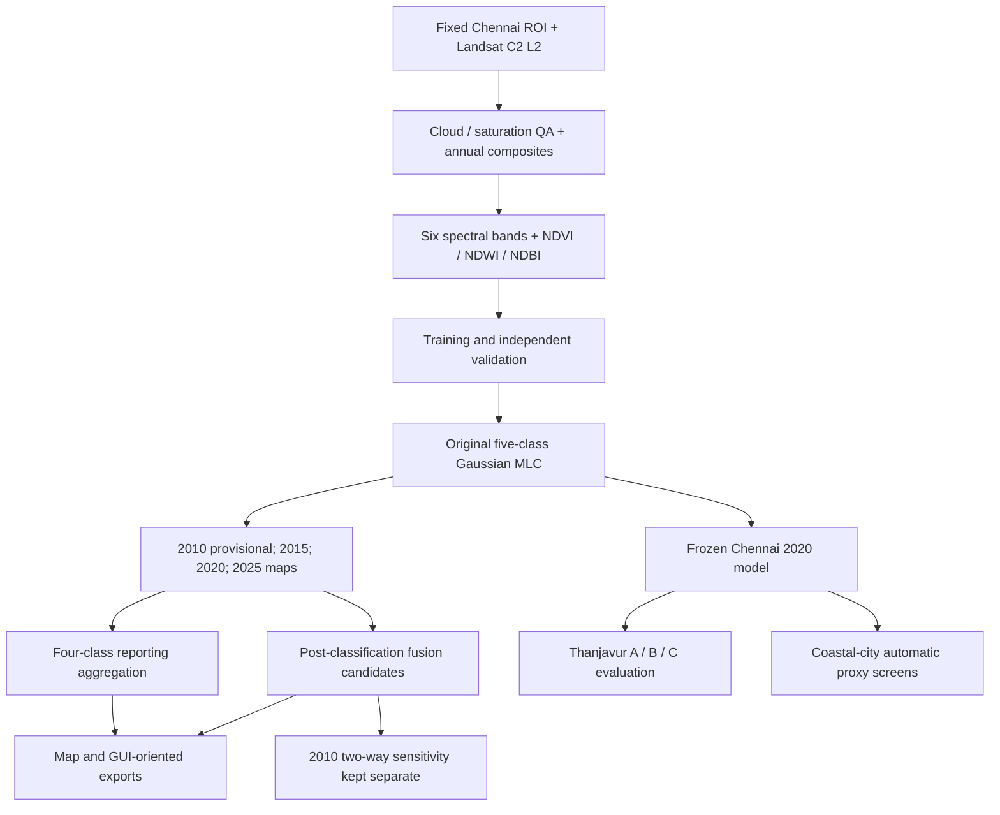

# Chennai Multi-Temporal Land Use / Land Cover (LULC) Research

**Landsat surface reflectance · Gaussian Maximum Likelihood Classification · Historical change analysis · Post-classification fusion · Geographic transferability**

This repository preserves the research code and documented decisions behind a multi-temporal land-use/land-cover (LULC) study of the **Chennai Urban Study Area, Tamil Nadu, India**. It includes the original Google Earth Engine (GEE) code history, a curated selection of research scripts, and documentation of the classification, quality-assurance, fusion, and geographical generalisability experiments.

> **Research evidence snapshot (28–29 October 2026):** The research scope considers **2005, 2010, 2015, 2020 and 2025**, with **no future LULC prediction**. The documented assessed series currently comprises **2010 (provisional), 2015, 2020 and 2025**. A final accepted **2005** classification has **not** been established from the archived evidence. The original 2010 map is *not* replaced by the later two-way fusion sensitivity experiment.

## Start here

| If you want to… | Read this |
|---|---|
| **Download the checked Stage 08 data** | [Dataset v1.0.0](https://github.com/bakayaro05/chennai-lulc-gis/releases/tag/dataset-v1.0.0) · [SHA-256 manifest](https://github.com/bakayaro05/chennai-lulc-gis/releases/download/dataset-v1.0.0/dataset_file_manifest.csv) · [Dataset QA report](https://github.com/bakayaro05/chennai-lulc-gis/releases/download/dataset-v1.0.0/CHENNAI_DATASET_V1_QA_REPORT.md) |
| Read the **final project report** | [Chennai LULC report with fusion maps](report/Chennai_LULC_Report_With_Fusion_Maps.pdf) |
| Understand what **each of the 156 scripts** does | [Complete research code manual](docs/CODE_MANUAL.md) |
| Explore the **62 selected source copies** by stage | [Curated GEE index](scripts/gee/INDEX.md) |
| Understand **research order and execution precautions** | [GEE execution and interpretation guide](scripts/gee/EXECUTION_ORDER.md) |
| Locate the exact **unmodified originals** | [Original GEE archive](archive/gee-original/) |
| Check **curation provenance and integrity** | [Curation audit](docs/CURATED_GEE_AUDIT.md) · [Manifest](docs/CURATED_GEE_MANIFEST.csv) |
| Trace **asset names** across scripts | [Static asset reference index](docs/ASSET_REFERENCE_INDEX.md) |
| See **metadata-verified Earth Engine assets** and export evidence | [Verified asset manifest](docs/ASSET_MANIFEST_VERIFIED.md) |
| Browse **research datasets, export folders and remote GEE assets** | [Data catalogue](data/README.md) · [GEE inventory](data/manifests/gee_asset_inventory_2026-10-28.csv) |
| View **authentic map figures** from the completed report | [Figure gallery](figures/README.md) · [Reported fusion maps](figures/report_exports/reported_series_maps_fig8_9.jpeg) |
| View the **small, traceable results tables** (no GIS rasters) | [Results index](results/README.md) |
| Review **study decisions and source provenance** | [Research lineage](docs/RESEARCH_LINEAGE.md) · [Original source revision](docs/SOURCE_REVISION.md) |

## Repository structure and file guide

This is the **recommended directory map for first-time visitors**. The repository contains two deliberately different forms of Earth Engine code: the **complete, untouched historical archive** and a smaller **curated reading collection**. The numbering is a research-workflow label, not an instruction to run everything in ascending order.

```text
chennai-lulc-gis/
├── README.md                             ← You are here: project overview and directory guide
├── archive/gee-original/                 ← 156 preserved GEE Code Editor source files
│   ├── [67 scripts at this level]         ← Foundations, 2015 work, early 2010 experiments, exports
│   ├── stage7/                           ← 39 scripts: 2010 manual reconstruction, QA, four-class work
│   ├── stage8/                           ← 29 scripts: urban omission audits and fusion experiments
│   └── tnjregion/                        ← 21 scripts: Thanjavur transfer + Tamil Nadu proxy screens
├── scripts/gee/                          ← 62 selected, byte-identical copies, grouped by research role
│   ├── 01_foundation/                    ← 2025/2020 source workflows, historical preparation
│   ├── 02_2015_mlc/                      ← 2015 training, validation and Gaussian classification
│   ├── 03_2010_provisional/              ← Historical manual 2010 lineage and L5/L7 provisional map
│   ├── 04_four_class/                    ← Five-to-four class aggregation, verification and exports
│   ├── 05_fusion/                        ← Post-classification 2015–2025 fusion + 2010 sensitivity
│   ├── 06_generalisability/              ← Frozen-model Thanjavur A/B/C + coastal proxy comparisons
│   ├── 07_map_exports/                   ← ROI, classified maps, Landsat RGB and index exports
│   ├── INDEX.md                          ← Every curated script and its specific research role
│   ├── EXECUTION_ORDER.md                ← Safe interpretation/checkpoint sequence (not a batch runner)
│   └── README.md                         ← Curation conditions and source preservation
├── app/                                  ← Final Stage 08 interactive map application source
│   ├── backend/                          ← FastAPI: metadata, areas, pixel queries and PNG tile routes
│   ├── frontend/                         ← React/TypeScript + Leaflet: maps, timelapse and controls
│   ├── gee/                              ← Stage 08 supporting boundary / historical RGB export code
│   ├── tools/                            ← Local raster and RGB integrity checks
│   ├── docs/                             ← Archived app raster QA record
│   └── README.md                         ← App setup, nine required local data files and limitations
├── docs/                                 ← Detailed scientific and code-provenance documentation
│   ├── CODE_MANUAL.md                    ← Complete 156-file explanations and historical decisions
│   ├── SCRIPT_INDEX.md / .csv            ← Complete filenames, inventory and original SHA-256 values
│   ├── CODE_SCAN_CATALOG.md / .csv       ← Source-derived catalogue of referenced code features
│   ├── CODE_MANUAL_REVIEWED_V1.md        ← Earlier reviewed working document (not the master manual)
│   ├── RESEARCH_LINEAGE.md               ← Accepted baselines versus experiments/sensitivity
│   ├── ASSET_REFERENCE_INDEX.md          ← Static references to remote Earth Engine asset names
│   ├── ASSET_MANIFEST_VERIFIED.md        ← 69-ID metadata audit, export evidence and limitations
│   ├── CURATED_GEE_MANIFEST.csv          ← Mappings/hashes for the 62 curated source copies
│   ├── CURATED_GEE_AUDIT.md              ← Selection integrity, labels and unresolved checks
│   ├── CURATION_REAUDIT.md               ← Why eight additional archived files were curated
│   ├── SOURCE_REVISION.md                ← Exact upstream GEE archive commit and snapshot method
│   ├── BEFORE_GITHUB.md                  ← Historical pre-publication preparation notes
│   ├── PHASE4_SOURCE_AUDIT.md            ← Application-import audit (historical snapshot)
│   └── PHASE5C_SCIENTIFIC_CONSISTENCY_AUDIT.md ← Documentation consistency report
├── data/                                 ← Discoverable datasets and exact remote-export evidence
│   ├── README.md                         ← Which binary datasets exist, access and licensing cautions
│   └── manifests/                        ← 69 GEE assets; 8 Drive folders; 9 app file requirements
├── figures/                              ← Actual map/plot figures extracted unchanged from final report
│   ├── README.md                         ← Figure captions, provenance and scientific interpretation
│   ├── figure_provenance.csv             ← PDF page, figure identity, source SHA-256
│   └── report_exports/                   ← Four authentic original/fusion composition and map panels
├── results/                              ← Source-labelled quantitative summaries, not large TIFFs
│   ├── README.md                         ← Full results catalogue and methodological distinctions
│   ├── chennai_accuracy.csv              ← Original 5-class vs derived 4-class OA
│   ├── chennai_four_class_areas.csv      ← Archived GEE original four-class area series
│   ├── fusion_2010_sensitivity.csv       ← 2010 baseline vs add-only/two-way sensitivity
│   ├── transferability_2020.csv          ← Manual Thanjavur vs automatic proxy results
│   └── reported/                         ← Nine additional report tables: transitions, fusion, external QA
├── tools/                                ← Research utilities including read-only local export inventory
└── .gitignore                            ← Excludes credentials, caches and large GIS binaries
```

**Why two copies of some scripts?** The 156 files under `archive/gee-original/` retain the original upstream filenames, including names without `.js`, alternative branches and unsuccessful experiments. The 62 selected files in `scripts/gee/` are source-preserving copies organized for navigation; **their placement does not mean every experiment was adopted or can run alone**. The other 94 files are still available in the archive. The original upstream revision is recorded in [SOURCE_REVISION.md](docs/SOURCE_REVISION.md).

### What do `stage7`, `stage8` and `tnjregion` mean?

| Original archive location | Meaning in this research | Examples and interpretation |
|---|---|---|
| [`archive/gee-original/`](archive/gee-original/) (67 root-level files) | Earlier/foundation and parallel workflows: 2025 and 2020 source classifiers, 2015 manual training and independent validation, early 2010 transfer attempts, original exports and utilities | `01_stage1_to_stage4_2025_master` is the multi-stage source workflow; `04A`–`04K` cover 2015 manual work; `05*`/`06*` document 2010 preliminary and corrected experiments. **Not all branches are final**. |
| [`stage7/`](archive/gee-original/stage7/) (39 files) | Continued historical **2010 reconstruction and diagnostic work**, culminating in the provisional Landsat 5+7 Gaussian MLC. Also four-class reporting/exports, cross-year plausibility checks and RF comparisons | `07F` prepares reviewed 2010 samples; `07M`/`07N` test L5+L7; `07O` exports the **reported provisional 2010** MLC; `07AC`/`07AC5` handle four-class maps; `07X`/`07Y` are exploratory RF comparisons. |
| [`stage8/`](archive/gee-original/stage8/) (29 files) | Diagnosis of **2015 Built-up omission**, historical pixel/context experiments and post-classification fusion alternatives using independent built-up evidence | `08D`/`08E` test historical site/pixel disagreement; `08F*` tests context/SNIC; `08G9`/`08G10` prepare retained 2015/2020/2025 fusion candidates; `08G15` evaluates a **2010 two-way sensitivity**; `11_...` contains later export instructions. |
| [`tnjregion/`](archive/gee-original/tnjregion/) (21 files) | **TNJ = Thanjavur**: outside-Chennai geographic generalisability benchmark and follow-on Tamil Nadu city screening | `01_TNJ_2020_Frozen_MLC` applies the Chennai model without local retraining; `03*` prepares and interprets reference samples; `04_TNJ_2020_Final_Accuracy_Benchmark` is a **manually referenced accuracy benchmark**; `06B`/`06C` test season matching/quantile harmonisation; `08*`/`10*` cover city screens/map exports. |

**Important:** `Stage 7` and `Stage 8` are the project's historical research stages; they are **not** seven-class/eight-class maps. `TNJ` is a geographic workstream, and the **`04` in `04_TNJ_2020_Final_Accuracy_Benchmark` is a script step**, *not* LULC class 4, the year 2004 or a separate project stage. More detailed script-by-script explanations are in the [complete Code Manual](docs/CODE_MANUAL.md).

### How to read the filenames and annotations

| Pattern in a filename | How to interpret it |
|---|---|
| `01_`, `04A_`, `07O_`, `08G10_` | Number and letter designate a historical script/checkpoint/branch; not a single clean automated execution order. |
| `2010`, `2015`, `2020`, `2025` | The observation/classification year being processed. The number at the **start** of the filename usually refers to a **workflow step**, not an observation year. |
| `MLC`, `RF`, `SNIC` | Gaussian Maximum Likelihood Classification; Random Forest experimental comparison; Simple Non-Iterative Clustering for exploratory spatial context. RF/SNIC branches are not automatically accepted baselines. |
| `training`, `validation`, `manual`, `QA`, `CV` | Training/reference preparation, independently reviewed validation, manual interpretation, quality assurance, and cross-validation; these are not synonymous. |
| `L5L7`, `GAIA`, `GHSL`, `WorldCover`, `DW`, `WSF` | Sensor combination and external spatial data source; the source's year, role and evidential limitations matter. `DW` here denotes Dynamic World. |
| `A`, `B`, `C` in Thanjavur experiments | **A:** direct frozen transfer; **B:** source-month/season matching; **C:** unsupervised spectral quantile harmonisation. The frozen Gaussian model is not retrained. |
| `V2`, `v1`, `exp`, `candidate`, `FINAL`, `FIXED` | Original author's version/experiment labels, **not** repository-wide independent scientific approval. Look up the specific file's status in the [curated index](scripts/gee/INDEX.md) or [Code Manual](docs/CODE_MANUAL.md). |

### Application source and repository-maintenance files

| File or folder | What it contains / why it matters |
|---|---|
| [`app/backend/main.py`](app/backend/main.py) | FastAPI entry point; health/metadata/area/boundary/pixel endpoints and LULC/historical RGB tile routes. |
| [`app/backend/catalog.py`](app/backend/catalog.py) | Supported years, official archived GEE area values, class legends, accuracy figures and paths for external inputs. |
| [`app/backend/raster_service.py`](app/backend/raster_service.py) | Read-only classification raster validation, boundary loading, spatial pixel lookup and categorical PNG tiles. |
| [`app/backend/satellite_service.py`](app/backend/satellite_service.py) | Annual Landsat RGBA raster validation and historical imagery tile generation. |
| [`app/backend/tests/test_api.py`](app/backend/tests/test_api.py) | Real-data integration tests; the final local project passed 3/3 in the October 2026 audit. Tests need the nine external inputs. |
| [`app/backend/requirements.txt`](app/backend/requirements.txt) | Pinned Python backend dependencies; install in a local virtual environment. |
| [`app/frontend/src/App.tsx`](app/frontend/src/App.tsx) | Main React map interface, year selection, timelapse, overlays, class legend and pixel inspection. |
| [`app/frontend/src/api.ts`](app/frontend/src/api.ts) | Typed HTTP requests to the FastAPI backend; defaults to `127.0.0.1:8000`. |
| [`app/frontend/src/main.tsx`](app/frontend/src/main.tsx) | React bootstrap; loads Leaflet and application styles. |
| [`app/frontend/package.json`](app/frontend/package.json) / [`package-lock.json`](app/frontend/package-lock.json) | Frontend scripts, versioned dependencies and npm installation lockfile. |
| [`app/frontend/tsconfig.json`](app/frontend/tsconfig.json) / [`vite.config.ts`](app/frontend/vite.config.ts) | TypeScript checks and Vite local development/build settings. |
| [`app/tools/audit_rasters.py`](app/tools/audit_rasters.py) / [`audit_satellite_rgb.py`](app/tools/audit_satellite_rgb.py) | Local scientific raster QA; do not confuse diagnostic tags with independently verified overview generation methods. |
| [`app/gee/`](app/gee/) | Application-oriented boundary and historical satellite exports, separate from archived GEE research scripts. |
| [`app/docs/milestone0_audit.json`](app/docs/milestone0_audit.json) | Historical local counts, grid QA and transition-matrix diagnostics, not the authoritative GEE pixel-area replacement. |
| [`tools/build_script_catalog.py`](tools/build_script_catalog.py) | Generates source-derived inventory/catalogue from the archived original scripts. |
| [`tools/curate_gee.py`](tools/curate_gee.py) / [`gee_curated_selection.csv`](tools/gee_curated_selection.csv) | Builds/verifies the exact 62-copy curated set against the 156-file archive. |
| [`tools/phase5c_docs_patch.py`](tools/phase5c_docs_patch.py) | Historic one-time narrow Markdown correction helper; **not** a model or raster processing stage. |

### Key files for each task

| Want to do this | Go to |
|---|---|
| Understand the research and accepted versus exploratory claims | [Code Manual](docs/CODE_MANUAL.md) · [Research lineage](docs/RESEARCH_LINEAGE.md) |
| Browse every one of the 156 original scripts | [Complete script index](docs/SCRIPT_INDEX.md) · [Original GEE archive](archive/gee-original/) |
| Find one of the 62 curated script copies and see its exact role | [Curated index](scripts/gee/INDEX.md) · [Execution guide](scripts/gee/EXECUTION_ORDER.md) |
| Understand which remote GEE outputs were observed | [Verified asset manifest](docs/ASSET_MANIFEST_VERIFIED.md) |
| Find readable results without opening scripts | [Results index](results/README.md) · [Chennai accuracies](results/chennai_accuracy.csv) · [Four-class areas](results/chennai_four_class_areas.csv) · [2010 sensitivity](results/fusion_2010_sensitivity.csv) · [Transferability](results/transferability_2020.csv) |
| Find complete reported fusion areas and transition tables | [Detailed report tables](results/README.md#additional-transcribed-tables-from-final-report) · [Five-class fusion areas](results/reported/five_class_fusion_areas_table8_9.csv) · [Five-class gain/loss](results/reported/fusion_fiveclass_gain_loss_table8_11.csv) |
| See exported map figures and external-data requirements | [Authentic figure gallery](figures/README.md) · [Data sources and manifests](data/README.md) |
| Run or review the FastAPI / React map interface | [Application guide](app/README.md) · [`app/backend/main.py`](app/backend/main.py) · [`app/frontend/src/App.tsx`](app/frontend/src/App.tsx) |

## Datasets, authentic maps and extended results

**Published checked dataset:** [Chennai LULC Dataset v1.0.0](https://github.com/bakayaro05/chennai-lulc-gis/releases/tag/dataset-v1.0.0) contains **33 individual attachments**: **26 original research files** (nine Stage 08 application inputs and 17 reference exports) and seven documentation/integrity files. The release includes [SHA-256 checksums](https://github.com/bakayaro05/chennai-lulc-gis/releases/download/dataset-v1.0.0/dataset_file_manifest.csv), [verification instructions](https://github.com/bakayaro05/chennai-lulc-gis/releases/download/dataset-v1.0.0/DATASET_README.md) and [scientific QA caveats](https://github.com/bakayaro05/chennai-lulc-gis/releases/download/dataset-v1.0.0/CHENNAI_DATASET_V1_QA_REPORT.md). The original 2010 map remains **provisional**; the 2010 two-way fusion sensitivity is a separate experiment. The 2025 source-polygon overlaps and approximately 30 m spacing concern for three 2015 validation points remain documented, not silently corrected. No final accepted 2005 map or full historical Earth Engine reproduction is supplied by this release.

**Related research:** [Final report](report/Chennai_LULC_Report_With_Fusion_Maps.pdf) · [Results tables](results/README.md) · [Authentic figures](figures/README.md) · [Source code and provenance](scripts/gee/INDEX.md) · [Interactive app](app/README.md).

- **[Dataset catalogue](data/README.md):** a structured index of **69 Earth Engine asset IDs** (62 metadata-accessible in the dated audit), **eight** screenshot-evidenced Google Drive export folders, and the **nine** exact local inputs the FastAPI viewer requires. The inventory does **not** itself contain remote asset bytes or downloadable public links.
- **[Original report figures](figures/README.md):** the unaltered, report-embedded map panels for 2010 original/2015/2020/2025 retained fusion (Fig. 8.9), the **separate 2010 two-way sensitivity** (Fig. 8.10), and original versus fusion-adjusted class-composition plots (Figs. 6.1 and 8.8). **JPEG figures are not georeferenced rasters.**
- **[Extended reported tables](results/README.md):** recorded classification-area transitions, original/fusion paired validation, five-class post-fusion areas, gains and losses, and external Thanjavur/coastal-city results. Each CSV names its report table and PDF page. These are **transcriptions of approved results**, not new classifications.
- **[Local export inventory tool](tools/inventory_local_exports.py):** scans actual files already on your machine and records relative paths, sizes and SHA-256 hashes without altering the TIFFs. A checksum cannot be claimed until the file has actually been read.

**Data availability:** The checked Stage 08 application inputs and original reference files are available as [versioned release attachments](https://github.com/bakayaro05/chennai-lulc-gis/releases/tag/dataset-v1.0.0), not as binary files in source-code Git history. Other full-size research exports and GEE-hosted assets remain external or permission-dependent; see [data/README.md](data/README.md). The separate 2010 two-way sensitivity must not be presented as the official baseline.

## Research questions and scope

The project investigates how Chennai's built-up land, vegetation, water and open/agricultural land are represented across historical Landsat observations; how classification results respond to limited historical training and imagery; and how well a Chennai-trained classifier transfers to a different urban environment without retraining.

Core workstreams:

1. **Chennai classification:** Landsat preprocessing, nine-band predictors, supervised five-class Gaussian MLC, independent validation and historical classification QA.
2. **Four-class reporting:** A derived schema for comparing and displaying 2010, 2015, 2020 and 2025 maps, merging original classes 4 and 5 into a single reporting class.
3. **Post-classification fusion:** Targeted built-up corrections supported by additional remote-sensing evidence, with original MLC outputs preserved separately.
4. **Generalisability:** Apply a frozen Chennai 2020 five-class model to Thanjavur, then test season matching and unsupervised spectral alignment; screen three coastal cities against *automatic reference-product consensus*.
5. **Visualization:** Export classification and historical true-colour layers intended for a separate FastAPI/React–Leaflet research prototype. **The Stage 08 application source is now available in [app/](app/); its large raster inputs remain external.**

## Study design and data

| Setting | Documented choice |
|---|---|
| Study area | Fixed Chennai Urban Study Area, Earth Engine asset `projects/assignment-482806/assets/chennai_admin_study_area_clean` |
| ROI vector area | Approximately **529.4508 km²**; pixel-grid area and geodesic vector area are not interchangeable |
| Analysis grid | **EPSG:32644**, **30 m**; preserve the archived grid transform and class masks in exported rasters |
| Satellite input | Landsat Collection 2, Tier 1, Level 2 surface reflectance |
| Sensors | Landsat 5 TM for early historical work; Landsat 8 OLI for 2015/2020; Landsat 8 + 9 for 2025; a separate **Landsat 5 + 7** reconstruction was used for the reported provisional 2010 baseline |
| Predictors | Blue, green, red, NIR, SWIR1, SWIR2, **NDVI, NDWI, NDBI** |
| Primary classifier | Five-class, multivariate **Gaussian MLC** with class means/covariances and regularisation; refer to individual scripts for exact variants |
| Reference products in selected experiments | GAIA, GHSL, ESA WorldCover, Dynamic World and WSF, with **year/scale-dependent roles** rather than universal ground truth |

### LULC class interpretation

The *underlying* Gaussian MLC uses five codes: **1 Built-up; 2 Vegetation; 3 Water; 4 Agricultural/Open; 5 Barren/Fallow** (terminology varies in some older Stage 7 comments). The *derived reporting layer* merges codes **4 + 5** as **Agricultural & Vacant/Unused Open Land**. This is a label aggregation, **not classifier retraining**. Always check the legend in the exact script or exported raster before comparisons.

## Principal research workflow



The diagram describes **methodological relationships**, not an automatically runnable dependency graph. Some scripts require previously exported Earth Engine assets, manually imported geometries or completed human reference reviews.

## Reported classification results

**These are recorded project validation outcomes, not metrics recomputed by this repository.** The five-class and four-class results describe different classification label schemas; fusion sensitivity metrics should not be substituted for the original MLC metrics.

| Year | Original five-class MLC overall accuracy | Derived four-class reporting overall accuracy | Interpretation |
|---|---:|---:|---|
| 2010 | **69.33%** (208/300) | **81.00%** | **Provisional** Landsat 5+7 manual MLC baseline |
| 2015 | **85.67%** (257/300) | **88.67%** | Historical five-class MLC, subsequently evaluated for fusion |
| 2020 | **86.33%** (259/300) | **95.67%** | Also serves as the frozen source model for geographical transfer |
| 2025 | **83.67%** (251/300) | **96.67%** | Original classification; recovered TIFF and reporting export were separately audited |

A compact machine-readable version is provided in [results/chennai_accuracy.csv](results/chennai_accuracy.csv).

The four-class accuracies are derived assessments on merged labels. Consult [CODE_MANUAL.md](docs/CODE_MANUAL.md) and [the curated execution guide](scripts/gee/EXECUTION_ORDER.md) before interpreting per-class results or comparing different denominators.

### Post-classification fusion is not a new Gaussian model

The retained fusion-map series distinguishes **2015 temporal-consistency**, **2020 GAIA + ESA WorldCover**, and **2025 GAIA + Dynamic World** candidate outputs from their underlying original MLC rasters. The **reported 2010 map remains the original provisional L5+L7 classification**.

For the *separate* 2010 GAIA/GHSL/2015 temporal-fusion sensitivity assessment, the recorded 300-point accuracy was **69.33% original**, **69.67% add-only**, and **71.33% two-way**. Recorded built-up area changed from approximately **279.82 km²** (original) to **304.72 km²** (two-way). These are **exploratory comparisons**, not a replacement of the official 2010 baseline. See [Stage 08G15 documentation](docs/CODE_MANUAL.md) and the original [comparison source](archive/gee-original/stage8/08G15_2010_GAIA_GHSL_Temporal_Fusion_Comparison).

## Out-of-region generalisability (2020)

The five-class **Chennai 2020 Gaussian MLC was held frozen**. Thanjavur was evaluated with an independently manually interpreted **112-point**, mapped-class-stratified target reference sample. No Thanjavur class labels were used to refit the Gaussian classifier.

| Thanjavur variant | Area-adjusted overall accuracy |
|---|---:|
| **A — direct frozen transfer** | **23.1854%** |
| **B — source-month/season matching** | **20.6625%** |
| **C — unsupervised quantile spectral harmonisation** | **35.9444%** |

The documented transfer/proxy metrics are also indexed in [results/transferability_2020.csv](results/transferability_2020.csv).

Experiment C's estimated improvement over A is **+12.759 percentage points**, with an *approximate* reported 95% interval of **+3.9345 to +21.5835 points**. The interval does **not** fully account for spatial dependence or reference-label uncertainty. These are exploratory transferability findings, not claims of robust model generalisation.

Cuddalore (**57.9251%**), Nagapattinam (**82.9085%**) and Thoothukudi (**46.0861%**) were evaluated by **automatic agreement with ESA WorldCover + Dynamic World consensus on eligible areas**, *not* independently interpreted ground-truth accuracy. The proxy covered only subsets of each city's map, so these numbers must not be directly compared with the Thanjavur manually referenced accuracies.

## How to explore and reproduce safely

1. Clone this repository, then start with the [complete code manual](docs/CODE_MANUAL.md), [curated index](scripts/gee/INDEX.md), and [execution guide](scripts/gee/EXECUTION_ORDER.md):

   ```bash
   git clone https://github.com/bakayaro05/chennai-lulc-gis.git
   cd chennai-lulc-gis
   ```

2. **Verify the local archive and curated source copies** (Python 3, standard library only; no GEE login required):

   ```bash
   python tools/curate_gee.py --verify
   ```

   This verifies local provenance/hashes; **it does not execute or validate the Earth Engine computations**.

3. For a research script you want to inspect or reproduce, open its **complete source** in the GEE Code Editor with access to the original remote assets. Check manual geometry imports, year-specific reference datasets, band schema, CRS, grid transform, class mapping and source-experiment role.

4. **Do not run every script in order or blindly start exports.** Some archived scripts are read-only; others define export tasks with asset paths that may already exist. Review and protect the original saved products. A declared `Export.*` task is not evidence that a task succeeded.

5. Validate any newly created raster or table against completed GEE task logs, remote asset metadata, masks, class distributions, relevant independent validation data, and the accompanying manifest. Document every new run/version separately.

### Availability limits

- The **Git source tree** does not embed the large raster inputs or Earth Engine-hosted assets. The nine Stage 08 runtime inputs and 17 original reference files are downloadable from the [dataset-v1.0.0 release](https://github.com/bakayaro05/chennai-lulc-gis/releases/tag/dataset-v1.0.0); other GEE assets may still require access permissions.
- Some historical GEE scripts rely on manually drawn geometries and Code Editor imports that are **not embedded** in the source code.
- The **FastAPI + React/Leaflet prototype** was developed separately. `app/` contains the application source. Running it requires the local raster inputs and setup documented in [app/README.md](app/README.md).
- An accepted **2005 final LULC** product and automated end-to-end reruns are **not claimed**. The [asset manifest](docs/ASSET_MANIFEST_VERIFIED.md) records 62/69 accessible static Earth Engine IDs and 107 `SUCCEEDED` operations from the October 2026 snapshot; these do not establish full task-to-file provenance.

## Documentation, provenance and maintenance

- **Full 156-file source reference:** [docs/CODE_MANUAL.md](docs/CODE_MANUAL.md).
- **Curated source provenance:** [scripts/gee/INDEX.md](scripts/gee/INDEX.md), [docs/CURATED_GEE_MANIFEST.csv](docs/CURATED_GEE_MANIFEST.csv), [docs/CURATED_GEE_AUDIT.md](docs/CURATED_GEE_AUDIT.md).
- **All-file inventories:** [docs/SCRIPT_INDEX.md](docs/SCRIPT_INDEX.md), [docs/CODE_SCAN_CATALOG.md](docs/CODE_SCAN_CATALOG.md).
- **Study decisions:** [docs/RESEARCH_LINEAGE.md](docs/RESEARCH_LINEAGE.md).
- **Source snapshot:** [docs/SOURCE_REVISION.md](docs/SOURCE_REVISION.md), preserving upstream Earth Engine commit `1c1335e76291d7014336912f2292ba56049bf345`.

The original 156-file archive is a **historical, read-only record**. Do not rewrite or reformat it in place. New experiments and corrected executable scripts should be introduced in separate versioned paths with explicit inputs, reproducibility checks and task/asset identifiers. Review [the curation re-audit](docs/CURATION_REAUDIT.md) before changing the curated set.

## Current limitations and next repository milestones

- Maintain and periodically recheck the [verified asset manifest](docs/ASSET_MANIFEST_VERIFIED.md): 62/69 code-derived IDs returned metadata and 7 remained unresolved in the recorded snapshot. Asset existence and `SUCCEEDED` operations are not complete output-file or scientific validation.
- Preserve the imported [Stage 08 FastAPI/React application](app/README.md); its four classification rasters, four historical RGB rasters and true boundary GeoJSON remain external runtime inputs rather than tracked GitHub files.
- Maintain the public-repository security and attribution review (tokens, data permissions, third-party licenses). The October 2026 local pattern scan reported no matches but does not guarantee absolute absence of secrets; see [Phase 5C audit](docs/PHASE5C_SCIENTIFIC_CONSISTENCY_AUDIT.md).
- Establish a suitable **citation, contribution, licensing and versioned-release policy** after those checks; no open-source reuse license is declared by the repository at present.

---

**Interpretation note:** This is an archived *research workflow*, not a published plug-and-play classifier. Reported numbers are tied to specific products, validation designs and historical tasks. Always distinguish **original vs. fusion**, **five-class vs. four-class**, and **manual-reference accuracy vs. automatic proxy agreement**.
