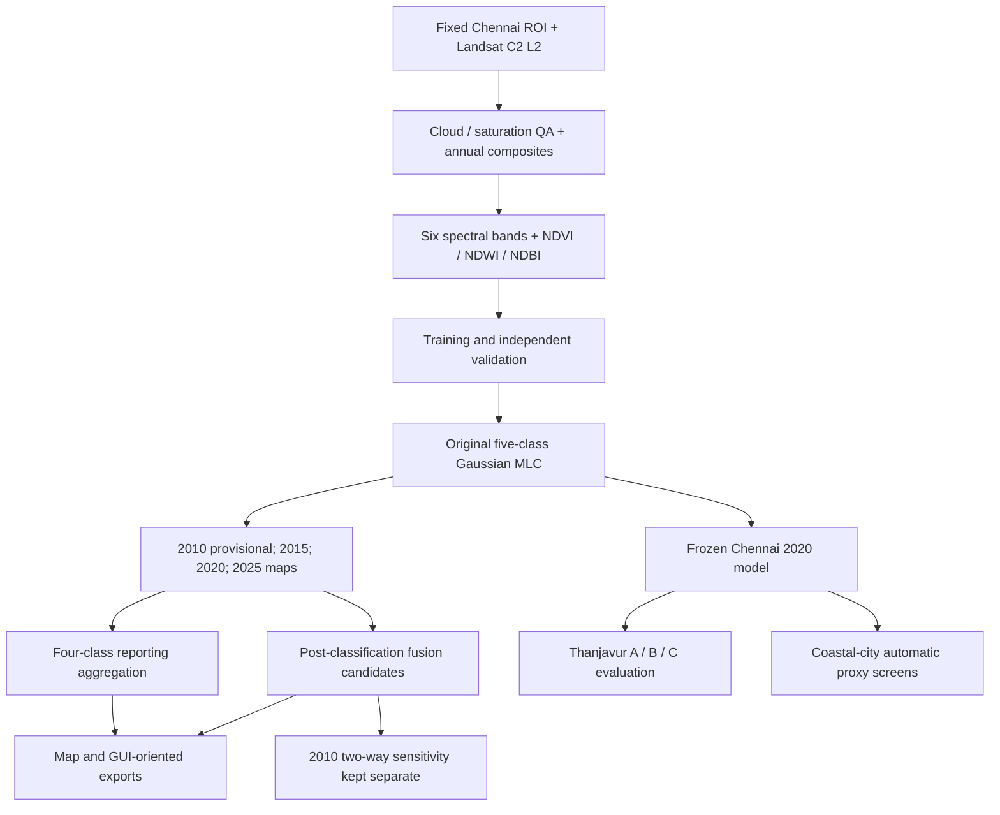

# Chennai Multi-Temporal Land Use / Land Cover (LULC) Research

**Landsat surface reflectance · Gaussian Maximum Likelihood Classification · Historical change analysis · Post-classification fusion · Geographic transferability**

This repository preserves the research code and documented decisions behind a multi-temporal land-use/land-cover (LULC) study of the **Chennai Urban Study Area, Tamil Nadu, India**. It includes the original Google Earth Engine (GEE) code history, a curated selection of research scripts, and documentation of the classification, quality-assurance, fusion, and geographical generalisability experiments.

> **Research status (28 October 2026):** The research scope considers **2005, 2010, 2015, 2020 and 2025**, with **no future LULC prediction**. The documented assessed series currently comprises **2010 (provisional), 2015, 2020 and 2025**. A final accepted **2005** classification has **not** been established from the archived evidence. The original 2010 map is *not* replaced by the later two-way fusion sensitivity experiment.

## Start here

| If you want to… | Read this |
|---|---|
| Understand what **each of the 156 scripts** does | [Complete research code manual](docs/CODE_MANUAL.md) |
| Explore the **62 selected source copies** by stage | [Curated GEE index](scripts/gee/INDEX.md) |
| Understand **research order and execution precautions** | [GEE execution and interpretation guide](scripts/gee/EXECUTION_ORDER.md) |
| Locate the exact **unmodified originals** | [Original GEE archive](archive/gee-original/) |
| Check **curation provenance and integrity** | [Curation audit](docs/CURATED_GEE_AUDIT.md) · [Manifest](docs/CURATED_GEE_MANIFEST.csv) |
| Trace **asset names** across scripts | [Static asset reference index](docs/ASSET_REFERENCE_INDEX.md) |
| Review **study decisions and source provenance** | [Research lineage](docs/RESEARCH_LINEAGE.md) · [Original source revision](docs/SOURCE_REVISION.md) |

## Research questions and scope

The project investigates how Chennai's built-up land, vegetation, water and open/agricultural land are represented across historical Landsat observations; how classification results respond to limited historical training and imagery; and how well a Chennai-trained classifier transfers to a different urban environment without retraining.

Core workstreams:

1. **Chennai classification:** Landsat preprocessing, nine-band predictors, supervised five-class Gaussian MLC, independent validation and historical classification QA.
2. **Four-class reporting:** A derived schema for comparing and displaying 2010, 2015, 2020 and 2025 maps, merging original classes 4 and 5 into a single reporting class.
3. **Post-classification fusion:** Targeted built-up corrections supported by additional remote-sensing evidence, with original MLC outputs preserved separately.
4. **Generalisability:** Apply a frozen Chennai 2020 five-class model to Thanjavur, then test season matching and unsupervised spectral alignment; screen three coastal cities against *automatic reference-product consensus*.
5. **Visualization:** Export classification and historical true-colour layers intended for a separate FastAPI/React–Leaflet research prototype. **The application source has not yet been imported into this GitHub repository.**

## Study design and data

| Setting | Documented choice |
|---|---|
| Study area | Fixed Chennai Urban Study Area, Earth Engine asset `projects/assignment-482806/assets/chennai_admin_study_area_clean` |
| ROI vector area | Approximately **529.4508 km²**; pixel-grid area and geodesic vector area are not interchangeable |
| Analysis grid | **EPSG:32644**, **30 m**; preserve the archived grid transform and class masks in exported rasters |
| Satellite input | Landsat Collection 2, Tier 1, Level 2 surface reflectance |
| Sensors | Landsat 5 TM for early historical work; Landsat 8 OLI for 2015/2020; Landsat 8 + 9 for 2025; a separate **Landsat 5 + 7** reconstruction was used for the reported provisional 2010 baseline |
| Predictors | Blue, green, red, NIR, SWIR1, SWIR2, **NDVI, NDWI, NDBI** |
| Primary classifier | Five-class, multivariate **Gaussian MLC** with class means/covariances and regularisation; refer to individual scripts for exact variants |
| Reference products in selected experiments | GAIA, GHSL, ESA WorldCover, Dynamic World and WSF, with **year/scale-dependent roles** rather than universal ground truth |

### LULC class interpretation

The *underlying* Gaussian MLC uses five codes: **1 Built-up; 2 Vegetation; 3 Water; 4 Agricultural/Open; 5 Barren/Fallow** (terminology varies in some older Stage 7 comments). The *derived reporting layer* merges codes **4 + 5** as **Agricultural & Vacant/Unused Open Land**. This is a label aggregation, **not classifier retraining**. Always check the legend in the exact script or exported raster before comparisons.

## Principal research workflow



The diagram describes **methodological relationships**, not an automatically runnable dependency graph. Some scripts require previously exported Earth Engine assets, manually imported geometries or completed human reference reviews.

## Reported classification results

**These are recorded project validation outcomes, not metrics recomputed by this repository.** The five-class and four-class results describe different classification label schemas; fusion sensitivity metrics should not be substituted for the original MLC metrics.

| Year | Original five-class MLC overall accuracy | Derived four-class reporting overall accuracy | Interpretation |
|---|---:|---:|---|
| 2010 | **69.33%** (208/300) | **81.00%** | **Provisional** Landsat 5+7 manual MLC baseline |
| 2015 | **85.67%** (257/300) | **88.67%** | Historical five-class MLC, subsequently evaluated for fusion |
| 2020 | **86.33%** (259/300) | **95.67%** | Also serves as the frozen source model for geographical transfer |
| 2025 | **83.67%** (251/300) | **96.67%** | Original classification; recovered TIFF and reporting export were separately audited |

The four-class accuracies are derived assessments on merged labels. Consult [CODE_MANUAL.md](docs/CODE_MANUAL.md) and [the curated execution guide](scripts/gee/EXECUTION_ORDER.md) before interpreting per-class results or comparing different denominators.

### Post-classification fusion is not a new Gaussian model

The retained fusion-map series distinguishes **2015 temporal-consistency**, **2020 GAIA + ESA WorldCover**, and **2025 GAIA + Dynamic World** candidate outputs from their underlying original MLC rasters. The **reported 2010 map remains the original provisional L5+L7 classification**.

For the *separate* 2010 GAIA/GHSL/2015 temporal-fusion sensitivity assessment, the recorded 300-point accuracy was **69.33% original**, **69.67% add-only**, and **71.33% two-way**. Recorded built-up area changed from approximately **279.82 km²** (original) to **304.72 km²** (two-way). These are **exploratory comparisons**, not a replacement of the official 2010 baseline. See [Stage 08G15 documentation](docs/CODE_MANUAL.md) and the original [comparison source](archive/gee-original/stage8/08G15_2010_GAIA_GHSL_Temporal_Fusion_Comparison).

## Out-of-region generalisability (2020)

The five-class **Chennai 2020 Gaussian MLC was held frozen**. Thanjavur was evaluated with an independently manually interpreted **112-point**, mapped-class-stratified target reference sample. No Thanjavur class labels were used to refit the Gaussian classifier.

| Thanjavur variant | Area-adjusted overall accuracy |
|---|---:|
| **A — direct frozen transfer** | **23.1854%** |
| **B — source-month/season matching** | **20.6625%** |
| **C — unsupervised quantile spectral harmonisation** | **35.9444%** |

Experiment C's estimated improvement over A is **+12.759 percentage points**, with an *approximate* reported 95% interval of **+3.9345 to +21.5835 points**. The interval does **not** fully account for spatial dependence or reference-label uncertainty. These are exploratory transferability findings, not claims of robust model generalisation.

Cuddalore (**57.9251%**), Nagapattinam (**82.9085%**) and Thoothukudi (**46.0861%**) were evaluated by **automatic agreement with ESA WorldCover + Dynamic World consensus on eligible areas**, *not* independently interpreted ground-truth accuracy. The proxy covered only subsets of each city's map, so these numbers must not be directly compared with the Thanjavur manually referenced accuracies.

## Repository layout

```text
.
├── archive/
│   └── gee-original/          # All 156 original GEE source files, unchanged
│       ├── stage7/
│       ├── stage8/
│       └── tnjregion/
├── scripts/
│   └── gee/                   # 62 byte-identical curated source copies
│       ├── 01_foundation/
│       ├── 02_2015_mlc/
│       ├── 03_2010_provisional/
│       ├── 04_four_class/
│       ├── 05_fusion/
│       ├── 06_generalisability/
│       ├── 07_map_exports/
│       ├── INDEX.md
│       └── EXECUTION_ORDER.md
├── docs/                       # Full code manual, inventories, manifests, decisions
├── tools/                      # Reproducible archive scanner and curation verifier
├── app/                        # Placeholder: FastAPI/React–Leaflet source not yet added
├── results/                    # Placeholder for small verified results / manifests
└── README.md
```

The 62 selected files are **copies of the originals**, with `.js` suffixes added where needed. They are not necessarily independently executable or scientifically accepted outputs. The other 94 historical files remain in `archive/gee-original/`; the archive includes superseded trials, alternatives, diagnostics and script variants. The selection criteria and decision labels are in [the curation manifest](docs/CURATED_GEE_MANIFEST.csv).

## How to explore and reproduce safely

1. Clone this repository, then start with the [complete code manual](docs/CODE_MANUAL.md), [curated index](scripts/gee/INDEX.md), and [execution guide](scripts/gee/EXECUTION_ORDER.md):

   ```bash
   git clone https://github.com/bakayaro05/chennai-lulc-gis.git
   cd chennai-lulc-gis
   ```

2. **Verify the local archive and curated source copies** (Python 3, standard library only; no GEE login required):

   ```bash
   python tools/curate_gee.py --verify
   ```

   This verifies local provenance/hashes; **it does not execute or validate the Earth Engine computations**.

3. For a research script you want to inspect or reproduce, open its **complete source** in the GEE Code Editor with access to the original remote assets. Check manual geometry imports, year-specific reference datasets, band schema, CRS, grid transform, class mapping and source-experiment role.

4. **Do not run every script in order or blindly start exports.** Some archived scripts are read-only; others define export tasks with asset paths that may already exist. Review and protect the original saved products. A declared `Export.*` task is not evidence that a task succeeded.

5. Validate any newly created raster or table against completed GEE task logs, remote asset metadata, masks, class distributions, relevant independent validation data, and the accompanying manifest. Document every new run/version separately.

### Availability limits

- This repository **does not contain** the Earth Engine-hosted training/reference assets or large source/output GeoTIFFs. Some required resources may need access permissions.
- Some historical GEE scripts rely on manually drawn geometries and Code Editor imports that are **not embedded** in the source code.
- The **FastAPI + React/Leaflet prototype** was developed separately. `app/` is presently only a placeholder, not a runnable application.
- **2005 final LULC**, automated end-to-end reruns, and live task-completion verification are **not claimed** here.

## Documentation, provenance and maintenance

- **Full 156-file source reference:** [docs/CODE_MANUAL.md](docs/CODE_MANUAL.md).
- **Curated source provenance:** [scripts/gee/INDEX.md](scripts/gee/INDEX.md), [docs/CURATED_GEE_MANIFEST.csv](docs/CURATED_GEE_MANIFEST.csv), [docs/CURATED_GEE_AUDIT.md](docs/CURATED_GEE_AUDIT.md).
- **All-file inventories:** [docs/SCRIPT_INDEX.md](docs/SCRIPT_INDEX.md), [docs/CODE_SCAN_CATALOG.md](docs/CODE_SCAN_CATALOG.md).
- **Study decisions:** [docs/RESEARCH_LINEAGE.md](docs/RESEARCH_LINEAGE.md).
- **Source snapshot:** [docs/SOURCE_REVISION.md](docs/SOURCE_REVISION.md), preserving upstream Earth Engine commit `1c1335e76291d7014336912f2292ba56049bf345`.

The original 156-file archive is a **historical, read-only record**. Do not rewrite or reformat it in place. New experiments and corrected executable scripts should be introduced in separate versioned paths with explicit inputs, reproducibility checks and task/asset identifiers. Review [the curation re-audit](docs/CURATION_REAUDIT.md) before changing the curated set.

## Current limitations and next repository milestones

- Complete an **asset existence / task-completion manifest** rather than inferring success from source `Export.*` statements.
- Add the actual **FastAPI backend and React/Leaflet frontend** from the separate application project, with environment files and large outputs appropriately excluded.
- Perform a **public-repository security and attribution audit** (tokens, data permissions, third-party licenses). The repository is currently public.
- Establish a suitable **citation, contribution, licensing and versioned-release policy** after those checks; no open-source reuse license is declared by the repository at present.

---

**Interpretation note:** This is an archived *research workflow*, not a published plug-and-play classifier. Reported numbers are tied to specific products, validation designs and historical tasks. Always distinguish **original vs. fusion**, **five-class vs. four-class**, and **manual-reference accuracy vs. automatic proxy agreement**.
