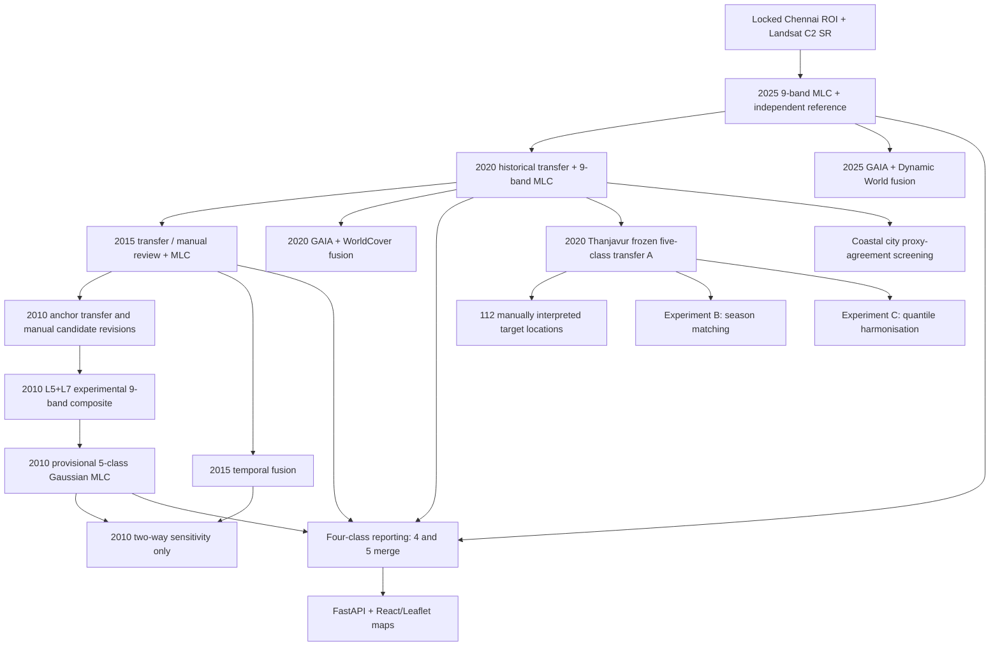

# CODE_MANUAL.md — Chennai Multi-Temporal LULC Research Code

**Edition:** 1.0 consolidated research-code manual · 28 October 2026
**Repository:** https://github.com/bakayaro05/chennai-lulc-gis
**Upstream Earth Engine source:** `users/harishravichandran0302/chennai_area_boundary` · archived upstream commit `1c1335e76291d7014336912f2292ba56049bf345`
**Scope:** 156 archived source files (67 root, 39 Stage 7, 29 Stage 8, 21 Thanjavur/coastal). Original archived files are not modified by this manual.
**Evidence date:** project conversations and archived GEE console outputs through 28 October 2026; saved local scientific summaries and GitHub source-code reviews.

> **Reading rule:** A filename, code comment, asset identifier or `Export.*` call proves what a script *contains*, not that it ran, finished an Earth Engine task or was adopted. “Verified result” below refers to recorded console outputs/CSV audits. For full scientific reproduction, check the live Earth Engine assets and task history. This manual does not claim to have executed any Earth Engine job.

## Contents

1. [Scope, evidence and scientific distinctions](#1-scope-evidence-and-scientific-distinctions)
2. [Project design and original Gaussian MLC](#2-project-design-and-original-gaussian-mlc)
3. [Chronology, decisions and verified outcomes](#3-chronology-decisions-and-verified-outcomes)
4. [Graph of principal workflows and assets](#4-graph-of-principal-workflows-and-assets)
5. [Canonical entry points and asset registry](#5-canonical-entry-points-and-asset-registry)
6. [Generalisability benchmark: 2020 Chennai to new regions](#6-generalisability-benchmark-2020-chennai-to-new-regions)
7. [Report, web application and export boundaries](#7-report-web-application-and-export-boundaries)
8. [Complete 156-file code reference](#8-complete-156-file-code-reference)
9. [How to reproduce safely](#9-how-to-reproduce-safely)
10. [Outstanding checks, limitations and repository policy](#10-outstanding-checks-limitations-and-repository-policy)
11. [Provenance and source-reading notes](#11-provenance-and-source-reading-notes)

---

## 1. Scope, evidence and scientific distinctions

### 1.1 Research objective

Historical Chennai land-use/land-cover classification for **2005, 2010, 2015, 2020 and 2025** with maps, quality assurance, change assessment, and an interactive application. **No future land-use prediction** is within the approved scope. The mature archival pipeline documents reproducible five-class results for 2025, 2020, 2015 and a **provisional 2010** map; a **final accepted 2005 classification is not verified** in the recovered source/evidence.

### 1.2 Evidence classes used in this manual

| Evidence grade | Meaning | Allowed claim |
|---|---|---|
| **R — code-reviewed** | Actual GitHub source read for principal scripts and all Stage 8/Thanjavur files; remaining scripts indexed from source-derived scan of all files | Code intent, declared dataset references and outputs |
| **C — console/CSV-confirmed** | Reproduced user Earth Engine console numerics or original supplied CSV outputs | Observed experimental results and computed summaries, with sampling caveats |
| **P — project chronology** | Prior GIS Project conversations, checkpoints and handoff documents | Motivation, decisions, and why branches were retained/rejected |
| **U — unverified execution** | Script defines an export or names an asset but no completed-task proof was read | Only state “export defined/prepared” |

The complete index is **not** an assertion that 156 different models or official products were adopted. Many source files represent one experimental lineage, revisions, point-review interfaces, QA scripts or diagnostic-only branches.

### 1.3 Five-class model versus four-class reporting

| Gaussian class ID | Five-class MLC label | Four-class reporting label |
|---:|---|---|
| 1 | Built-up | Built-up (1) |
| 2 | Vegetation | Vegetation (2) |
| 3 | Water | Water (3) |
| 4 | Agricultural/Open | Agricultural & Vacant/Unused Open Land (4) |
| 5 | Barren/Fallow | **Merged into reporting class 4** |

The **underlying MLC and fusion experiments use five classes**. Stage 07AC aggregates classes 4 and 5 into four-class reporting/GUI rasters. Never compare a four-class confusion-matrix OA with a five-class OA without naming the class schema. In particular, four-class aggregation improves arithmetic accuracy merely because confusion between classes 4/5 ceases to count as an error; it is not retraining or new independent validation.

### 1.4 Other non-equivalent experiments

- **Post-classification fusion** uses historical external built-area evidence to change selected labels of an existing Gaussian MLC map; the Gaussian means, covariance matrices and class priors remain frozen.
- **Thanjavur A/B/C** all apply the **five-class frozen 2020 Chennai Gaussian MLC**; B alters the target seasonal composite and C alters unlabeled target reflectance before applying the same Gaussian parameters. These are preprocessing adaptations, not untouched direct transfer.
- **Cuddalore/Nagapattinam/Thoothukudi screens** measure agreement with automatic reference products on selected pixels, *not* independently verified overall accuracy. Their pilot ROIs are exploratory geometries, not official city boundaries.

---

## 2. Project design and original Gaussian MLC

### 2.1 Geography, grid and preprocessing

- **Locked ROI:** `projects/assignment-482806/assets/chennai_admin_study_area_clean` (Chennai Urban Study Area). Exact vector area **529.450838 km²**, not the earlier GCC-only ~426/432 km² study area.
- **Reference grid:** EPSG:32644, 30 m; archived transform `[30, 0, 399060, 0, -30, 1463250]` in the exported 2010 MLC. Fixed-grid mapped pixel area can be about **529.771104 km²** while vector geodesic area is 529.450838 km²; these are different quantities.
- **Landsat:** Collection 2 Tier 1 Level 2 surface reflectance; 2005/2010 Landsat 5 TM in original standard pipeline; 2015/2020 Landsat 8 OLI; 2025 Landsat 8+9. The later 2010 provisional comparison explicitly uses an experimental **Landsat 5+7** stack.
- **Mask:** invalid fill/cloud/dilated cloud/shadow/snow/cirrus as applicable by `QA_PIXEL`, plus `QA_RADSAT == 0`; Landsat 7 SLC-off invalidity handled through native validity.
- **Scaling:** optical SR = `DN × 0.0000275 − 0.2`; annual Jan–Dec, per-pixel **median reflectance**; earlier Jan–Apr/May common-season tests were rejected for 2010 cloud/scene scarcity.
- **Nine predictor bands:** `blue, green, red, nir, swir1, swir2, NDVI, NDWI, NDBI`. Indices are calculated from the annual median reflectances, not from monthly mean NDVI values.

| Year | Original sensor(s) | Intersecting annual scenes | Median valid observations/pixel (approx.) |
|---|---|---:|---:|
| 2005 | L5 | 19 | 7 |
| 2010 | L5 | 7 | 2 |
| 2015 | L8 | 19 | 7 |
| 2020 | L8 | 21 | 8–9 |
| 2025 | L8 + L9 | 40 (20+20) | 20 |

The 2020 **Thanjavur** ROI had **64** Landsat 8 scenes; this does **not** replace the 21-scene count for Chennai in the same year.

### 2.2 Gaussian MLC mathematics

For class `k`, fit the nine-dimensional source mean `μₖ` and sample covariance `Σₖ` from **120 training pixels/class** (600/year). Apply the archived small diagonal regulariser `Σₖ + 10⁻⁶I`. With equal prior probabilities, classify each pixel by the highest multivariate Gaussian log likelihood:

```text
score_k(x) = -1/2 * log(det(Sigma_k + 1e-6*I))
             -1/2 * (x - mu_k)^T * inverse(Sigma_k + 1e-6*I) * (x - mu_k)
predicted_class(x) = argmax_k score_k(x)
```

The common `-d/2 log(2π)` and equal-prior terms can be omitted because they do not change class ranking. **Nearest-centroid, unregularised Mahalanobis-only distance, or RF are not substitutes** for this project’s MLC. Validation uses **300 distinct pixels, 60/class** for the completed Chennai source years. Check original training-buffer exclusions and pixel-ID uniqueness before rerunning.

### 2.3 Original versus mapped grid area

A 30 m nominal pixel has 900 m², but exact reported geodesic pixel areas may differ slightly due to projection and masking. Stage 07AE found the prior **528.785508 km²** reduction to be a **mask-as-value underestimate**; the correct fixed-grid total was about **529.771104 km²**. The vector footprint remains **529.450838 km²**. The two figures must be labelled and not forced to agree.

---

## 3. Chronology, decisions and verified outcomes

### 3.1 From the 2025 source to historical years

1. A compact GCC-only extent was replaced with the **fixed expanded Chennai Urban Study Area** including adjacent settlements; one ROI applies to all historical years.
2. Stage 01/02 built the 2025 reference polygon samples and full-year nine-band predictor. A source 2025 five-class Gaussian MLC was independently evaluated and archived.
3. `02_stage5_temporal_transfer` supported **2025→2020** review; `04*` scripts supported **2020→2015** review, manual additions, independent validation and Gaussian MLC.
4. Initial **2015→2010 automated anchor transfer** (`05A–05G`) identified class scarcity and source-polygon diversity limitations. `06*` corrected/reused manually reviewed evidence. This is the chronology, not one continuously valid “final” script.
5. **Stage 07** tested manually assembled 2010 MLC (initial 59.33% independent OA), then tested whether scarce 2010 Landsat 5 observations justified a **Landsat 5+7** experimental composite; the archived **2010 provisional L5+L7 MLC is 69.33%** independent five-class OA.
6. Stage 07 also studied site-held-out CV, cross-year 2010–2015 urban plausibility, five→four class reporting, and RF alternatives. **87.67% site-held-out CV** reported for a 2010 experiment is not the same as independent 2010 OA.
7. Stage 08 investigated systematic 2015 Built-up omissions, considered spatial context and RF, then retained three post-classification fusion candidates. The original maps remain separately preserved.

### 3.2 Validated five-class Chennai results

| Year | Source classification version | Independent OA | Number correct | Notes |
|---|---|---:|---:|---|
| 2025 | Original 2025 Gaussian MLC | **83.67%** | 251/300 | 2025 Landsat 8+9, original source sampling |
| 2020 | Original 2020 Gaussian MLC | **86.33%** | 259/300 | Frozen source model for transfer benchmark |
| 2015 | Original 2015 Gaussian MLC | **85.67%** | 257/300 | Built-up producer accuracy 81.67% |
| 2010 | **Provisional** L5+L7 manual MLC | **69.33%** | 208/300 | Not interchangeable with earlier L5-only/V2C branches |
| 2005 | Not established as an accepted completed output | **Not verified** | — | Do not invent accuracy or map |

For completed original 2020 MLC, the archive records a five-class confusion matrix (actual rows): `[[52,0,0,5,3], [0,59,0,1,0], [0,0,60,0,0], [0,0,0,59,1], [4,0,0,27,29]]`. Its main confusion was actual Barren/Fallow predicted Agricultural/Open.

### 3.3 Derived four-class reporting, not new MLC training

The Stage 07AC reporting QA combines classes 4+5. Derived four-class validation OAs reported in the project workflow are **2010 81.00% (provisional), 2015 88.67%, 2020 95.67%, 2025 96.67%**. These values are **not the five-class** MLC values in §3.2. In later local application exports, four aligned categorical rasters and historical true-colour imagery support the web UI.

### 3.4 Why 2010 is provisional

The 2010 source had particularly few annual clear observations (median ~2). The early transfer route had class shortages (05B: 527/600 tentative; Agricultural/Open short by 13, Barren/Fallow short by 60) and poor diversity in some transferred vegetation sites. Manual V2 and L5+L7 work improved the study, but the selected 2010 historical map remained explicitly **provisional**. Apparent 2010→2015 Built-up decline cannot be asserted as true urban loss without independent corroboration.

### 3.5 2015 urban omission and alternative classifiers

- Stage 08D reproduced the original 2015 Gaussian behaviour at 10 historically disputed sites; Stage 08E inspected actual 30 m footprints rather than treating Google Maps/Google Earth visual regions as exact pixels.
- The 10-site audit included **4 likely 2015 Built-up omissions, 1 correctly Built-up, 2 likely non-Built-up and 3 mixed/uncertain** cases. Do not generalise these diagnostic site counts to an area-wide confusion matrix.
- 2015 experimental V2A training yielded **86.00%** versus the original **85.67%**, but Built-up producer accuracy stayed **81.67%**. V2A was **not adopted**.
- Stage 08F2/F3/F4 investigated neighbourhood statistics, 5×5 context and SNIC segment context; the exploration, including frozen predictor snapshots and paired checks, was **not retained as a replacement** for original MLC.
- Stage 07X/07Y and 08G3/08G4 investigated RF and GAIA-assisted alternatives; they are explicitly comparison/experimental branches and should never be silently described as baseline Gaussian MLC.

### 3.6 Retained post-classification fusion and 2010 sensitivity

| Historical map | Processing | Status / asset suffix |
|---|---|---|
| 2010 | Original provisional L5+L7 MLC | Official **reported 2010 baseline**, `chennai_mlc_lulc_2010_L5L7_manual_exp_v1` |
| 2015 | Temporal-consistency post-classification fusion | Retained candidate `chennai_08g10_2015_temporal_fusion_candidate_v1` |
| 2020 | GAIA + ESA WorldCover conservative Built-up fusion | Retained candidate `chennai_08g10_2020_gaia_wc_fusion_candidate_v1` |
| 2025 | GAIA + Dynamic World fusion | Retained candidate `chennai_08g10_2025_gaia_dw_fusion_candidate_v1` |
| 2010 (supplement) | GAIA+GHSL+2015 evidence **two-way** Built-up fusion | **Sensitivity only**, `chennai_08g15_2010_two_way_fusion_sensitivity_v1` (archival export task created) |

| 2010 comparison | Validation OA | Mapped Built-up (km²) |
|---|---:|---:|
| Original provisional L5+L7 | **69.3333%** | **279.8219** |
| Add-only alternative | **69.6667%** | **308.4687** |
| Two-way sensitivity | **71.3333%** | **304.7161** |

The original Stage 08G15 comparison is **read-only**; the later Stage 11 reproduction checked identical 300 validation locations, **7 corrected and 1 worsened** pixels, 28.6469 km² promoted and 3.7526 km² demoted, reproducing the 304.7161 km² Built-up result. The later script defines five class-code and five coloured GeoTIFF exports, one manifest CSV and one new sensitivity asset (12 tasks). **A “Tasks ready” console message alone does not prove the Drive files/asset completed.** The official time-series 2010 map remains original.

---

## 4. Graph of principal workflows and assets



This is a **methodological lineage diagram**, not an exact Earth Engine dependency DAG; several assets can be reused and some final products depend on separate manual validation or source exports.

---

## 5. Canonical entry points and asset registry

### 5.1 Recommended scripts to consult first (not a command to rerun)

| Research task | Primary script(s) in `archive/gee-original/` | Why canonical or important |
|---|---|---|
| 2025 source | `01_stage1_to_stage4_2025_master` | Original 2025 baseline workflow |
| 2020 source | `02_stage5_temporal_transfer` / `03_2020_area_stats` | Historical transfer + materialised output QA |
| 2015 original MLC | `04A`–`04K` series, especially `04J_2015_gaussian_mlc` | Manual reference and Gaussian fit |
| 2010 early development | `05A`–`06E1` family | Provenance for class shortages and manual corrections; not one final script |
| 2010 reported provisional | `stage7/07L` → `07M` → `07N` → `07O`; validate through `07Q` | Explicit L5+L7 version |
| Four-class outputs | `stage7/07AC_FOUR_CLASS_AGGREGATION_QA_AND_EXPORT`, `07AC5_FINAL_FOUR_CLASS_EXPORT_ALL_YEARS`, `07AD`/`07AE` | Derived raster and area QA |
| Fusion | `stage8/08G9_2015_Temporal_Consistency_Fusion`, `08G10_Export_Three_Fusion_Candidates` | Retained 2015–2025 post-classification candidates |
| 2010 sensitivity | `stage8/08G15_2010_GAIA_GHSL_Temporal_Fusion_Comparison` and `stage8/11_CHENNAI_STAGE08G15_RECOVER_2010_FUSION_AND_EXPORT_FIVE_LULC_MAPS` | Distinguish read-only analysis vs later exports |
| External transfer | `tnjregion/01_TNJ_2020_Frozen_MLC` through `07_TNJ_Final_Transfer_Audit` | Manually referenced benchmark |
| Coastal screens | `tnjregion/08_TN_Closest_Spectral_City_Frozen_MLC_Auto_Proxy_2020`, `STAGE_09 _AUTOMATED_FROZEN_MLC_TRANSFER_BENCHMARK` | Automated screening, not accuracy |
| All six transfer maps | `tnjregion/10_EXPORT_ALL_SIX_FROZEN_MLC_LULC_MAPS_TO_DRIVE` | Raster/legend export tasks for report |

### 5.2 Selected named asset registry

| Asset suffix (prefix `projects/assignment-482806/assets/`) | Type/use | Evidence boundary |
|---|---|---|
| `chennai_admin_study_area_clean` | Locked study boundary | Verified workflow reference |
| `chennai_training_2020_final`, `chennai_validation_2020_final` | Source frozen MLC 2020 input/holdout | Verified baseline |
| `chennai_training_2015_final`, `chennai_validation_2015_final` | Original 2015 MLC sample sets | Verified baseline |
| `chennai_validation_2010_final` | 300-point 2010 reference | Referenced in independent QA |
| `chennai_predictor_stack_2010_L5L7_exp_v1` | Later 2010 historical predictor | Referenced by Stage 07N/07O |
| `chennai_training_2010_L5L7_manual_exp_v1` | 2010 manual source samples resampled to L5+L7 | Stage 07O |
| `chennai_mlc_lulc_2010_L5L7_manual_exp_v1` | Reported provisional 2010 **five-class** MLC | Reproduced in Stage 08G15 audit |
| `chennai_mlc_lulc_2015`, `chennai_mlc_lulc_2020` | Original five-class MLC rasters | Retained separately from fusion |
| `chennai_mlc_lulc_2025_from_original_tif` | Recovered original 2025 five-class raster | Verify its local TIFF provenance |
| `chennai_lulc4_2010_L5L7_provisional_v1`, `chennai_lulc4_2015_v1`, `chennai_lulc4_2020_v1`, `chennai_lulc4_2025_v1` | Four-class reporting/GUI rasters | Stage 07AC5/07AD; not fusion rasters |
| `chennai_08g10_2015_temporal_fusion_candidate_v1` | 2015 five-class fusion candidate | Stage 08G10 archive/asset |
| `chennai_08g10_2020_gaia_wc_fusion_candidate_v1` | 2020 five-class fusion candidate | Stage 08G10 archive/asset |
| `chennai_08g10_2025_gaia_dw_fusion_candidate_v1` | 2025 five-class fusion candidate | Stage 08G10 archive/asset |
| `chennai_08g15_2010_two_way_fusion_sensitivity_v1` | Two-way 2010 sensitivity raster | Stage 11 task; verify completed asset |
| `tnj_city_trace_pilot_roi_2020` | Approximate 27.1007 km² pilot ROI | Screenshot trace; not official municipality |
| `thanjavur_mlc_transfer_2020_frozen_chennai` | Thanjavur benchmark A five-class raster | Evaluated on 112 target points |
| `tnj_2020_reference_112_final_v1` | Manually interpreted target reference labels | 112, balanced by **mapped**, not actual class |
| `tnj_2020_experiment_B_source_months_v3`, `tnj_2020_experiment_C_quantile_align_v2` | B/C five-class classification variants | Results reproduced; check Earth Engine asset tasks as needed |
| `tn_2020_spectrally_selected_city_frozen_mlc_v1`, `tn_2020_nagapattinam_frozen_mlc_v1`, `tn_2020_thoothukudi_frozen_mlc_v1` | Coastal pilot classification rasters | No manual validation |

A full **static string-reference** registry is maintained at [`docs/ASSET_REFERENCE_INDEX.md`](ASSET_REFERENCE_INDEX.md). That list is **not** a confirmed direction-of-dataflow graph; a string can occur in commented code or as a destination.

---

## 6. Generalisability benchmark: 2020 Chennai to new regions

### 6.1 Strict frozen-model experiment design

The direct benchmark asked whether a high performing within-Chennai Gaussian MLC can classify a different urban landscape **without any new target training**. The Chennai 2020 model uses **600 source training samples**, nine Landsat-based features and fixed equal Gaussian priors. In target cities, preserve the same five-class definitions. Unlike Chennai within-region evaluation, target accuracy requires independent new reference labels.

### 6.2 Thanjavur pilot and independent 112-point validation

- A Google Maps screenshot of **Thanjavur city**, not Thanjavur district, informed a **provisional screenshot-traced polygon** of **27.100700 km²**, not a surveyed city corporation boundary.
- Direct 2020 Landsat 8 target scene count: **64**; classified area **26.991336 km²**, covering ~99.60% of pilot polygon. The original MLC mapped **1.873199 km² Built-up (6.94%)**, **0.010565 km² Vegetation**, **0.358582 km² Water**, **13.673326 km² Agricultural/Open**, **11.075664 km² Barren/Fallow**.
- First 252 predicted-class-stratified locations were reduced reproducibly to **112**: mapped strata `[25,12,25,25,25]`. Exactly **21** existing manual labels were carried forward and **91** more independently interpreted from historical Sentinel-2; automatic WorldCover/Dynamic World suggestion labels were **not** accepted as truth.
- Actual reference counts among the 112 were `[55,8,20,25,4]`. Hence sample-balanced 47/112 = **41.96%** is *not* area-wide overall accuracy. Mapped-class area-weighted **OA=23.18541099%**, approximate 95% CI **13.51–32.86%** under simple within-stratum assumptions without spatial covariance/label error correction.

### 6.3 Diagnosing transfer failure, including monthly-seasonal data

- Stage 05A measured class-conditional source–target spectral shifts: Thanjavur Built-up NDVI about **0.3734** versus Chennai **0.1896**; NDBI about **−0.0172** versus **+0.0702**. The dense/hard-surface Chennai source built-up signature did not match many mixed-vegetation Thanjavur pixels.
- Stage 05A.2 V3 extracted monthly NDVI/NDWI/NDBI + clear count at **600 Chennai source points and 112 Thanjavur references**; original CSVs contained those row counts. Monthly clear point-month coverage was **4513/7200 (62.7%)** in Chennai versus **1177/1344 (87.6%)** in Thanjavur.
- June and September had **zero** valid source-point monthly observations in Chennai, despite **100% and ~92%** target-point coverage respectively. However, persistent target Built-up NDVI differences in shared clear months demonstrate that season composition is **not the whole explanation**.
- The monthly audit found **18 invalid |NDVI|>1 Chennai Water** single-observation point-month readings. Exclude these from monthly diagnostic averages; they do not alone prove that the frozen annual model is faulty.

### 6.4 A, B, C controlled comparisons

| Variant | Preprocessing | Area-adjusted OA on the **same original mapped strata** | Compared with A | Meaning |
|---|---|---:|---:|---|
| **A** | Original annual Landsat 2020 median | **23.1854%** | — | Unchanged transfer |
| **B V3** | Target Jan–May, Jul–Aug, Dec only; 46/64 target scenes | **20.6625%** | **−2.5229 pp** | Source-month support alone did not help |
| **C V2** | Unlabeled six-band source/target quantile gain-offset alignment; indices recomputed | **35.9444%** | **+12.7590 pp** | Exploratory benefit, not proof of robust target generalisation |

For Experiment C, the frozen **2020 Chennai** Gaussian class means, covariance matrices, priors and the Thanjavur reference labels are **not changed**; only the target spectral preprocessing changes. Because the same 112 points were used for exploratory comparisons after diagnostic inspection, the +12.76 pp must be tested on a fresh target set before generalisation is claimed. Paired SE ~**4.5023 pp** and approximate 95% CI for improvement **+3.9345 to +21.5835 pp** omit clustering and reference errors. C mapped Built-up area rose from **1.8732 to 6.7055 km²**, while its classified vegetation area remained small (**0.25375 km²**); none of the 8 actual reference Vegetation pixels were correctly predicted as Vegetation in C.

### 6.5 Additional unseen-city automatic screens

The predefined spectral candidate shortlist was Cuddalore, Nagapattinam and Thoothukudi, with ~27.9365 km² **pilot sampling geometries**. Whole-pilot unlabeled median spectral distances (Cuddalore **0.07651**, Nagapattinam **0.14304**, Thoothukudi **0.21391**) selected Cuddalore for the initial screen. The frozen Chennai model was then run for all three. Reference proxy pixels were high-confidence ESA WorldCover 2020 + 2020 Dynamic World consensus, with 40 sampled locations per proxy class (200/city). This is **automated cross-product agreement on the supported subset**, not independent human-verified accuracy.

| City | Overall proxy agreement on supported subset | Non-water proxy agreement | Proxy support fraction of classified region |
|---|---:|---:|---:|
| Cuddalore | **57.9251%** | ~40.01% | **56.83%** |
| Nagapattinam | **82.9085%** | **57.7010%** | **56.14%** |
| Thoothukudi | **46.0861%** | **43.6122%** | **28.91%** |

Nagapattinam’s overall 82.91% is heavily influenced by Water: about **59.59% of its proxy-supported area was Water** and **40/40** proxy Water locations agreed with the MLC. The higher overall agreement does not establish a high area-wide land-cover accuracy. No human-validated equivalent OA is available for these three pilot sites.

### 6.6 Summary of defensible generalisation conclusion

The **unmodified Gaussian MLC generalised poorly to the manually assessed Thanjavur city pilot**. Seasonal matching alone did not rescue it. Label-free spectral harmonisation improved an exploratory estimate but induced class-specific trade-offs and requires independent confirmation. Additional coastal pilots gave heterogeneous **proxy** agreement and cannot establish external accuracy. No target training was undertaken; none of these tests justifies a statewide generalisation claim.

---

## 7. Report, web application and export boundaries

The Earth Engine Code Editor archive contains GEE scripts, **not** the later complete FastAPI/React application implementation. Prior project history documents a separate FastAPI service (`/api/metadata`, `/api/areas`, `/api/pixel`, `/api/tiles`) and React/Leaflet front end with year choice, timelapse, transparency, class inspection, map basemaps and annual RGB satellite-tile option. Actual application files must be imported independently before declaring the GitHub repo a fully executable UI repository.

The four-class application used four 30 m EPSG:32644 raster products (2010 provisional, 2015, 2020, 2025), not the five-class external-transfer raster family. The later historical-RGB mode displays Landsat annual true-colour composites; it is lower-resolution/pixelated compared with modern commercial imagery, by design. The UI source tests and frontend code are **outside the 156-file GEE clone**.

For report/PPT fusion figures, use authentic exported post-classification maps: a four-panel **2010 original/2015 fused/2020 fused/2025 fused** series and a separate **2010 original vs two-way sensitivity** figure, always using the five-class palette for the underlying fusion image. Do **not** use `chennai_lulc4_*` four-class reporting rasters as though they were five-class fused map assets.

---

## 8. Complete 156-file code reference

### How to interpret the per-file entries

Every entry below identifies a real path in GitHub and the static inventory SHA-256. “Purpose and why it existed” is derived from actual code headings, a source-reviewed entry where available, and project chronology. “References” are **mentions detected in the archived file**, not automatically confirmed inputs. “Export expressions” are **definitions**, not confirmed outputs. This prevents assigning a commented-out or failed export to a real result.

Source fingerprint and file-size values are preserved for comparing future GitHub edits. For the full raw extraction including timestamps absent from Git commit metadata, refer to `docs/CODE_SCAN_CATALOG.csv` and `docs/SCRIPT_INDEX.csv`.

### 8.1 Foundation: ROI, 2025 and 2020 (3 archived files)

#### 8.1.1 [`01_stage1_to_stage4_2025_master`](https://github.com/bakayaro05/chennai-lulc-gis/blob/main/archive/gee-original/01_stage1_to_stage4_2025_master)

**Purpose / rationale.** The original multi-stage 2025 master: fixes study area, inventories Landsat, prepares annual predictor stacks, source training/validation polygons, and the five-class 2025 Gaussian MLC. Although it contains numerous code blocks/exports, do not rerun it en bloc: assess the specific stage and outputs required.

**Research status.** Principal historical baseline pipeline (2025; archived script).

**Referenced project assets (static names; not all necessarily inputs):** `chennai_admin_study_area_clean`, `chennai_training_polygons_2025_master`, `chennai_validation_polygons_2025_master`.

**External dataset IDs detected:** `LANDSAT/LT05/C02/T1_L2`, `LANDSAT/LC08/C02/T1_L2`, `LANDSAT/LC09/C02/T1_L2`.

**Exports defined in code:** 8 `Export.*` call(s). Detected arguments: `Chennai_MLC_LULC_2025`, `Chennai_MLC_Area_Statistics_2025`, `Chennai_Training_Samples_2025`, `Chennai_Validation_Samples_2025`, `Chennai_MLC_Validation_Predictions_2025`, `Chennai_MLC_Accuracy_2025`, `Export_Chennai_Training_Polygons_2025_Master`, `projects/assignment-482806/assets/chennai_training_polygons_2025_master` …. **A defined export is not proof of completed task.**

**Provenance:** 7110 lines · 131,811 bytes · SHA-256 `13e33cb8798b2b4da7edb29b1683ec4fe1cb62bbf17b04cf737da8a3b6db6c86`.

#### 8.1.2 [`02_stage5_temporal_transfer`](https://github.com/bakayaro05/chennai-lulc-gis/blob/main/archive/gee-original/02_stage5_temporal_transfer)

**Purpose / rationale.** Temporal transfer from the 2025 source work to 2020. Reviews historical class plausibility at retained locations, handles training versus validation separately, and builds the saved 2020 Gaussian MLC and reference assets. Several later fixed variants exist outside this exact archived snapshot; do not assume line-for-line identity.

**Research status.** Principal historical baseline pipeline (2020; archived script).

**Referenced project assets (static names; not all necessarily inputs):** `chennai_admin_study_area_clean`, `chennai_training_polygons_2025_master`, `chennai_validation_polygons_2025_master`, `chennai_mlc_lulc_2020`, `chennai_training_2020_final`, `chennai_validation_2020_final`.

**External dataset IDs detected:** `LANDSAT/LC08/C02/T1_L2`, `LANDSAT/LC09/C02/T1_L2`.

**Exports defined in code:** 8 `Export.*` call(s). Detected arguments: `Chennai_MLC_LULC_2020_Asset`, `projects/assignment-482806/assets/chennai_mlc_lulc_2020`, `Chennai_Training_2020_Final_Asset`, `projects/assignment-482806/assets/chennai_training_2020_final`, `Chennai_Validation_2020_Final_Asset`, `projects/assignment-482806/assets/chennai_validation_2020_final`, `Chennai_MLC_LULC_2020`, `Chennai_Training_Samples_2020` …. **A defined export is not proof of completed task.**

**Provenance:** 6100 lines · 100,945 bytes · SHA-256 `4318eba0f855cc3a3c6cbeec28ec5a65c19ecbb89e95fbf32849ad90262c1eb3`.

#### 8.1.3 [`03_2020_area_stats`](https://github.com/bakayaro05/chennai-lulc-gis/blob/main/archive/gee-original/03_2020_area_stats)

**Purpose / rationale.** Reads the saved 2020 classification for mapped-class area statistics after the expensive Gaussian raster is materialised. Created to avoid costly full-region reductions over a live classification computation graph.

**Research status.** Defines export(s); completion must be verified separately.

**Referenced project assets (static names; not all necessarily inputs):** `chennai_admin_study_area_clean`, `chennai_mlc_lulc_2020`.

**Exports defined in code:** 1 `Export.*` call(s). Detected arguments: `Chennai_MLC_Area_Statistics_2020`. **A defined export is not proof of completed task.**

**Provenance:** 569 lines · 8,645 bytes · SHA-256 `e59c5b43ea4ec41d6f0dfe9455e8c30f47d455c02ecfc9f526eba9e6315f8b48`.

### 8.2 2015 temporal transfer and original Gaussian MLC (12 archived files)

#### 8.2.1 [`04_stage5_temporal_transfer_2015`](https://github.com/bakayaro05/chennai-lulc-gis/blob/main/archive/gee-original/04_stage5_temporal_transfer_2015)

**Purpose / rationale.** Begins the 2020→2015 transfer/review pipeline. The transfer is a candidate construction step, not authorization to copy 2020 land labels unchanged through time.

**Research status.** Historical intermediate; exact execution/adoption not established.

**Referenced project assets (static names; not all necessarily inputs):** `chennai_admin_study_area_clean`, `chennai_training_2020_final`, `chennai_validation_2020_final`, `chennai_training_polygons_2025_master`, `chennai_validation_polygons_2025_master`.

**External dataset IDs detected:** `LANDSAT/LC08/C02/T1_L2`.

**Exports defined in code:** No `Export.*` call detected in static scan (typically read-only/diagnostic).

**Provenance:** 2959 lines · 47,155 bytes · SHA-256 `2ab882a3b67b5a4a68123ace96761a01f8223877062480e3f21354829cf420fe`.

#### 8.2.2 [`04A_2015_training_manual_review`](https://github.com/bakayaro05/chennai-lulc-gis/blob/main/archive/gee-original/04A_2015_training_manual_review)

**Purpose / rationale.** Single-site manual historical review of candidate 2015 training samples, checking class plausibility against the 2015 optical context.

**Research status.** Supporting read-only or observational analysis; exact adoption not asserted.

**Referenced project assets (static names; not all necessarily inputs):** `chennai_admin_study_area_clean`, `chennai_training_2020_final`.

**External dataset IDs detected:** `LANDSAT/LC08/C02/T1_L2`.

**Exports defined in code:** No `Export.*` call detected in static scan (typically read-only/diagnostic).

**Provenance:** 994 lines · 14,430 bytes · SHA-256 `94b62cc3993975cb553e1c70d7d1dc2a9290a7f542a5e8a59e4506117e39cc19`.

#### 8.2.3 [`04B_2015_training_consolidation`](https://github.com/bakayaro05/chennai-lulc-gis/blob/main/archive/gee-original/04B_2015_training_consolidation)

**Purpose / rationale.** Consolidates manually accepted 2015 training candidates and supplies extra Water/Agricultural sites where source coverage was insufficient.

**Research status.** Defines export(s); completion must be verified separately.

**Referenced project assets (static names; not all necessarily inputs):** `chennai_admin_study_area_clean`, `chennai_training_2020_final`, `chennai_water_add_2015`, `chennai_agri_add_2015`.

**External dataset IDs detected:** `LANDSAT/LC08/C02/T1_L2`.

**Exports defined in code:** 2 `Export.*` call(s). Detected arguments: `export_waterAdd2015`, `projects/assignment-482806/assets/chennai_water_add_2015`, `export_agriAdd2015`, `projects/assignment-482806/assets/chennai_agri_add_2015`. **A defined export is not proof of completed task.**

**Provenance:** 1533 lines · 23,053 bytes · SHA-256 `c872172118c0c69a86e3a58cf6acb30cbea178cb829c8fd79572745f2e155e1d`.

#### 8.2.4 [`04C_2015_add_missing_training`](https://github.com/bakayaro05/chennai-lulc-gis/blob/main/archive/gee-original/04C_2015_add_missing_training)

**Purpose / rationale.** Examines remaining class deficits and selects supplementary 2015 training pixels rather than weakening fixed acceptance criteria.

**Research status.** Historical intermediate; exact execution/adoption not established.

**Referenced project assets (static names; not all necessarily inputs):** `chennai_admin_study_area_clean`, `chennai_training_2020_final`.

**External dataset IDs detected:** `LANDSAT/LC08/C02/T1_L2`.

**Exports defined in code:** No `Export.*` call detected in static scan (typically read-only/diagnostic).

**Provenance:** 1880 lines · 28,364 bytes · SHA-256 `6cf1fdb85f9685f7f2cdbea18346403e780a9966cc12c5ae5c58160c8950f5c4`.

#### 8.2.5 [`04D_2015_finalize_training`](https://github.com/bakayaro05/chennai-lulc-gis/blob/main/archive/gee-original/04D_2015_finalize_training)

**Purpose / rationale.** Final stage materialising the balanced and reviewed 2015 training collection. Verify 120 per class and independence from validation before using it.

**Research status.** Defines export(s); completion must be verified separately.

**Referenced project assets (static names; not all necessarily inputs):** `chennai_admin_study_area_clean`, `chennai_training_2020_final`, `chennai_training_2015_final`.

**External dataset IDs detected:** `LANDSAT/LC08/C02/T1_L2`.

**Exports defined in code:** 2 `Export.*` call(s). Detected arguments: `chennai_training_2015_final`, `FINAL_TRAINING_2015_ASSET`. **A defined export is not proof of completed task.**

**Provenance:** 1161 lines · 17,339 bytes · SHA-256 `a92f616218b0ab6b1181047f89c8324fe4bafcd53d4c56a46dc901d2e76b1029`.

#### 8.2.6 [`04E_2015_validation_transfer`](https://github.com/bakayaro05/chennai-lulc-gis/blob/main/archive/gee-original/04E_2015_validation_transfer)

**Purpose / rationale.** Separately transfers existing reference locations into the 2015 year, with no use of target predictions as reference truth.

**Research status.** Historical intermediate; exact execution/adoption not established.

**Referenced project assets (static names; not all necessarily inputs):** `chennai_admin_study_area_clean`, `chennai_training_2020_final`, `chennai_validation_2020_final`, `chennai_training_2015_final`.

**External dataset IDs detected:** `LANDSAT/LC08/C02/T1_L2`.

**Exports defined in code:** No `Export.*` call detected in static scan (typically read-only/diagnostic).

**Provenance:** 1893 lines · 25,308 bytes · SHA-256 `4cd08d2c86a7e1a58f7acb8be3663e45cd8093a8529226a1fa998811b14ee790`.

#### 8.2.7 [`04F_2015_validation_manual_review`](https://github.com/bakayaro05/chennai-lulc-gis/blob/main/archive/gee-original/04F_2015_validation_manual_review)

**Purpose / rationale.** Manual review helper for the 2015 independent validation candidates, especially where historical land use differs from 2020.

**Research status.** Supporting read-only or observational analysis; exact adoption not asserted.

**Referenced project assets (static names; not all necessarily inputs):** `chennai_admin_study_area_clean`, `chennai_validation_2020_final`, `chennai_training_2015_final`.

**External dataset IDs detected:** `LANDSAT/LC08/C02/T1_L2`.

**Exports defined in code:** No `Export.*` call detected in static scan (typically read-only/diagnostic).

**Provenance:** 1021 lines · 13,866 bytes · SHA-256 `28a6c695b8d55e2811c764f3fc5bce2dbccec9c2755c241ac7a4c0e178893abf`.

#### 8.2.8 [`04G_2015_validation_consolidation`](https://github.com/bakayaro05/chennai-lulc-gis/blob/main/archive/gee-original/04G_2015_validation_consolidation)

**Purpose / rationale.** Combines accepted 2015 reference points, safeguarding training/validation separation and class quotas.

**Research status.** Historical intermediate; exact execution/adoption not established.

**Referenced project assets (static names; not all necessarily inputs):** `chennai_admin_study_area_clean`, `chennai_training_2015_final`, `chennai_validation_2020_final`.

**External dataset IDs detected:** `LANDSAT/LC08/C02/T1_L2`.

**Exports defined in code:** No `Export.*` call detected in static scan (typically read-only/diagnostic).

**Provenance:** 1504 lines · 21,597 bytes · SHA-256 `b1a4e5bcef89a9ca6f1da1a7435ded45c3a08283efc1d7188d31846c2eb30353`.

#### 8.2.9 [`04H_2015_add_missing_validation`](https://github.com/bakayaro05/chennai-lulc-gis/blob/main/archive/gee-original/04H_2015_add_missing_validation)

**Purpose / rationale.** Addresses remaining reference class shortfalls with separately reviewed additional 2015 locations.

**Research status.** Historical intermediate; exact execution/adoption not established.

**Referenced project assets (static names; not all necessarily inputs):** `chennai_admin_study_area_clean`, `chennai_training_2015_final`, `chennai_validation_2020_final`.

**External dataset IDs detected:** `LANDSAT/LC08/C02/T1_L2`.

**Exports defined in code:** No `Export.*` call detected in static scan (typically read-only/diagnostic).

**Provenance:** 1857 lines · 28,420 bytes · SHA-256 `5493944fbed5db04dcf273e74db427c29fb4ba7064c603a5228fc6024a475a32`.

#### 8.2.10 [`04I_2015_finalize_validation`](https://github.com/bakayaro05/chennai-lulc-gis/blob/main/archive/gee-original/04I_2015_finalize_validation)

**Purpose / rationale.** Materialises the final independent 2015 validation set, used only to evaluate the classifier.

**Research status.** Defines export(s); completion must be verified separately.

**Referenced project assets (static names; not all necessarily inputs):** `chennai_admin_study_area_clean`, `chennai_training_2015_final`, `chennai_validation_2020_final`, `chennai_validation_2015_final`.

**External dataset IDs detected:** `LANDSAT/LC08/C02/T1_L2`.

**Exports defined in code:** 2 `Export.*` call(s). Detected arguments: `chennai_validation_2015_final`, `FINAL_VALIDATION_2015_ASSET`. **A defined export is not proof of completed task.**

**Provenance:** 665 lines · 14,901 bytes · SHA-256 `22ecb0af950fbdaeec1161e05bb5c439d238fae4a1b75fa5f3cee77e62b79116`.

#### 8.2.11 [`04J_2015_gaussian_mlc`](https://github.com/bakayaro05/chennai-lulc-gis/blob/main/archive/gee-original/04J_2015_gaussian_mlc)

**Purpose / rationale.** Canonical 2015 five-class Gaussian log-likelihood MLC: class means/covariance, 1e-6 diagonal regularisation, equal priors; validation and raster exports.

**Research status.** Principal historical baseline (2015; original MLC).

**Referenced project assets (static names; not all necessarily inputs):** `chennai_admin_study_area_clean`, `chennai_training_2015_final`, `chennai_validation_2015_final`, `chennai_mlc_lulc_2015`.

**External dataset IDs detected:** `LANDSAT/LC08/C02/T1_L2`.

**Exports defined in code:** 4 `Export.*` call(s). Detected arguments: `chennai_mlc_lulc_2015`, `CLASSIFICATION_ASSET`, `chennai_validation_predictions_2015`, `chennai_mlc_accuracy_2015`. **A defined export is not proof of completed task.**

**Provenance:** 1089 lines · 16,768 bytes · SHA-256 `ec72bc7f320536a7d7cf7051a431bd397b80ad194697761a475a52128c2ae87c`.

#### 8.2.12 [`04K_2015_area_statistics`](https://github.com/bakayaro05/chennai-lulc-gis/blob/main/archive/gee-original/04K_2015_area_statistics)

**Purpose / rationale.** Calculates mapped-class areas from saved 2015 MLC output; avoid interpreting class area as ground-truth area without uncertainty.

**Research status.** Defines export(s); completion must be verified separately.

**Referenced project assets (static names; not all necessarily inputs):** `chennai_admin_study_area_clean`, `chennai_mlc_lulc_2015`.

**Exports defined in code:** 1 `Export.*` call(s). Detected arguments: `chennai_lulc_area_2015`. **A defined export is not proof of completed task.**

**Provenance:** 376 lines · 5,467 bytes · SHA-256 `9763bc35b4ca41e90e7dcb492570e24c04c4daaed722c89de2646544da4444c7`.

### 8.3 2010 automated anchor transfer and early Gaussian MLC (40 archived files)

#### 8.3.1 [`05A_2010_transfer_harmonization_QA`](https://github.com/bakayaro05/chennai-lulc-gis/blob/main/archive/gee-original/05A_2010_transfer_harmonization_QA)

**Purpose / rationale.** Tests cross-sensor 2015→2010 training-anchor consistency before 2010 candidate selection. Historical 05A screen reported 289 stable, 277 uncertain and 34 changed; this is an intermediate screening outcome.

**Research status.** Defines export(s); completion must be verified separately.

**Referenced project assets (static names; not all necessarily inputs):** `chennai_admin_study_area_clean`, `chennai_training_2015_final`, `chennai_transfer_2015_to_2010_QA_05A`.

**External dataset IDs detected:** `LANDSAT/LT05/C02/T1_L2`, `LANDSAT/LC08/C02/T1_L2`.

**Exports defined in code:** 1 `Export.*` call(s). Detected arguments: `05A_2015_to_2010_transfer_QA`, `projects/assignment-482806/assets/chennai_transfer_2015_to_2010_QA_05A`. **A defined export is not proof of completed task.**

**Provenance:** 2039 lines · 37,974 bytes · SHA-256 `8dbb42ef9038941df257bace319dca842ff9ba89f16353ef1acfae32d94c7863`.

#### 8.3.2 [`05B_2010_automated_training`](https://github.com/bakayaro05/chennai-lulc-gis/blob/main/archive/gee-original/05B_2010_automated_training)

**Purpose / rationale.** Constructs 2010 automated training candidates using screened transferred anchors. Historical first pass had 527/600 candidates after balance and diversity QA, with class 4 and 5 shortages; do not describe that first pass as final.

**Research status.** Early candidate branch, superseded for final 2010 map.

**Referenced project assets (static names; not all necessarily inputs):** `chennai_admin_study_area_clean`, `chennai_transfer_2015_to_2010_QA_05A`, `chennai_training_2010_final`, `chennai_2010_passB_candidates_05B`.

**External dataset IDs detected:** `LANDSAT/LT05/C02/T1_L2`.

**Exports defined in code:** 2 `Export.*` call(s). Detected arguments: `chennai_training_2010_final`, `chennai_2010_passB_candidates_05B`, `projects/assignment-482806/assets/chennai_2010_passB_candidates_05B`. **A defined export is not proof of completed task.**

**Provenance:** 2149 lines · 36,339 bytes · SHA-256 `1de9adfce7762d342003c4ef43a9d0453d58c607699ce99588ba188d034b1c47`.

#### 8.3.3 [`05B_export_only_restricted_mode`](https://github.com/bakayaro05/chennai-lulc-gis/blob/main/archive/gee-original/05B_export_only_restricted_mode)

**Purpose / rationale.** Export-only/memory-restricted variant of the 05B candidate pipeline, created to separate heavy inference and asset materialisation.

**Research status.** Defines export(s); completion must be verified separately.

**Referenced project assets (static names; not all necessarily inputs):** `chennai_admin_study_area_clean`, `chennai_transfer_2015_to_2010_QA_05A`, `chennai_2010_passB_candidates_05B`.

**External dataset IDs detected:** `LANDSAT/LT05/C02/T1_L2`.

**Exports defined in code:** 1 `Export.*` call(s). Detected arguments: `chennai_2010_passB_candidates_05B`, `projects/assignment-482806/assets/chennai_2010_passB_candidates_05B`. **A defined export is not proof of completed task.**

**Provenance:** 1021 lines · 17,054 bytes · SHA-256 `0827f7cc5057912d1ebf4fe54cceefb3255a8bbd4b6d66a952be121c252cd938`.

#### 8.3.4 [`05C0_2010_materialize_predictor_stack`](https://github.com/bakayaro05/chennai-lulc-gis/blob/main/archive/gee-original/05C0_2010_materialize_predictor_stack)

**Purpose / rationale.** Freezes the nine-band 2010 predictor image and QA bands as an asset to reduce repeated server computation and enforce pixel alignment.

**Research status.** Defines export(s); completion must be verified separately.

**Referenced project assets (static names; not all necessarily inputs):** `chennai_admin_study_area_clean`, `chennai_predictor_stack_2010`.

**External dataset IDs detected:** `LANDSAT/LT05/C02/T1_L2`.

**Exports defined in code:** 1 `Export.*` call(s). Detected arguments: `chennai_predictor_stack_2010`. **A defined export is not proof of completed task.**

**Provenance:** 473 lines · 7,620 bytes · SHA-256 `34a51fe781d52727250b7cf865efa386c878feb724d39c6f442c825cb20a1bc4`.

#### 8.3.5 [`05C1_2010_reQA_passB_candidates`](https://github.com/bakayaro05/chennai-lulc-gis/blob/main/archive/gee-original/05C1_2010_reQA_passB_candidates)

**Purpose / rationale.** Reapplies native-2010 pixel QA to earlier automated candidate points, avoiding reliance on 2015 reflectance fields.

**Research status.** Defines export(s); completion must be verified separately.

**Referenced project assets (static names; not all necessarily inputs):** `chennai_predictor_stack_2010`, `chennai_transfer_2015_to_2010_QA_05A`, `chennai_2010_passB_candidates_05B`, `chennai_2010_passB_reQA_05C1`.

**Exports defined in code:** 1 `Export.*` call(s). Detected arguments: `chennai_2010_passB_reQA_05C1`. **A defined export is not proof of completed task.**

**Provenance:** 1341 lines · 21,534 bytes · SHA-256 `25b44c45a8e27dd0779196683470fa2ac48642e8ad6734cb91857a76e1b46e48`.

#### 8.3.6 [`05C2A_2010_rescue_uncertain_anchors`](https://github.com/bakayaro05/chennai-lulc-gis/blob/main/archive/gee-original/05C2A_2010_rescue_uncertain_anchors)

**Purpose / rationale.** Reconsiders uncertain historical transferred anchors using 2010 spectral evidence and explicitly guarded selection criteria.

**Research status.** Defines export(s); completion must be verified separately.

**Referenced project assets (static names; not all necessarily inputs):** `chennai_predictor_stack_2010`, `chennai_transfer_2015_to_2010_QA_05A`, `chennai_2010_rescued_uncertain_05C2A`.

**Exports defined in code:** 1 `Export.*` call(s). Detected arguments: `chennai_2010_rescued_uncertain_05C2A`. **A defined export is not proof of completed task.**

**Provenance:** 1116 lines · 17,250 bytes · SHA-256 `5f9febd1eff6bb88ca1b0f38cf966f357e4b7a06f85ae7810dbf54a1dff7cbd0`.

#### 8.3.7 [`05C2B_2010_candidate_diversity_and_failure_QA`](https://github.com/bakayaro05/chennai-lulc-gis/blob/main/archive/gee-original/05C2B_2010_candidate_diversity_and_failure_QA)

**Purpose / rationale.** Diagnoses why original 2010 candidate quotas fail, including source-polygon concentration and class-specific shortages.

**Research status.** Supporting read-only or observational analysis; exact adoption not asserted.

**Referenced project assets (static names; not all necessarily inputs):** `chennai_predictor_stack_2010`, `chennai_transfer_2015_to_2010_QA_05A`, `chennai_2010_passB_reQA_05C1`, `chennai_2010_rescued_uncertain_05C2A`.

**Exports defined in code:** No `Export.*` call detected in static scan (typically read-only/diagnostic).

**Provenance:** 1984 lines · 32,383 bytes · SHA-256 `7a2eabe2565634cd6e72b1743e0b4d74c0ca1a8d77310e3a821dd4ad614c6772`.

#### 8.3.8 [`05C3A_2010_targeted_expansion_60m_QA`](https://github.com/bakayaro05/chennai-lulc-gis/blob/main/archive/gee-original/05C3A_2010_targeted_expansion_60m_QA)

**Purpose / rationale.** Tests spatially restricted 60 m candidate expansion to improve 2010 training coverage while checking duplication and reference exclusion.

**Research status.** Defines export(s); completion must be verified separately.

**Referenced project assets (static names; not all necessarily inputs):** `chennai_predictor_stack_2010`, `chennai_transfer_2015_to_2010_QA_05A`, `chennai_2010_passB_reQA_05C1`, `chennai_2010_rescued_uncertain_05C2A`, `chennai_2010_targeted_expansion_05C3A`.

**Exports defined in code:** 1 `Export.*` call(s). Detected arguments: `chennai_2010_targeted_expansion_05C3A`. **A defined export is not proof of completed task.**

**Provenance:** 1575 lines · 25,423 bytes · SHA-256 `c64132aa30253d98b4a8c256a1420ed683d2485f075024ccb163caec51278be5`.

#### 8.3.9 [`05C3B_2010_barren_targeted_expansion_90m_QA`](https://github.com/bakayaro05/chennai-lulc-gis/blob/main/archive/gee-original/05C3B_2010_barren_targeted_expansion_90m_QA)

**Purpose / rationale.** Class-5-specific expansion at 90 m to address scarce Barren/Fallow training evidence, with QA safeguards.

**Research status.** Defines export(s); completion must be verified separately.

**Referenced project assets (static names; not all necessarily inputs):** `chennai_predictor_stack_2010`, `chennai_transfer_2015_to_2010_QA_05A`, `chennai_2010_passB_reQA_05C1`, `chennai_2010_rescued_uncertain_05C2A`, `chennai_2010_targeted_expansion_05C3A`, `chennai_2010_barren_expansion_90m_05C3B`.

**Exports defined in code:** 1 `Export.*` call(s). Detected arguments: `chennai_2010_barren_expansion_90m_05C3B`. **A defined export is not proof of completed task.**

**Provenance:** 1185 lines · 19,377 bytes · SHA-256 `895141d91ac04ebd62ecad321d980c041959ed54ddfa88d53280f6d3a332c4b3`.

#### 8.3.10 [`05C4A_2010_manual_barren_review`](https://github.com/bakayaro05/chennai-lulc-gis/blob/main/archive/gee-original/05C4A_2010_manual_barren_review)

**Purpose / rationale.** Human site-review interface for difficult 2010 Barren/Fallow class decisions; no classifier output.

**Research status.** Supporting read-only or observational analysis; exact adoption not asserted.

**Referenced project assets (static names; not all necessarily inputs):** `chennai_admin_study_area_clean`, `chennai_predictor_stack_2010`, `chennai_2010_passB_reQA_05C1`, `chennai_2010_rescued_uncertain_05C2A`, `chennai_2010_targeted_expansion_05C3A`.

**Exports defined in code:** No `Export.*` call detected in static scan (typically read-only/diagnostic).

**Provenance:** 422 lines · 7,591 bytes · SHA-256 `149f3e427737d1d07ab5b99a41b32e7cc1d5d2e5ec26953629ac2c9a88693e22`.

#### 8.3.11 [`05C4B_2010_manual_barren_sampling_QA`](https://github.com/bakayaro05/chennai-lulc-gis/blob/main/archive/gee-original/05C4B_2010_manual_barren_sampling_QA)

**Purpose / rationale.** Audits manually chosen Barren/Fallow polygons and candidate pixel sampling before final inclusion.

**Research status.** Supporting read-only or observational analysis; exact adoption not asserted.

**Referenced project assets (static names; not all necessarily inputs):** `chennai_predictor_stack_2010`, `chennai_transfer_2015_to_2010_QA_05A`, `chennai_2010_passB_reQA_05C1`, `chennai_2010_rescued_uncertain_05C2A`, `chennai_2010_targeted_expansion_05C3A`.

**Exports defined in code:** No `Export.*` call detected in static scan (typically read-only/diagnostic).

**Provenance:** 1622 lines · 27,469 bytes · SHA-256 `8322fadfe91a264dc49910560b2b5e016101a80cdc870bbdeee0e70266b6f821`.

#### 8.3.12 [`05C4C_2010_manual_barren_visual_review05C4C_2010_manual_barren_visual_review`](https://github.com/bakayaro05/chennai-lulc-gis/blob/main/archive/gee-original/05C4C_2010_manual_barren_visual_review05C4C_2010_manual_barren_visual_review)

**Purpose / rationale.** Additional manual class-5 visual verification; the repeated stem in its filename is the actual original name, not a duplicate file.

**Research status.** Supporting read-only or observational analysis; exact adoption not asserted.

**Referenced project assets (static names; not all necessarily inputs):** `chennai_admin_study_area_clean`, `chennai_predictor_stack_2010`, `chennai_2010_passB_reQA_05C1`, `chennai_2010_rescued_uncertain_05C2A`, `chennai_2010_targeted_expansion_05C3A`.

**Exports defined in code:** No `Export.*` call detected in static scan (typically read-only/diagnostic).

**Provenance:** 455 lines · 8,374 bytes · SHA-256 `4275d24f2366fc890396e739d82226200992ee00ecbff8068fa753d280c784f1`.

#### 8.3.13 [`05C4D_2010_polygon304_final_QA`](https://github.com/bakayaro05/chennai-lulc-gis/blob/main/archive/gee-original/05C4D_2010_polygon304_final_QA)

**Purpose / rationale.** Final QA of a specific manually reviewed Barren/Fallow polygon (ID 304), resolving the individual site selection.

**Research status.** Supporting read-only or observational analysis; exact adoption not asserted.

**Referenced project assets (static names; not all necessarily inputs):** `chennai_predictor_stack_2010`, `chennai_transfer_2015_to_2010_QA_05A`, `chennai_2010_passB_reQA_05C1`, `chennai_2010_rescued_uncertain_05C2A`, `chennai_2010_targeted_expansion_05C3A`.

**Exports defined in code:** No `Export.*` call detected in static scan (typically read-only/diagnostic).

**Provenance:** 1124 lines · 18,612 bytes · SHA-256 `b8405a34b7c5bcf40a907ee148138a2dc9c28e0e6546e1bd633f1ea40fe0aef7`.

#### 8.3.14 [`05C4E_2010_manual_barren_select_export`](https://github.com/bakayaro05/chennai-lulc-gis/blob/main/archive/gee-original/05C4E_2010_manual_barren_select_export)

**Purpose / rationale.** Selects and exports the reviewed 61-pixel manual Barren/Fallow asset needed by 2010 candidate consolidation.

**Research status.** Defines export(s); completion must be verified separately.

**Referenced project assets (static names; not all necessarily inputs):** `chennai_predictor_stack_2010`, `chennai_transfer_2015_to_2010_QA_05A`, `chennai_2010_passB_reQA_05C1`, `chennai_2010_rescued_uncertain_05C2A`, `chennai_2010_targeted_expansion_05C3A`, `chennai_2010_manual_barren_05C4E`.

**Exports defined in code:** 1 `Export.*` call(s). Detected arguments: `chennai_2010_manual_barren_05C4E`. **A defined export is not proof of completed task.**

**Provenance:** 1096 lines · 18,058 bytes · SHA-256 `17d82542f76b69fd8a09db014991e2dc02a2d112792704f1da07d74185d30968`.

#### 8.3.15 [`05D1_2010_final_training_QA`](https://github.com/bakayaro05/chennai-lulc-gis/blob/main/archive/gee-original/05D1_2010_final_training_QA)

**Purpose / rationale.** Assembles 2010 transfer, rescue and manually verified candidates; checks class counts, distinct pixels, and validation exclusion.

**Research status.** Defines export(s); completion must be verified separately.

**Referenced project assets (static names; not all necessarily inputs):** `chennai_predictor_stack_2010`, `chennai_2010_passB_reQA_05C1`, `chennai_2010_rescued_uncertain_05C2A`, `chennai_2010_targeted_expansion_05C3A`, `chennai_2010_manual_barren_05C4E`, `chennai_2010_training_candidate_05D1`.

**Exports defined in code:** 1 `Export.*` call(s). Detected arguments: `chennai_2010_training_candidate_05D1`. **A defined export is not proof of completed task.**

**Provenance:** 1357 lines · 23,420 bytes · SHA-256 `173f8abf84fdb3c3dd432525675e782f260c5efc1f8c098355765949a585ce96`.

#### 8.3.16 [`05D2_2010_finalize_training`](https://github.com/bakayaro05/chennai-lulc-gis/blob/main/archive/gee-original/05D2_2010_finalize_training)

**Purpose / rationale.** Promotes the audited 2010 training candidate to the saved final training asset for this historical branch.

**Research status.** Defines export(s); completion must be verified separately.

**Referenced project assets (static names; not all necessarily inputs):** `chennai_2010_training_candidate_05D1`, `chennai_training_2010_final`.

**Exports defined in code:** 1 `Export.*` call(s). Detected arguments: `chennai_training_2010_final`. **A defined export is not proof of completed task.**

**Provenance:** 360 lines · 6,394 bytes · SHA-256 `f18328573a12473cf7bc1dc40586ea8c2e2a0246f3e9bed48ca1cc52ac856d4f`.

#### 8.3.17 [`05E1_2010_validation_transfer_QA`](https://github.com/bakayaro05/chennai-lulc-gis/blob/main/archive/gee-original/05E1_2010_validation_transfer_QA)

**Purpose / rationale.** Separately constructs a 2010 reference candidate from reviewed 2015 locations and checks independence from the 2010 training collection.

**Research status.** Defines export(s); completion must be verified separately.

**Referenced project assets (static names; not all necessarily inputs):** `chennai_admin_study_area_clean`, `chennai_validation_2015_final`, `chennai_predictor_stack_2010`, `chennai_training_2010_final`, `chennai_validation_transfer_2015_to_2010_QA_05E1`.

**External dataset IDs detected:** `LANDSAT/LC08/C02/T1_L2`.

**Exports defined in code:** 1 `Export.*` call(s). Detected arguments: `chennai_validation_transfer_2015_to_2010_QA_05E1`. **A defined export is not proof of completed task.**

**Provenance:** 2184 lines · 35,048 bytes · SHA-256 `98bec0a46486427e8e6be3987cb398b94093e9cf67eba6d82537918081f35ee3`.

#### 8.3.18 [`05E2A_2010_manual_validation_review`](https://github.com/bakayaro05/chennai-lulc-gis/blob/main/archive/gee-original/05E2A_2010_manual_validation_review)

**Purpose / rationale.** Manual interpretation stage for historically uncertain 2010 validation candidates; interpret reference labels without using model predictions as truth.

**Research status.** Supporting read-only or observational analysis; exact adoption not asserted.

**Referenced project assets (static names; not all necessarily inputs):** `chennai_admin_study_area_clean`, `chennai_predictor_stack_2010`, `chennai_training_2010_final`, `chennai_validation_transfer_2015_to_2010_QA_05E1`.

**Exports defined in code:** No `Export.*` call detected in static scan (typically read-only/diagnostic).

**Provenance:** 787 lines · 15,239 bytes · SHA-256 `85ce49788cf026bfc5c76b1d6f3568deabcad55c6c27019049225cc263f6925c`.

#### 8.3.19 [`05E2B_2010_manual_validation_sampling_QA`](https://github.com/bakayaro05/chennai-lulc-gis/blob/main/archive/gee-original/05E2B_2010_manual_validation_sampling_QA)

**Purpose / rationale.** Checks reference candidates and exclusions at grid/pixel level before final 2010 validation assembly.

**Research status.** Supporting read-only or observational analysis; exact adoption not asserted.

**Referenced project assets (static names; not all necessarily inputs):** `chennai_predictor_stack_2010`, `chennai_training_2010_final`, `chennai_validation_transfer_2015_to_2010_QA_05E1`.

**Exports defined in code:** No `Export.*` call detected in static scan (typically read-only/diagnostic).

**Provenance:** 1385 lines · 28,426 bytes · SHA-256 `1f181ede24be30a080bfb7e0b15b518ecf76c811282dbbdca1fcd3ea494118aa`.

#### 8.3.20 [`05E2C_2010_finalize_validation_candidate`](https://github.com/bakayaro05/chennai-lulc-gis/blob/main/archive/gee-original/05E2C_2010_finalize_validation_candidate)

**Purpose / rationale.** Materialises 2010 validation candidate dataset after independent manual and QA checks.

**Research status.** Defines export(s); completion must be verified separately.

**Referenced project assets (static names; not all necessarily inputs):** `chennai_predictor_stack_2010`, `chennai_training_2010_final`, `chennai_validation_transfer_2015_to_2010_QA_05E1`, `chennai_2010_validation_candidate_05E2C`.

**Exports defined in code:** 1 `Export.*` call(s). Detected arguments: `chennai_2010_validation_candidate_05E2C`. **A defined export is not proof of completed task.**

**Provenance:** 1616 lines · 31,713 bytes · SHA-256 `0f975b4c00e5002bcfd7e630e0eb6c91e6e4b0c045a6d571687c9f78be8290cb`.

#### 8.3.21 [`05E2D_2010_finalize_validation`](https://github.com/bakayaro05/chennai-lulc-gis/blob/main/archive/gee-original/05E2D_2010_finalize_validation)

**Purpose / rationale.** Promotes and saves the reviewed 2010 independent validation collection.

**Research status.** Defines export(s); completion must be verified separately.

**Referenced project assets (static names; not all necessarily inputs):** `chennai_2010_validation_candidate_05E2C`, `chennai_training_2010_final`, `chennai_validation_2010_final`.

**Exports defined in code:** 1 `Export.*` call(s). Detected arguments: `chennai_validation_2010_final`. **A defined export is not proof of completed task.**

**Provenance:** 485 lines · 8,604 bytes · SHA-256 `33789e01a303f0eeea199ad51b0cdfa16d5bc8c66e59353377ae160081c328f1`.

#### 8.3.22 [`05F1_2010_gaussian_MLC_validation`](https://github.com/bakayaro05/chennai-lulc-gis/blob/main/archive/gee-original/05F1_2010_gaussian_MLC_validation)

**Purpose / rationale.** Earlier Landsat-5-based 2010 Gaussian MLC and validation, using corrected covariance estimator; later 2010 L5+L7 branch is a separate version.

**Research status.** Earlier L5-only branch; not 2010 reported L5+L7 version.

**Referenced project assets (static names; not all necessarily inputs):** `chennai_predictor_stack_2010`, `chennai_training_2010_final`, `chennai_validation_2010_final`, `chennai_admin_study_area_clean`, `chennai_mlc_lulc_2010`.

**Exports defined in code:** 1 `Export.*` call(s). Detected arguments: `chennai_mlc_lulc_2010`, `OUTPUT_CLASSIFICATION_ASSET`. **A defined export is not proof of completed task.**

**Provenance:** 1380 lines · 24,466 bytes · SHA-256 `f02117035dcbc1a81031a35610d9a629610e2c1af933c3b67194ef574521bb73`.

#### 8.3.23 [`05F1A_2010_MLC_training_sanity_QA`](https://github.com/bakayaro05/chennai-lulc-gis/blob/main/archive/gee-original/05F1A_2010_MLC_training_sanity_QA)

**Purpose / rationale.** Diagnostic version of the 2010 Gaussian model checking fitted training data/parameter sanity without rewriting official assets.

**Research status.** Supporting read-only or observational analysis; exact adoption not asserted.

**Referenced project assets (static names; not all necessarily inputs):** `chennai_predictor_stack_2010`, `chennai_training_2010_final`, `chennai_validation_2010_final`, `chennai_admin_study_area_clean`, `chennai_mlc_lulc_2010`.

**Exports defined in code:** No `Export.*` call detected in static scan (typically read-only/diagnostic).

**Provenance:** 1252 lines · 22,250 bytes · SHA-256 `6ddd3d327b4617a322cef2b151c1f4abdfa42d213b2a72ca077ce4e65f270699`.

#### 8.3.24 [`05F1B_2010_classification_export_only`](https://github.com/bakayaro05/chennai-lulc-gis/blob/main/archive/gee-original/05F1B_2010_classification_export_only)

**Purpose / rationale.** Minimal asset-export branch to materialise 2010 Gaussian classification after heavy computation interfered with interactive reductions.

**Research status.** Defines export(s); completion must be verified separately.

**Referenced project assets (static names; not all necessarily inputs):** `chennai_admin_study_area_clean`, `chennai_predictor_stack_2010`, `chennai_training_2010_final`, `chennai_mlc_lulc_2010`.

**Exports defined in code:** 1 `Export.*` call(s). Detected arguments: `chennai_mlc_lulc_2010`. **A defined export is not proof of completed task.**

**Provenance:** 753 lines · 12,322 bytes · SHA-256 `685642424fc4e66fe5ff1f5300bd75ca8789a21b13a306a7274fd4004ecd8de4`.

#### 8.3.25 [`05G_2010_materialized_classification_QA_and_area`](https://github.com/bakayaro05/chennai-lulc-gis/blob/main/archive/gee-original/05G_2010_materialized_classification_QA_and_area)

**Purpose / rationale.** Reloads an already exported 2010 MLC image for mapped-area and pixel QA instead of recomputing the full classifier.

**Research status.** Supporting read-only or observational analysis; exact adoption not asserted.

**Referenced project assets (static names; not all necessarily inputs):** `chennai_mlc_lulc_2010`, `chennai_admin_study_area_clean`.

**Exports defined in code:** No `Export.*` call detected in static scan (typically read-only/diagnostic).

**Provenance:** 868 lines · 14,030 bytes · SHA-256 `4fc5f0219cd1027802ad82fcbc0f1ddebcd7275bdda10980a8517c6d8bacebf8`.

#### 8.3.26 [`06A_2010_lock_manual_validation_polygons_V2`](https://github.com/bakayaro05/chennai-lulc-gis/blob/main/archive/gee-original/06A_2010_lock_manual_validation_polygons_V2)

**Purpose / rationale.** Freezes the manually drawn 2010 validation polygons as an independent reference-design asset.

**Research status.** Defines export(s); completion must be verified separately.

**Referenced project assets:** No constant asset suffix recognized by the static scanner; inspect dynamic expressions or locally defined geometries.

**Exports defined in code:** 1 `Export.*` call(s). Detected arguments: `chennai_validation_polygons_2010_manual_master`. **A defined export is not proof of completed task.**

**Provenance:** 456 lines · 12,209 bytes · SHA-256 `d19498647db943a3b8e4f0220a4be25eb960866cb199d4adb20e7701748d7d6d`.

#### 8.3.27 [`06B_2010_manual_training_review_V2`](https://github.com/bakayaro05/chennai-lulc-gis/blob/main/archive/gee-original/06B_2010_manual_training_review_V2)

**Purpose / rationale.** Begins a second, manual/native-2010 re-examination of class evidence and candidate sites.

**Research status.** Supporting read-only or observational analysis; exact adoption not asserted.

**Referenced project assets (static names; not all necessarily inputs):** `chennai_admin_study_area_clean`, `chennai_predictor_stack_2010`, `chennai_transfer_2015_to_2010_QA_05A`.

**Exports defined in code:** No `Export.*` call detected in static scan (typically read-only/diagnostic).

**Provenance:** 1466 lines · 21,458 bytes · SHA-256 `856a7386395bd7033fe10cc898b0d2cde17c760d16e876dbd78ec920447fa51d`.

#### 8.3.28 [`06C2_2010_manual_consolidation_QA_FINAL`](https://github.com/bakayaro05/chennai-lulc-gis/blob/main/archive/gee-original/06C2_2010_manual_consolidation_QA_FINAL)

**Purpose / rationale.** Corrected manual training consolidation ledger, with site-level label consistency checks.

**Research status.** Supporting read-only or observational analysis; exact adoption not asserted.

**Referenced project assets (static names; not all necessarily inputs):** `chennai_admin_study_area_clean`, `chennai_predictor_stack_2010`, `chennai_transfer_2015_to_2010_QA_05A`.

**Exports defined in code:** No `Export.*` call detected in static scan (typically read-only/diagnostic).

**Provenance:** 2170 lines · 36,325 bytes · SHA-256 `ed165e7c9b8927d8830b462bb6750c81a7926e0b3ea02c8679912fd9c52d4a0a`.

#### 8.3.29 [`06C_2010_V2_training_consolidation_QA`](https://github.com/bakayaro05/chennai-lulc-gis/blob/main/archive/gee-original/06C_2010_V2_training_consolidation_QA)

**Purpose / rationale.** Tests composition of the V2 manually reviewed 2010 training pool and its class distribution.

**Research status.** Supporting read-only or observational analysis; exact adoption not asserted.

**Referenced project assets (static names; not all necessarily inputs):** `chennai_admin_study_area_clean`, `chennai_predictor_stack_2010`, `chennai_transfer_2015_to_2010_QA_05A`.

**Exports defined in code:** No `Export.*` call detected in static scan (typically read-only/diagnostic).

**Provenance:** 1929 lines · 33,184 bytes · SHA-256 `2c69dfd313ac98bca434fa3e2ed347f0f07a8c7cb5ccf4491127b1340a92a5f0`.

#### 8.3.30 [`06D0_2010_existing_training_reuse_QA`](https://github.com/bakayaro05/chennai-lulc-gis/blob/main/archive/gee-original/06D0_2010_existing_training_reuse_QA)

**Purpose / rationale.** Audits whether legitimate 2010 training examples can be reused before digitising additional sites.

**Research status.** Supporting read-only or observational analysis; exact adoption not asserted.

**Referenced project assets (static names; not all necessarily inputs):** `chennai_admin_study_area_clean`, `chennai_predictor_stack_2010`, `chennai_transfer_2015_to_2010_QA_05A`, `chennai_2010_passB_reQA_05C1`, `chennai_2010_rescued_uncertain_05C2A`, `chennai_2010_targeted_expansion_05C3A`, `chennai_2010_manual_barren_05C4E`.

**Exports defined in code:** No `Export.*` call detected in static scan (typically read-only/diagnostic).

**Provenance:** 1383 lines · 28,274 bytes · SHA-256 `f1784d6e81f805d5fde9b0df707c567f50fbd739dc74917b340056b27d24c144`.

#### 8.3.31 [`06D0B_2010_existing_training_reuse_QA_FAST`](https://github.com/bakayaro05/chennai-lulc-gis/blob/main/archive/gee-original/06D0B_2010_existing_training_reuse_QA_FAST)

**Purpose / rationale.** Computation-light replacement for 06D0, reducing Earth Engine server load.

**Research status.** Supporting read-only or observational analysis; exact adoption not asserted.

**Referenced project assets (static names; not all necessarily inputs):** `chennai_predictor_stack_2010`, `chennai_transfer_2015_to_2010_QA_05A`, `chennai_2010_passB_reQA_05C1`, `chennai_2010_rescued_uncertain_05C2A`, `chennai_2010_targeted_expansion_05C3A`, `chennai_2010_manual_barren_05C4E`.

**Exports defined in code:** No `Export.*` call detected in static scan (typically read-only/diagnostic).

**Provenance:** 949 lines · 17,602 bytes · SHA-256 `43702bc3236a70e41ef31bf4b39a7ea9c07d0818b13a309095fbc3c5a98cd399`.

#### 8.3.32 [`06D0C_2010_existing_training_reuse_QA_ROBUST`](https://github.com/bakayaro05/chennai-lulc-gis/blob/main/archive/gee-original/06D0C_2010_existing_training_reuse_QA_ROBUST)

**Purpose / rationale.** Improved fast and robust reuse QA that became the basis for later independence and final-selection checks.

**Research status.** Supporting read-only or observational analysis; exact adoption not asserted.

**Referenced project assets (static names; not all necessarily inputs):** `chennai_predictor_stack_2010`, `chennai_transfer_2015_to_2010_QA_05A`, `chennai_2010_passB_reQA_05C1`, `chennai_2010_rescued_uncertain_05C2A`, `chennai_2010_targeted_expansion_05C3A`, `chennai_2010_manual_barren_05C4E`.

**Exports defined in code:** No `Export.*` call detected in static scan (typically read-only/diagnostic).

**Provenance:** 1147 lines · 21,903 bytes · SHA-256 `70431d3f496b30dc5c9d8114cbac90ef2697aaba63da0e87433c560bfd4e011c`.

#### 8.3.33 [`06D1_2010_training_validation_independence_QA`](https://github.com/bakayaro05/chennai-lulc-gis/blob/main/archive/gee-original/06D1_2010_training_validation_independence_QA)

**Purpose / rationale.** Protects independent 2010 reference points against overlap with candidate training and buffer zones.

**Research status.** Supporting read-only or observational analysis; exact adoption not asserted.

**Referenced project assets (static names; not all necessarily inputs):** `chennai_predictor_stack_2010`, `chennai_transfer_2015_to_2010_QA_05A`, `chennai_2010_passB_reQA_05C1`, `chennai_2010_rescued_uncertain_05C2A`, `chennai_2010_targeted_expansion_05C3A`, `chennai_2010_manual_barren_05C4E`, `chennai_validation_2010_final`.

**Exports defined in code:** No `Export.*` call detected in static scan (typically read-only/diagnostic).

**Provenance:** 1074 lines · 19,608 bytes · SHA-256 `eb5d362606897e574d543e13a37bd643aca863d0adbb36205cbf338a72ddf352`.

#### 8.3.34 [`06D2_2010_V2_final_training_selection_QA_EXPORT`](https://github.com/bakayaro05/chennai-lulc-gis/blob/main/archive/gee-original/06D2_2010_V2_final_training_selection_QA_EXPORT)

**Purpose / rationale.** Exports the V2 balanced 2010 training candidate while preserving older assets.

**Research status.** Defines export(s); completion must be verified separately.

**Referenced project assets (static names; not all necessarily inputs):** `chennai_training_2010_final`, `chennai_training_2010_final_v2`, `chennai_predictor_stack_2010`, `chennai_transfer_2015_to_2010_QA_05A`, `chennai_2010_passB_reQA_05C1`, `chennai_2010_rescued_uncertain_05C2A`, `chennai_2010_targeted_expansion_05C3A`, `chennai_2010_manual_barren_05C4E`, `chennai_validation_2010_final`.

**Exports defined in code:** 1 `Export.*` call(s). Detected arguments: `chennai_training_2010_final_v2`. **A defined export is not proof of completed task.**

**Provenance:** 1742 lines · 29,962 bytes · SHA-256 `5c5a0d6a505c71e04f9173d2e639d8c24837c757d9d843310bb2c95e2c4ef182`.

#### 8.3.35 [`06D3_2010_V2_training_asset_reload_QA`](https://github.com/bakayaro05/chennai-lulc-gis/blob/main/archive/gee-original/06D3_2010_V2_training_asset_reload_QA)

**Purpose / rationale.** Reloads exported V2 training asset to verify saved values, coverage and class counts.

**Research status.** Supporting read-only or observational analysis; exact adoption not asserted.

**Referenced project assets (static names; not all necessarily inputs):** `chennai_training_2010_final_v2`, `chennai_validation_2010_final`.

**Exports defined in code:** No `Export.*` call detected in static scan (typically read-only/diagnostic).

**Provenance:** 348 lines · 6,239 bytes · SHA-256 `a225feae065792963b2b637a163a0dc9292aab27d892104894a567dd8928f211`.

#### 8.3.36 [`06D3B_2010_V2_final_asset_scalar_check`](https://github.com/bakayaro05/chennai-lulc-gis/blob/main/archive/gee-original/06D3B_2010_V2_final_asset_scalar_check)

**Purpose / rationale.** Lightweight scalar verification of the materialised V2 training asset, without exports.

**Research status.** Historical intermediate; exact execution/adoption not established.

**Referenced project assets (static names; not all necessarily inputs):** `chennai_training_2010_final_v2`.

**Exports defined in code:** No `Export.*` call detected in static scan (typically read-only/diagnostic).

**Provenance:** 126 lines · 2,989 bytes · SHA-256 `b13f8a50ef596f210fcb233cca804567a9a8562bf929d35739d6edea6c8efe02`.

#### 8.3.37 [`06D4_2010_V2B_correct_Vegetation16_QA_EXPORT`](https://github.com/bakayaro05/chennai-lulc-gis/blob/main/archive/gee-original/06D4_2010_V2B_correct_Vegetation16_QA_EXPORT)

**Purpose / rationale.** Removes a rejected Vegetation polygon 16 and replaces it with cleaner reviewed evidence; V2B intermediate correction.

**Research status.** Defines export(s); completion must be verified separately.

**Referenced project assets (static names; not all necessarily inputs):** `chennai_training_2010_final_v2`, `chennai_training_2010_final_v2b_corrected`, `chennai_2010_passB_reQA_05C1`, `chennai_predictor_stack_2010`, `chennai_validation_2010_final`.

**Exports defined in code:** 1 `Export.*` call(s). Detected arguments: `chennai_training_2010_final_v2b_corrected`. **A defined export is not proof of completed task.**

**Provenance:** 1217 lines · 22,296 bytes · SHA-256 `abac4bc08e47310178bac6860367a8c1f2e846b840a60ddd0bdb819f88eb2a0c`.

#### 8.3.38 [`06D5_2010_V2C_final_correction_QA_EXPORT`](https://github.com/bakayaro05/chennai-lulc-gis/blob/main/archive/gee-original/06D5_2010_V2C_final_correction_QA_EXPORT)

**Purpose / rationale.** Corrects rejected 2010 training evidence and creates the V2C replacement collection.

**Research status.** Defines export(s); completion must be verified separately.

**Referenced project assets (static names; not all necessarily inputs):** `chennai_training_2010_final_v2`, `chennai_training_2010_final_v2c_corrected`, `chennai_predictor_stack_2010`, `chennai_validation_2010_final`, `chennai_2010_passB_reQA_05C1`, `chennai_2010_targeted_expansion_05C3A`.

**Exports defined in code:** 1 `Export.*` call(s). Detected arguments: `chennai_training_2010_final_v2c_corrected`. **A defined export is not proof of completed task.**

**Provenance:** 1825 lines · 29,365 bytes · SHA-256 `1ed5be08feaf322dd2528958640b32ce68b254187a4cf2d9c7ce41e27c1ec4d5`.

#### 8.3.39 [`06D6_2010_V2C_materialized_final_QA`](https://github.com/bakayaro05/chennai-lulc-gis/blob/main/archive/gee-original/06D6_2010_V2C_materialized_final_QA)

**Purpose / rationale.** Confirms that the saved V2C 2010 training collection contains the intended corrected samples.

**Research status.** Supporting read-only or observational analysis; exact adoption not asserted.

**Referenced project assets (static names; not all necessarily inputs):** `chennai_training_2010_final_v2c_corrected`, `chennai_validation_2010_final`.

**Exports defined in code:** No `Export.*` call detected in static scan (typically read-only/diagnostic).

**Provenance:** 571 lines · 11,560 bytes · SHA-256 `626d3aed783898222582cf7cb01431cc0249be1cd7ca6c9d61e5ce588272477b`.

#### 8.3.40 [`06E1_2010_V2C_Gaussian_MLC_validation_export`](https://github.com/bakayaro05/chennai-lulc-gis/blob/main/archive/gee-original/06E1_2010_V2C_Gaussian_MLC_validation_export)

**Purpose / rationale.** Runs genuine Gaussian MLC and independent validation with V2C corrected 2010 training; distinct from the later L5+L7 provisional baseline.

**Research status.** Earlier corrected branch; not 2010 reported L5+L7 version.

**Referenced project assets (static names; not all necessarily inputs):** `chennai_training_2010_final_v2c_corrected`, `chennai_validation_2010_final`, `chennai_predictor_stack_2010`, `chennai_admin_study_area_clean`, `chennai_mlc_lulc_2010_v2c`, `chennai_mlc_lulc_2010`.

**Exports defined in code:** 1 `Export.*` call(s). Detected arguments: `chennai_mlc_lulc_2010_v2c`, `OUTPUT_CLASSIFICATION_ASSET`. **A defined export is not proof of completed task.**

**Provenance:** 1337 lines · 22,542 bytes · SHA-256 `1919b3abfdcac4e3c1f9755935dc5426ea1dab2a19c5c499d169e82d4a26be1d`.

### 8.4 Cross-stage exports, asset recovery, boundary and diagnostics (12 archived files)

#### 8.4.1 [`07AC1_FIND_2025_CLASSIFICATION_ASSET`](https://github.com/bakayaro05/chennai-lulc-gis/blob/main/archive/gee-original/07AC1_FIND_2025_CLASSIFICATION_ASSET)

**Purpose / rationale.** Read-only recovery search for the exact 2025 source classification asset before four-class aggregation.

**Research status.** Historical intermediate; exact execution/adoption not established.

**Referenced project assets:** No constant asset suffix recognized by the static scanner; inspect dynamic expressions or locally defined geometries.

**Exports defined in code:** No `Export.*` call detected in static scan (typically read-only/diagnostic).

**Provenance:** 54 lines · 1,605 bytes · SHA-256 `2f7ad18fd1b943f306435a6166392d33ac0c1cdb2935d83b9a8bf505dbec3dee`.

#### 8.4.2 [`07AC4_VERIFY_RECOVERED_2025_TIFF`](https://github.com/bakayaro05/chennai-lulc-gis/blob/main/archive/gee-original/07AC4_VERIFY_RECOVERED_2025_TIFF)

**Purpose / rationale.** Verifies the 2025 recovered TIFF and its four-class mapping; preserves original five-class distinction.

**Research status.** Defines export(s); completion must be verified separately.

**Referenced project assets (static names; not all necessarily inputs):** `chennai_mlc_lulc_2025_from_original_tif`, `chennai_lulc4_2025_v1`, `chennai_admin_study_area_clean`.

**Exports defined in code:** 1 `Export.*` call(s). Detected arguments: `Chennai_LULC4_2025_from_original_GeoTIFF`. **A defined export is not proof of completed task.**

**Provenance:** 328 lines · 7,242 bytes · SHA-256 `c877b6af71eda1e020b0375ff18ae83225f70ec85f0bd8e5d564e6325881b8c4`.

#### 8.4.3 [`07AD_FINAL_POST_EXPORT_FOUR_CLASS_QA`](https://github.com/bakayaro05/chennai-lulc-gis/blob/main/archive/gee-original/07AD_FINAL_POST_EXPORT_FOUR_CLASS_QA)

**Purpose / rationale.** Read-only check of four exported 2010–2025 four-class maps, confirming grid, class codes, areas and cross-product consistency.

**Research status.** Supporting read-only or observational analysis; exact adoption not asserted.

**Referenced project assets (static names; not all necessarily inputs):** `chennai_admin_study_area_clean`.

**Exports defined in code:** No `Export.*` call detected in static scan (typically read-only/diagnostic).

**Provenance:** 252 lines · 6,170 bytes · SHA-256 `d6d933fc7c4d50e13fa62d9256a5be88a22a99f0a2853de3f2b502a301475f2a`.

#### 8.4.4 [`07AE`](https://github.com/bakayaro05/chennai-lulc-gis/blob/main/archive/gee-original/07AE)

**Purpose / rationale.** Explains why a mask-as-value area reduction disagreed with valid-grid pixel area; confirmed 529.7711 km² grid area vs an erroneous 528.7855 km² estimate.

**Research status.** Historical intermediate; exact execution/adoption not established.

**Referenced project assets (static names; not all necessarily inputs):** `chennai_admin_study_area_clean`.

**Exports defined in code:** No `Export.*` call detected in static scan (typically read-only/diagnostic).

**Provenance:** 229 lines · 5,739 bytes · SHA-256 `a929c96a1faa4a68526e1b0f40150f4a8ca47954e58e6015062812f6448e717e`.

#### 8.4.5 [`08_REPORT_NDVI_NDWI_NDBI_ALL_YEARS`](https://github.com/bakayaro05/chennai-lulc-gis/blob/main/archive/gee-original/08_REPORT_NDVI_NDWI_NDBI_ALL_YEARS)

**Purpose / rationale.** Exports/reporting recovery of NDVI, NDWI and NDBI visuals across 2010/2015/2020/2025; indices are observational features, not an extra classification.

**Research status.** Defines export(s); completion must be verified separately.

**Referenced project assets (static names; not all necessarily inputs):** `chennai_admin_study_area_clean`, `chennai_predictor_stack_2010_L5L7_exp_v1`.

**External dataset IDs detected:** `LANDSAT/LC08/C02/T1_L2`, `LANDSAT/LC09/C02/T1_L2`.

**Exports defined in code:** 2 `Export.*` call(s). Detected arguments: `Chennai_Spectral_Indices_' +`, `Chennai_Indices_' +`, `Chennai_' +`. **A defined export is not proof of completed task.**

**Provenance:** 593 lines · 11,135 bytes · SHA-256 `2d8b3ec5b2c26288bd154c84ca61996a74e315cfac10287af905e4bf9a65354e`.

#### 8.4.6 [`08G12_2010_Asset_Identification`](https://github.com/bakayaro05/chennai-lulc-gis/blob/main/archive/gee-original/08G12_2010_Asset_Identification)

**Purpose / rationale.** Read-only source-identification check that found the corrected Landsat 5+7 2010 raster for the final Stage 08G analysis.

**Research status.** Historical intermediate; exact execution/adoption not established.

**Referenced project assets (static names; not all necessarily inputs):** `chennai_admin_study_area_clean`, `chennai_validation_2010_final`.

**Exports defined in code:** No `Export.*` call detected in static scan (typically read-only/diagnostic).

**Provenance:** 195 lines · 4,381 bytes · SHA-256 `e07c6227b7e73e1d8c5d08dce6088b4feec5f40eb747fc8844d9a14fa51b7a55`.

#### 8.4.7 [`99_DOWNLOAD_ALL_ASSETS`](https://github.com/bakayaro05/chennai-lulc-gis/blob/main/archive/gee-original/99_DOWNLOAD_ALL_ASSETS)

**Purpose / rationale.** Asset-backup helper for raster GeoTIFF and vector exports to Google Drive; one must verify tasks and permissions.

**Research status.** Defines export(s); completion must be verified separately.

**Referenced project assets:** No constant asset suffix recognized by the static scanner; inspect dynamic expressions or locally defined geometries.

**Exports defined in code:** 3 `Export.*` call(s). Detected arguments: `EXPORT_chennai_mlc_lulc_2015`, `chennai_mlc_lulc_2015`, `EXPORT_chennai_mlc_lulc_2020`, `chennai_mlc_lulc_2020`, `EXPORT_' + assetName`, `assetName`. **A defined export is not proof of completed task.**

**Provenance:** 174 lines · 3,793 bytes · SHA-256 `5e1207900951c554373308752db0ff9139d1e90c30853a9a5bfea2383b62fdc5`.

#### 8.4.8 [`CHENNAIboundary`](https://github.com/bakayaro05/chennai-lulc-gis/blob/main/archive/gee-original/CHENNAIboundary)

**Purpose / rationale.** Historical script concerning Chennai boundary geometry, superseded by the locked administrative study-area asset.

**Research status.** Historical intermediate; exact execution/adoption not established.

**Referenced project assets (static names; not all necessarily inputs):** `chennai_gcc_wards_corrected_shapefile`, `chennai_urban_study_area_expanded`, `chennai_admin_study_area`, `chennai_admin_study_area_clean`.

**Exports defined in code:** No `Export.*` call detected in static scan (typically read-only/diagnostic).

**Provenance:** 32 lines · 1,118 bytes · SHA-256 `15c1bc918224a84580cb401994ba75a5781e1ecb30c52e11e065b9df989f2c61`.

#### 8.4.9 [`export_final4_to_drive.js`](https://github.com/bakayaro05/chennai-lulc-gis/blob/main/archive/gee-original/export_final4_to_drive.js)

**Purpose / rationale.** Drive-export helper for the final four-class reporting rasters; belongs to GUI pipeline, not the five-class generalisability benchmark.

**Research status.** Defines export(s); completion must be verified separately.

**Referenced project assets (static names; not all necessarily inputs):** `chennai_admin_study_area_clean`.

**Exports defined in code:** 2 `Export.*` call(s). Detected arguments: `spec.filename`, `Chennai_Study_Area_Boundary`, `chennai_study_area`. **A defined export is not proof of completed task.**

**Provenance:** 117 lines · 3,323 bytes · SHA-256 `779909582c9259e21994fecf72f21f17eb8ee3defe8f6f00c7b7240515ee57bd`.

#### 8.4.10 [`export_historical_satellite_rgb`](https://github.com/bakayaro05/chennai-lulc-gis/blob/main/archive/gee-original/export_historical_satellite_rgb)

**Purpose / rationale.** Exports annual true-colour Landsat RGB composites for the application satellite-background option; they are 30 m historical medians, not modern high-resolution basemaps.

**Research status.** Defines export(s); completion must be verified separately.

**Referenced project assets (static names; not all necessarily inputs):** `chennai_admin_study_area_clean`.

**Exports defined in code:** 1 `Export.*` call(s). Detected arguments: `Chennai_RGB_' + year`. **A defined export is not proof of completed task.**

**Provenance:** 385 lines · 7,131 bytes · SHA-256 `13a5db4df583d13e860ce374b9e1eb51bbfd9c570d812e5bd387d2d91444ab56`.

#### 8.4.11 [`rough`](https://github.com/bakayaro05/chennai-lulc-gis/blob/main/archive/gee-original/rough)

**Purpose / rationale.** Empty source file (0 bytes). Preserve for provenance, but there is no executable analysis to describe.

**Research status.** Empty archive placeholder.

**Referenced project assets:** No constant asset suffix recognized by the static scanner; inspect dynamic expressions or locally defined geometries.

**Exports defined in code:** No `Export.*` call detected in static scan (typically read-only/diagnostic).

**Provenance:** 0 lines · 0 bytes · SHA-256 `e3b0c44298fc1c149afbf4c8996fb92427ae41e4649b934ca495991b7852b855`.

#### 8.4.12 [`xport_boundary_only`](https://github.com/bakayaro05/chennai-lulc-gis/blob/main/archive/gee-original/xport_boundary_only)

**Purpose / rationale.** Exports the study boundary alone for outside-GEE application mapping without altering any classification.

**Research status.** Defines export(s); completion must be verified separately.

**Referenced project assets (static names; not all necessarily inputs):** `chennai_admin_study_area_clean`.

**Exports defined in code:** 1 `Export.*` call(s). Detected arguments: `Chennai_Study_Area_Boundary_Stage08`, `chennai_study_area`. **A defined export is not proof of completed task.**

**Provenance:** 18 lines · 657 bytes · SHA-256 `ba4f301fc791ca1d300df93739ed3edc60c5add37efe7fbd9f6f1e7b41cf2356`.

### 8.5 Stage 07: revised historical MLC, four-class reporting and comparisons (39 archived files)

#### 8.5.1 [`stage7/07A_2010_V2_manual_training_audit`](https://github.com/bakayaro05/chennai-lulc-gis/blob/main/archive/gee-original/stage7/07A_2010_V2_manual_training_audit)

**Purpose / rationale.** Read-only manual 2010 training audit that fixed boolean/number issues, duplicate pixel checks and validation buffer exclusion.

**Research status.** Supporting read-only or observational analysis; exact adoption not asserted.

**Referenced project assets (static names; not all necessarily inputs):** `chennai_admin_study_area_clean`, `chennai_predictor_stack_2010`, `chennai_training_2015_final`, `chennai_validation_polygons_2010_manual_master`.

**Exports defined in code:** No `Export.*` call detected in static scan (typically read-only/diagnostic).

**Provenance:** 802 lines · 14,804 bytes · SHA-256 `357acf61543f36d303d63beeeb92fa37b2352d9b1dcf4568de855368bfa28022`.

#### 8.5.2 [`stage7/07AB_FINAL_BUILTUP_DISCREPANCY_ATTRIBUTION_2010_2015`](https://github.com/bakayaro05/chennai-lulc-gis/blob/main/archive/gee-original/stage7/07AB_FINAL_BUILTUP_DISCREPANCY_ATTRIBUTION_2010_2015)

**Purpose / rationale.** Attempts to attribute the striking 2010–2015 Built-up disparity to differing source and class spectra; no claim of verified urban loss.

**Research status.** Historical intermediate; exact execution/adoption not established.

**Referenced project assets (static names; not all necessarily inputs):** `chennai_admin_study_area_clean`, `chennai_training_2010_L5L7_manual_exp_v1`, `chennai_training_2015_final`, `chennai_validation_2010_final`, `chennai_validation_2015_final`, `chennai_mlc_lulc_2010_L5L7_manual_exp_v1`, `chennai_mlc_lulc_2015`, `chennai_predictor_stack_2010_L5L7_exp_v1`.

**External dataset IDs detected:** `LANDSAT/LC08/C02/T1_L2`.

**Exports defined in code:** No `Export.*` call detected in static scan (typically read-only/diagnostic).

**Provenance:** 1057 lines · 21,817 bytes · SHA-256 `28f4e30fc85ac08c58ca24f5134c204e698e24945072d9b870842ef6b62cd385`.

#### 8.5.3 [`stage7/07AC5_FINAL_FOUR_CLASS_EXPORT_ALL_YEARS`](https://github.com/bakayaro05/chennai-lulc-gis/blob/main/archive/gee-original/stage7/07AC5_FINAL_FOUR_CLASS_EXPORT_ALL_YEARS)

**Purpose / rationale.** Writes four classified reporting raster assets (2010 provisional, 2015, 2020, 2025) on a common 30 m EPSG:32644 grid.

**Research status.** Reported four-class raster producer (derived, no retraining).

**Referenced project assets (static names; not all necessarily inputs):** `chennai_admin_study_area_clean`, `chennai_mlc_lulc_2010_L5L7_manual_exp_v1`, `chennai_lulc4_2010_L5L7_provisional_v1`, `chennai_mlc_lulc_2015`, `chennai_lulc4_2015_v1`, `chennai_mlc_lulc_2020`, `chennai_lulc4_2020_v1`, `chennai_mlc_lulc_2025_from_original_tif`, `chennai_lulc4_2025_v1`, `chennai_lulc4_transition_`.

**Exports defined in code:** 1 `Export.*` call(s). Destination may be computed dynamically; inspect script variables. **A defined export is not proof of completed task.**

**Provenance:** 537 lines · 10,273 bytes · SHA-256 `b6904b9ac295749efdd39bc21172c6811c0e9347f543652ebd3239de2ca4b6ba`.

#### 8.5.4 [`stage7/07AC_FOUR_CLASS_AGGREGATION_QA_AND_EXPORT`](https://github.com/bakayaro05/chennai-lulc-gis/blob/main/archive/gee-original/stage7/07AC_FOUR_CLASS_AGGREGATION_QA_AND_EXPORT)

**Purpose / rationale.** Merges five-class labels 4 and 5 into reporting class 4, evaluates derived four-class accuracies and class areas, without retraining.

**Research status.** Defines export(s); completion must be verified separately.

**Referenced project assets (static names; not all necessarily inputs):** `chennai_admin_study_area_clean`, `chennai_mlc_lulc_2010_L5L7_manual_exp_v1`, `chennai_validation_2010_final`, `chennai_lulc4_2010_L5L7_provisional_v1`, `chennai_mlc_lulc_2015`, `chennai_validation_2015_final`, `chennai_lulc4_2015_v1`, `chennai_mlc_lulc_2020`, `chennai_validation_2020_final`, `chennai_lulc4_2020_v1`, `chennai_lulc4_2025_v1`.

**Exports defined in code:** 2 `Export.*` call(s). Detected arguments: `Chennai_07AC_LULC4_' +`, `Chennai_07AC_LULC4_TIFF_' +`, `chennai_lulc4_' +`. **A defined export is not proof of completed task.**

**Provenance:** 920 lines · 17,147 bytes · SHA-256 `790f948aabf21b07eb72c651de1500ec7d7d43fb79dceb9e4c080d4ba495df4a`.

#### 8.5.5 [`stage7/07B1_2010_barren_manual_review`](https://github.com/bakayaro05/chennai-lulc-gis/blob/main/archive/gee-original/stage7/07B1_2010_barren_manual_review)

**Purpose / rationale.** Manual review of native 2010 class-5 Barren/Fallow training sites; appropriate given class 4/5 spectral ambiguity.

**Research status.** Supporting read-only or observational analysis; exact adoption not asserted.

**Referenced project assets (static names; not all necessarily inputs):** `chennai_admin_study_area_clean`, `chennai_predictor_stack_2010`, `chennai_training_2015_final`, `chennai_validation_polygons_2010_manual_master`.

**Exports defined in code:** No `Export.*` call detected in static scan (typically read-only/diagnostic).

**Provenance:** 991 lines · 17,047 bytes · SHA-256 `3dc88458c5e6eded21ddb20a25bda0dcccdf32daf42730a7a91a8726a17df242`.

#### 8.5.6 [`stage7/07B2_2010_native_barren_batch_QA`](https://github.com/bakayaro05/chennai-lulc-gis/blob/main/archive/gee-original/stage7/07B2_2010_native_barren_batch_QA)

**Purpose / rationale.** Checks native 2010 Barren/Fallow polygon candidates and pixel-level evidence.

**Research status.** Supporting read-only or observational analysis; exact adoption not asserted.

**Referenced project assets (static names; not all necessarily inputs):** `chennai_admin_study_area_clean`, `chennai_predictor_stack_2010`, `chennai_validation_polygons_2010_manual_master`.

**External dataset IDs detected:** `LANDSAT/LT05/C02/T1_L2`.

**Exports defined in code:** No `Export.*` call detected in static scan (typically read-only/diagnostic).

**Provenance:** 470 lines · 16,336 bytes · SHA-256 `6fe6c1b3b199e06399639f1ca4f23cda866999ad4fb218618e063c011475a2dc`.

#### 8.5.7 [`stage7/07B2A_2010_export_validation_exclusion_KML`](https://github.com/bakayaro05/chennai-lulc-gis/blob/main/archive/gee-original/stage7/07B2A_2010_export_validation_exclusion_KML)

**Purpose / rationale.** Exports exclusion geometry for drawing independent 2010 training polygons outside validation buffers in Google Earth.

**Research status.** Defines export(s); completion must be verified separately.

**Referenced project assets (static names; not all necessarily inputs):** `chennai_admin_study_area_clean`, `chennai_validation_polygons_2010_manual_master`.

**Exports defined in code:** 1 `Export.*` call(s). Detected arguments: `Chennai_2010_Validation_Exclusion_60m`. **A defined export is not proof of completed task.**

**Provenance:** 137 lines · 2,876 bytes · SHA-256 `22bd88f561c36e3014dc32ef798a27e3d1c8a8af3823655dc5efc281dd301200`.

#### 8.5.8 [`stage7/07C2_export_locked_ROI`](https://github.com/bakayaro05/chennai-lulc-gis/blob/main/archive/gee-original/stage7/07C2_export_locked_ROI)

**Purpose / rationale.** Exports the frozen Chennai study boundary to support human geographic inspection.

**Research status.** Defines export(s); completion must be verified separately.

**Referenced project assets (static names; not all necessarily inputs):** `chennai_admin_study_area_clean`.

**Exports defined in code:** 1 `Export.*` call(s). Detected arguments: `Chennai_Locked_ROI_2010_Training`. **A defined export is not proof of completed task.**

**Provenance:** 42 lines · 979 bytes · SHA-256 `a2920674a571b89ed59ed36d58c6751050dea93b68533500d98eaae1d1a93ced`.

#### 8.5.9 [`stage7/07C_2010_native_barren_batch_QA`](https://github.com/bakayaro05/chennai-lulc-gis/blob/main/archive/gee-original/stage7/07C_2010_native_barren_batch_QA)

**Purpose / rationale.** Audits candidate Barren/Fallow native sites for class purity and separation.

**Research status.** Supporting read-only or observational analysis; exact adoption not asserted.

**Referenced project assets (static names; not all necessarily inputs):** `chennai_admin_study_area_clean`, `chennai_predictor_stack_2010`, `chennai_training_2010_barren_native_candidates`, `chennai_validation_polygons_2010_manual_master`, `chennai_validation_2010_final`.

**Exports defined in code:** No `Export.*` call detected in static scan (typically read-only/diagnostic).

**Provenance:** 349 lines · 8,302 bytes · SHA-256 `871211b570242b45d71bf22c30052e24efbd386e62dcae5b40d281fbac655412`.

#### 8.5.10 [`stage7/07D_2010_all_classes_candidate_QA`](https://github.com/bakayaro05/chennai-lulc-gis/blob/main/archive/gee-original/stage7/07D_2010_all_classes_candidate_QA)

**Purpose / rationale.** Reviews class balance across all new manually interpreted 2010 candidate training sites.

**Research status.** Supporting read-only or observational analysis; exact adoption not asserted.

**Referenced project assets (static names; not all necessarily inputs):** `chennai_admin_study_area_clean`, `chennai_training_2010_native_allclasses_v1`, `chennai_predictor_stack_2010`, `chennai_validation_polygons_2010_manual_master`, `chennai_validation_2010_final`.

**Exports defined in code:** No `Export.*` call detected in static scan (typically read-only/diagnostic).

**Provenance:** 304 lines · 6,530 bytes · SHA-256 `11e972ffafa19950901bddf79761cfc8ef98ec07d9916e554367e267a709763e`.

#### 8.5.11 [`stage7/07E_2010_manual_label_triage`](https://github.com/bakayaro05/chennai-lulc-gis/blob/main/archive/gee-original/stage7/07E_2010_manual_label_triage)

**Purpose / rationale.** Guides class-by-class manual label review without generating a new model.

**Research status.** Historical intermediate; exact execution/adoption not established.

**Referenced project assets (static names; not all necessarily inputs):** `chennai_admin_study_area_clean`, `chennai_training_2010_native_allclasses_v1`, `chennai_predictor_stack_2010`, `chennai_validation_polygons_2010_manual_master`, `chennai_validation_2010_final`.

**Exports defined in code:** No `Export.*` call detected in static scan (typically read-only/diagnostic).

**Provenance:** 518 lines · 12,425 bytes · SHA-256 `a3329d823f1897160e1024a2a363298be5b1dd76e4235909ed8c12ea1b680639`.

#### 8.5.12 [`stage7/07F_2010_manual_balanced_training_v1`](https://github.com/bakayaro05/chennai-lulc-gis/blob/main/archive/gee-original/stage7/07F_2010_manual_balanced_training_v1)

**Purpose / rationale.** Selects 600 balanced training locations from original manually drawn 2010 polygons, keeping validation independent.

**Research status.** Defines export(s); completion must be verified separately.

**Referenced project assets (static names; not all necessarily inputs):** `chennai_training_2010_manual_final_v1`, `chennai_admin_study_area_clean`, `chennai_training_2010_native_allclasses_v1`, `chennai_predictor_stack_2010`, `chennai_validation_polygons_2010_manual_master`, `chennai_validation_2010_final`.

**Exports defined in code:** 1 `Export.*` call(s). Detected arguments: `Chennai_2010_manual_training_600_v1`, `EXPORT_ASSET`. **A defined export is not proof of completed task.**

**Provenance:** 419 lines · 8,466 bytes · SHA-256 `e14d5dff6349855f1f48d7592e570828fc45a78ab8a4f34fca04cc9e47b2c1ab`.

#### 8.5.13 [`stage7/07G_2010_manual_Gaussian_MLC_v1`](https://github.com/bakayaro05/chennai-lulc-gis/blob/main/archive/gee-original/stage7/07G_2010_manual_Gaussian_MLC_v1)

**Purpose / rationale.** Builds first manually trained 2010 Gaussian MLC; later source reviews recorded 59.33% on this branch before the L5+L7 alternative.

**Research status.** Exploratory manual baseline, later superseded by L5+L7.

**Referenced project assets (static names; not all necessarily inputs):** `chennai_mlc_lulc_2010_manual_v1`, `chennai_admin_study_area_clean`, `chennai_training_2010_manual_final_v1`, `chennai_predictor_stack_2010`.

**Exports defined in code:** 1 `Export.*` call(s). Detected arguments: `Chennai_2010_manual_Gaussian_MLC_v1`. **A defined export is not proof of completed task.**

**Provenance:** 546 lines · 12,279 bytes · SHA-256 `bdfaf5e97cf5579d5744b7a6b0183bb75d84867afca2fec31c3b2106a9f0b7b1`.

#### 8.5.14 [`stage7/07H1_2010_MLC_root_cause_diagnostics`](https://github.com/bakayaro05/chennai-lulc-gis/blob/main/archive/gee-original/stage7/07H1_2010_MLC_root_cause_diagnostics)

**Purpose / rationale.** Investigates classification failures rather than automatically changing training labels.

**Research status.** Supporting read-only or observational analysis; exact adoption not asserted.

**Referenced project assets (static names; not all necessarily inputs):** `chennai_admin_study_area_clean`, `chennai_training_2010_manual_final_v1`, `chennai_validation_2010_final`, `chennai_mlc_lulc_2010_manual_v1`, `chennai_predictor_stack_2010`.

**Exports defined in code:** No `Export.*` call detected in static scan (typically read-only/diagnostic).

**Provenance:** 399 lines · 9,837 bytes · SHA-256 `77ead1ac85f7e363060c6a7da2bb9f915e4f8fc26867a397991d3ce0a1ce2f9e`.

#### 8.5.15 [`stage7/07H2_2010_site_heldout_CV`](https://github.com/bakayaro05/chennai-lulc-gis/blob/main/archive/gee-original/stage7/07H2_2010_site_heldout_CV)

**Purpose / rationale.** Per-site spatial cross-validation on 2010 manual MLC; fold estimates must not be called independent final accuracy.

**Research status.** Historical intermediate; exact execution/adoption not established.

**Referenced project assets (static names; not all necessarily inputs):** `chennai_training_2010_manual_final_v1`, `chennai_predictor_stack_2010`, `chennai_admin_study_area_clean`.

**Exports defined in code:** No `Export.*` call detected in static scan (typically read-only/diagnostic).

**Provenance:** 636 lines · 13,931 bytes · SHA-256 `8e31cc2b568a4d4eae419e18fd59eb1d675091b3e6a851b5870c5e736b9bb3f1`.

#### 8.5.16 [`stage7/07H3_Spectral_Separability_Analysis`](https://github.com/bakayaro05/chennai-lulc-gis/blob/main/archive/gee-original/stage7/07H3_Spectral_Separability_Analysis)

**Purpose / rationale.** Diagnoses spectral overlap among vegetation, Agricultural/Open and Barren/Fallow in 2010.

**Research status.** Supporting read-only or observational analysis; exact adoption not asserted.

**Referenced project assets (static names; not all necessarily inputs):** `chennai_training_2010_manual_final_v1`.

**Exports defined in code:** No `Export.*` call detected in static scan (typically read-only/diagnostic).

**Provenance:** 487 lines · 11,595 bytes · SHA-256 `ec36a937529f112e71028f8e0aea7a026e0f3edd50cb555799d6ec327e31c4e3`.

#### 8.5.17 [`stage7/07H4_Test_whether_the nine-band_stack_is_helping_generalization`](https://github.com/bakayaro05/chennai-lulc-gis/blob/main/archive/gee-original/stage7/07H4_Test_whether_the%20nine-band_stack_is_helping_generalization)

**Purpose / rationale.** Six-band versus nine-band Gaussian MLC ablation under site-held-out folds; tests whether indices improve discrimination.

**Research status.** Historical intermediate; exact execution/adoption not established.

**Referenced project assets (static names; not all necessarily inputs):** `chennai_training_2010_manual_final_v1`, `chennai_predictor_stack_2010`.

**Exports defined in code:** No `Export.*` call detected in static scan (typically read-only/diagnostic).

**Provenance:** 426 lines · 9,280 bytes · SHA-256 `1d39be69ab6ce446f067a9f17ed1dc178c489a2fc835d53a8df1180014cf9725`.

#### 8.5.18 [`stage7/07H_Independent_Accuracy_Assessment`](https://github.com/bakayaro05/chennai-lulc-gis/blob/main/archive/gee-original/stage7/07H_Independent_Accuracy_Assessment)

**Purpose / rationale.** Independent validation of manual 2010 MLC, not in-sample training accuracy.

**Research status.** Supporting read-only or observational analysis; exact adoption not asserted.

**Referenced project assets (static names; not all necessarily inputs):** `chennai_admin_study_area_clean`, `chennai_mlc_lulc_2010_manual_v1`, `chennai_validation_2010_final`, `chennai_predictor_stack_2010`.

**Exports defined in code:** No `Export.*` call detected in static scan (typically read-only/diagnostic).

**Provenance:** 327 lines · 8,262 bytes · SHA-256 `b290e596e1c1e73d8537b2a134a52ea9c789e0e16463deae977c268230475138`.

#### 8.5.19 [`stage7/07J_2015_MLC_to_2010_direct_transfer`](https://github.com/bakayaro05/chennai-lulc-gis/blob/main/archive/gee-original/stage7/07J_2015_MLC_to_2010_direct_transfer)

**Purpose / rationale.** Tests directly applying a 2015 Gaussian model to the 2010 stack without target training; exploratory.

**Research status.** Historical intermediate; exact execution/adoption not established.

**Referenced project assets (static names; not all necessarily inputs):** `chennai_training_2015_final`, `chennai_predictor_stack_2010`, `chennai_validation_2010_final`, `chennai_admin_study_area_clean`.

**Exports defined in code:** No `Export.*` call detected in static scan (typically read-only/diagnostic).

**Provenance:** 187 lines · 6,914 bytes · SHA-256 `96925b7dc9e218f00795001c969ce5b2d1bcd5d742c4bda74ef654fb45c71dc2`.

#### 8.5.20 [`stage7/07K_2015_MLC_2010_calibrated_transfer`](https://github.com/bakayaro05/chennai-lulc-gis/blob/main/archive/gee-original/stage7/07K_2015_MLC_2010_calibrated_transfer)

**Purpose / rationale.** Cross-year band calibration before applying 2015 Gaussian parameters to 2010; exploratory, not retained historical baseline.

**Research status.** Historical intermediate; exact execution/adoption not established.

**Referenced project assets (static names; not all necessarily inputs):** `chennai_training_2015_final`, `chennai_training_2010_manual_final_v1`, `chennai_validation_2010_final`, `chennai_predictor_stack_2010`, `chennai_admin_study_area_clean`.

**Exports defined in code:** No `Export.*` call detected in static scan (typically read-only/diagnostic).

**Provenance:** 447 lines · 10,647 bytes · SHA-256 `e1f1f362bc13e234007eb07a0ebbd365e3515955649d65cc573a8d7b8d811256`.

#### 8.5.21 [`stage7/07L_2010_L5_L7_clear_observation_feasibility`](https://github.com/bakayaro05/chennai-lulc-gis/blob/main/archive/gee-original/stage7/07L_2010_L5_L7_clear_observation_feasibility)

**Purpose / rationale.** Read-only investigation whether 2010 Landsat 7 adds usable coverage beyond the sparse Landsat 5 record.

**Research status.** Supporting read-only or observational analysis; exact adoption not asserted.

**Referenced project assets (static names; not all necessarily inputs):** `chennai_admin_study_area_clean`.

**External dataset IDs detected:** `LANDSAT/LT05/C02/T1_L2`, `LANDSAT/LE07/C02/T1_L2`.

**Exports defined in code:** No `Export.*` call detected in static scan (typically read-only/diagnostic).

**Provenance:** 265 lines · 6,464 bytes · SHA-256 `17da4379636b2b8a8b708eaef007b1d04f51e8551cd890ebc30153c44ed3ddba`.

#### 8.5.22 [`stage7/07M_2010_L5L7_experimental_stack`](https://github.com/bakayaro05/chennai-lulc-gis/blob/main/archive/gee-original/stage7/07M_2010_L5L7_experimental_stack)

**Purpose / rationale.** Creates the experimental 2010 Landsat 5+7 nine-band predictor composite; sensor change is explicit.

**Research status.** Exploratory branch; not canonical baseline.

**Referenced project assets (static names; not all necessarily inputs):** `chennai_predictor_stack_2010_L5L7_exp_v1`, `chennai_admin_study_area_clean`, `chennai_predictor_stack_2010`, `chennai_training_2010_manual_final_v1`.

**External dataset IDs detected:** `LANDSAT/LT05/C02/T1_L2`, `LANDSAT/LE07/C02/T1_L2`.

**Exports defined in code:** 1 `Export.*` call(s). Detected arguments: `Chennai_2010_L5L7_predictor_exp_v1`. **A defined export is not proof of completed task.**

**Provenance:** 340 lines · 7,520 bytes · SHA-256 `d15c2a5443c69958ed7653938cc69d1c3f8cebb5b4c75e9079c56ba830efcfaa`.

#### 8.5.23 [`stage7/07N_2010_L5L7_Gaussian_MLC_test`](https://github.com/bakayaro05/chennai-lulc-gis/blob/main/archive/gee-original/stage7/07N_2010_L5L7_Gaussian_MLC_test)

**Purpose / rationale.** Fits/retests Gaussian MLC at the same 600 manual training locations on the new 2010 L5+L7 stack.

**Research status.** Historical intermediate; exact execution/adoption not established.

**Referenced project assets (static names; not all necessarily inputs):** `chennai_admin_study_area_clean`, `chennai_predictor_stack_2010`, `chennai_predictor_stack_2010_L5L7_exp_v1`, `chennai_training_2010_manual_final_v1`, `chennai_validation_2010_final`.

**Exports defined in code:** No `Export.*` call detected in static scan (typically read-only/diagnostic).

**Provenance:** 514 lines · 11,797 bytes · SHA-256 `34aab897dc024298f8756393c4837c08301ef45facca18405ccbfc5745d4f23e`.

#### 8.5.24 [`stage7/07O_2010_L5L7_MLC_export_exp_v1`](https://github.com/bakayaro05/chennai-lulc-gis/blob/main/archive/gee-original/stage7/07O_2010_L5L7_MLC_export_exp_v1)

**Purpose / rationale.** Exports the Landsat 5+7 2010 Gaussian MLC and its training asset; source of the later officially reported provisional baseline.

**Research status.** Reported provisional five-class 2010 baseline.

**Referenced project assets (static names; not all necessarily inputs):** `chennai_predictor_stack_2010_L5L7_exp_v1`, `chennai_training_2010_manual_final_v1`, `chennai_training_2010_L5L7_manual_exp_v1`, `chennai_mlc_lulc_2010_L5L7_manual_exp_v1`, `chennai_admin_study_area_clean`.

**Exports defined in code:** 2 `Export.*` call(s). Detected arguments: `Chennai_2010_L5L7_training_manual_exp_v1`, `OUTPUT_TRAINING`, `Chennai_2010_L5L7_Gaussian_MLC_exp_v1`, `OUTPUT_RASTER`. **A defined export is not proof of completed task.**

**Provenance:** 376 lines · 8,092 bytes · SHA-256 `3e01e9e06a1313c6010123517464c060afa2d3f05907e51a3376dc7ecc604120`.

#### 8.5.25 [`stage7/07P_2010_L5L7_site_heldout_CV`](https://github.com/bakayaro05/chennai-lulc-gis/blob/main/archive/gee-original/stage7/07P_2010_L5L7_site_heldout_CV)

**Purpose / rationale.** Five-fold spatial site-held-out validation for the L5+L7 experiment; not the same as 300 independent test points.

**Research status.** Historical intermediate; exact execution/adoption not established.

**Referenced project assets (static names; not all necessarily inputs):** `chennai_training_2010_L5L7_manual_exp_v1`, `chennai_predictor_stack_2010_L5L7_exp_v1`, `chennai_mlc_lulc_2010_L5L7_manual_exp_v1`, `chennai_validation_2010_final`, `chennai_admin_study_area_clean`.

**Exports defined in code:** No `Export.*` call detected in static scan (typically read-only/diagnostic).

**Provenance:** 688 lines · 15,701 bytes · SHA-256 `fa264e3d866fd8246c019555a2fe4e3fcd308499c38547f0daf1b4c2e708fd17`.

#### 8.5.26 [`stage7/07Q_2010_L5L7_spatial_area_audit`](https://github.com/bakayaro05/chennai-lulc-gis/blob/main/archive/gee-original/stage7/07Q_2010_L5L7_spatial_area_audit)

**Purpose / rationale.** Read-only coverage, mapped areas and reference alignment of the materialised 2010 L5+L7 map.

**Research status.** Supporting read-only or observational analysis; exact adoption not asserted.

**Referenced project assets (static names; not all necessarily inputs):** `chennai_admin_study_area_clean`, `chennai_mlc_lulc_2010_L5L7_manual_exp_v1`, `chennai_predictor_stack_2010_L5L7_exp_v1`, `chennai_training_2010_L5L7_manual_exp_v1`, `chennai_validation_2010_final`.

**Exports defined in code:** No `Export.*` call detected in static scan (typically read-only/diagnostic).

**Provenance:** 492 lines · 10,147 bytes · SHA-256 `c275a10fcdffe78676ad2ce68ceeccd37620f76f42471a8a8e1b02f18271f0ad`.

#### 8.5.27 [`stage7/07R_2010_2015_cross_year_plausibility`](https://github.com/bakayaro05/chennai-lulc-gis/blob/main/archive/gee-original/stage7/07R_2010_2015_cross_year_plausibility)

**Purpose / rationale.** Investigates seemingly implausible 2010→2015 Built-up decline; this is not proof of urban loss.

**Research status.** Historical intermediate; exact execution/adoption not established.

**Referenced project assets (static names; not all necessarily inputs):** `chennai_admin_study_area_clean`, `chennai_mlc_lulc_2010_L5L7_manual_exp_v1`, `chennai_mlc_lulc_2015`.

**Exports defined in code:** No `Export.*` call detected in static scan (typically read-only/diagnostic).

**Provenance:** 421 lines · 9,508 bytes · SHA-256 `ab90b87d8ff459c536ef3979e9d1fddb3d71b92dd1bf1d28591a6b26fcd84508`.

#### 8.5.28 [`stage7/07S_script_diagnostic_Inspection_points`](https://github.com/bakayaro05/chennai-lulc-gis/blob/main/archive/gee-original/stage7/07S_script_diagnostic_Inspection_points)

**Purpose / rationale.** Targeted historical pixel/site inspector for 2010 vs 2015 disagreements.

**Research status.** Supporting read-only or observational analysis; exact adoption not asserted.

**Referenced project assets (static names; not all necessarily inputs):** `chennai_admin_study_area_clean`, `chennai_mlc_lulc_2010_L5L7_manual_exp_v1`, `chennai_mlc_lulc_2015`, `chennai_predictor_stack_2010_L5L7_exp_v1`.

**External dataset IDs detected:** `LANDSAT/LC08/C02/T1_L2`.

**Exports defined in code:** No `Export.*` call detected in static scan (typically read-only/diagnostic).

**Provenance:** 646 lines · 14,038 bytes · SHA-256 `7bad4ca6f93f31738eec10a1c6a3c8c04391fd3cc3a590fcd57f75fdd5755565`.

#### 8.5.29 [`stage7/07T_2015_Builtup_Omission_Diagnostic`](https://github.com/bakayaro05/chennai-lulc-gis/blob/main/archive/gee-original/stage7/07T_2015_Builtup_Omission_Diagnostic)

**Purpose / rationale.** 2015 Built-up omission and coverage diagnostics, preserving the original MLC.

**Research status.** Supporting read-only or observational analysis; exact adoption not asserted.

**Referenced project assets (static names; not all necessarily inputs):** `chennai_admin_study_area_clean`, `chennai_mlc_lulc_2015`, `chennai_training_2015_final`, `chennai_validation_2015_final`.

**External dataset IDs detected:** `LANDSAT/LC08/C02/T1_L2`, `LANDSAT/LE07/C02/T1_L2`.

**Exports defined in code:** No `Export.*` call detected in static scan (typically read-only/diagnostic).

**Provenance:** 455 lines · 9,615 bytes · SHA-256 `7783e06485de216bfbeb30d463ad8c588a80053a138aa7affc57df2ffd0b18bc`.

#### 8.5.30 [`stage7/07U1_Prepare_the_2015_training_polygon_workspace`](https://github.com/bakayaro05/chennai-lulc-gis/blob/main/archive/gee-original/stage7/07U1_Prepare_the_2015_training_polygon_workspace)

**Purpose / rationale.** Supports 2015 V2 digitisation through a KML/review workspace, not a new baseline itself.

**Research status.** Defines export(s); completion must be verified separately.

**Referenced project assets (static names; not all necessarily inputs):** `chennai_admin_study_area_clean`, `chennai_training_2015_final`, `chennai_validation_2015_final`, `chennai_mlc_lulc_2015`, `chennai_mlc_lulc_2010_L5L7_manual_exp_v1`.

**External dataset IDs detected:** `LANDSAT/LC08/C02/T1_L2`.

**Exports defined in code:** 1 `Export.*` call(s). Detected arguments: `Chennai_2015_Validation_60m_Exclusions_KML`, `Chennai_2015_Validation_60m_Exclusions`. **A defined export is not proof of completed task.**

**Provenance:** 233 lines · 5,926 bytes · SHA-256 `d08af1babd5915c14b0e7ec19de3cf06065c7d77d003b62d7d9ec207169456f6`.

#### 8.5.31 [`stage7/07U2 _2015_V2A_TRAINING_GAUSSIAN_MLC`](https://github.com/bakayaro05/chennai-lulc-gis/blob/main/archive/gee-original/stage7/07U2%20_2015_V2A_TRAINING_GAUSSIAN_MLC)

**Purpose / rationale.** Experimental 2015 revised training and Gaussian MLC; 86.00% overall versus 85.67% baseline, no Built-up recall improvement; not adopted.

**Research status.** Exploratory, not adopted.

**Referenced project assets (static names; not all necessarily inputs):** `chennai_training_polygons_2015_v2_clean9`, `chennai_mlc_lulc_2015_V2A_exp_v1`, `chennai_admin_study_area_clean`, `chennai_training_2015_final`, `chennai_validation_2015_final`, `chennai_mlc_lulc_2015`.

**External dataset IDs detected:** `LANDSAT/LC08/C02/T1_L2`.

**Exports defined in code:** 1 `Export.*` call(s). Detected arguments: `07U2_2015_V2A_Gaussian_MLC_Experimental`. **A defined export is not proof of completed task.**

**Provenance:** 674 lines · 15,027 bytes · SHA-256 `8725a4b4e7701a757cb8fcb62a97c5d77bdd51a8d95fc7d6d2cf3aa06d75a0e4`.

#### 8.5.32 [`stage7/07V_spatial_temporal_MLC`](https://github.com/bakayaro05/chennai-lulc-gis/blob/main/archive/gee-original/stage7/07V_spatial_temporal_MLC)

**Purpose / rationale.** Tests spatial and temporal predictors around 2015/2010 beyond original nine-band baseline; not a replacement.

**Research status.** Exploratory, not adopted.

**Referenced project assets (static names; not all necessarily inputs):** `chennai_admin_study_area_clean`, `chennai_predictor_stack_2010_L5L7_exp_v1`.

**External dataset IDs detected:** `LANDSAT/LT05/C02/T1_L2`, `LANDSAT/LE07/C02/T1_L2`, `LANDSAT/LC08/C02/T1_L2`.

**Exports defined in code:** No `Export.*` call detected in static scan (typically read-only/diagnostic).

**Provenance:** 631 lines · 14,600 bytes · SHA-256 `8f18d46413b0441219008ac8b6c5de6bb9fbdfb3db813c30f785e78666e454a2`.

#### 8.5.33 [`stage7/07W_External_historical_Built_up_verification`](https://github.com/bakayaro05/chennai-lulc-gis/blob/main/archive/gee-original/stage7/07W_External_historical_Built_up_verification)

**Purpose / rationale.** Uses GAIA and GHSL as contextual cross-checks of historical Built-up, not independent pixel labels.

**Research status.** Historical intermediate; exact execution/adoption not established.

**Referenced project assets (static names; not all necessarily inputs):** `chennai_admin_study_area_clean`, `chennai_mlc_lulc_2010_L5L7_manual_exp_v1`, `chennai_mlc_lulc_2015`.

**External dataset IDs detected:** `Tsinghua/FROM-GLC/GAIA/v10`, `JRC/GHSL/P2023A/GHS_BUILT_S/`.

**Exports defined in code:** No `Export.*` call detected in static scan (typically read-only/diagnostic).

**Provenance:** 325 lines · 8,065 bytes · SHA-256 `b1fece1bfdb132417c2197da7ac281ac692e3f9cf0c712bf9055a53138b84840`.

#### 8.5.34 [`stage7/07X_One_final_Random_Forest_comparison`](https://github.com/bakayaro05/chennai-lulc-gis/blob/main/archive/gee-original/stage7/07X_One_final_Random_Forest_comparison)

**Purpose / rationale.** Explicit Random Forest alternative for 2015/2010; model comparison only, not a change to Gaussian MLC provenance.

**Research status.** Alternative classifier only; not adopted as core MLC.

**Referenced project assets (static names; not all necessarily inputs):** `chennai_admin_study_area_clean`, `chennai_predictor_stack_2010_L5L7_exp_v1`.

**External dataset IDs detected:** `LANDSAT/LC08/C02/T1_L2`.

**Exports defined in code:** No `Export.*` call detected in static scan (typically read-only/diagnostic).

**Provenance:** 456 lines · 10,266 bytes · SHA-256 `d63b6cba682ba62cbfd062c87bd7d76adbcc01a766067dec7da1e280a286e094`.

#### 8.5.35 [`stage7/07Y_2020_RF_Comparison`](https://github.com/bakayaro05/chennai-lulc-gis/blob/main/archive/gee-original/stage7/07Y_2020_RF_Comparison)

**Purpose / rationale.** RF versus Gaussian MLC on saved 2020 reference design; distinguishes alternative classifier from original frozen MLC.

**Research status.** Alternative classifier only; not adopted as core MLC.

**Referenced project assets (static names; not all necessarily inputs):** `chennai_admin_study_area_clean`, `chennai_training_2020_final`, `chennai_validation_2020_final`, `chennai_mlc_lulc_2020`.

**External dataset IDs detected:** `LANDSAT/LC08/C02/T1_L2`.

**Exports defined in code:** No `Export.*` call detected in static scan (typically read-only/diagnostic).

**Provenance:** 515 lines · 11,466 bytes · SHA-256 `32ef5e4b13278c4782969b49042a87b0047e49f726fdcc3a7d8d0dbf9dab0573`.

#### 8.5.36 [`stage7/07Y_2025_RF_MLC_reconstructed_paired`](https://github.com/bakayaro05/chennai-lulc-gis/blob/main/archive/gee-original/stage7/07Y_2025_RF_MLC_reconstructed_paired)

**Purpose / rationale.** Rebuilds a matched 2025 sample from archived polygons and compares RF/MLC; reconstructed points are not exact locked sample.

**Research status.** Historical intermediate; exact execution/adoption not established.

**Referenced project assets (static names; not all necessarily inputs):** `chennai_admin_study_area_clean`, `chennai_training_polygons_2025_master`, `chennai_validation_polygons_2025_master`.

**External dataset IDs detected:** `LANDSAT/LC08/C02/T1_L2`, `LANDSAT/LC09/C02/T1_L2`.

**Exports defined in code:** No `Export.*` call detected in static scan (typically read-only/diagnostic).

**Provenance:** 611 lines · 13,994 bytes · SHA-256 `edcb3ac429a32e1f475bc1157abedb073d6f22cf8a4b5724b613d8e4b8616016`.

#### 8.5.37 [`stage7/07Y_Random_Forest_2020_2025`](https://github.com/bakayaro05/chennai-lulc-gis/blob/main/archive/gee-original/stage7/07Y_Random_Forest_2020_2025)

**Purpose / rationale.** Additional reconstructed paired 2025 RF/MLC comparison; same caveat about recreated points.

**Research status.** Historical intermediate; exact execution/adoption not established.

**Referenced project assets (static names; not all necessarily inputs):** `chennai_admin_study_area_clean`, `chennai_training_polygons_2025_master`, `chennai_validation_polygons_2025_master`.

**External dataset IDs detected:** `LANDSAT/LC08/C02/T1_L2`, `LANDSAT/LC09/C02/T1_L2`.

**Exports defined in code:** No `Export.*` call detected in static scan (typically read-only/diagnostic).

**Provenance:** 627 lines · 14,474 bytes · SHA-256 `e1d531ace159fc258c59e204945aa7c364f7e67e05d4fb478b1f5e3a0b5d9a42`.

#### 8.5.38 [`stage7/07Z`](https://github.com/bakayaro05/chennai-lulc-gis/blob/main/archive/gee-original/stage7/07Z)

**Purpose / rationale.** Read-only 2010 Class 4/5 confusion diagnosis; reinforces need to separate class-conditional errors from apparent urban change.

**Research status.** Historical intermediate; exact execution/adoption not established.

**Referenced project assets (static names; not all necessarily inputs):** `chennai_admin_study_area_clean`, `chennai_training_2010_L5L7_manual_exp_v1`, `chennai_validation_2010_final`, `chennai_predictor_stack_2010_L5L7_exp_v1`, `chennai_mlc_lulc_2010_L5L7_manual_exp_v1`.

**Exports defined in code:** No `Export.*` call detected in static scan (typically read-only/diagnostic).

**Provenance:** 316 lines · 7,611 bytes · SHA-256 `cd7a7065b87a9c6dc503c814fbbf9f63b42feba737135bae7cb04fdd6deeafbe`.

#### 8.5.39 [`stage7/07Z2_2010_NDBI_SWIR1_Separability`](https://github.com/bakayaro05/chennai-lulc-gis/blob/main/archive/gee-original/stage7/07Z2_2010_NDBI_SWIR1_Separability)

**Purpose / rationale.** Tests 2010 Class 4 versus Class 5 separability using NDBI and SWIR1, rather than relabelling solely to improve OA.

**Research status.** Supporting read-only or observational analysis; exact adoption not asserted.

**Referenced project assets (static names; not all necessarily inputs):** `chennai_training_2010_L5L7_manual_exp_v1`, `chennai_validation_2010_final`, `chennai_predictor_stack_2010_L5L7_exp_v1`, `chennai_mlc_lulc_2010_L5L7_manual_exp_v1`.

**Exports defined in code:** No `Export.*` call detected in static scan (typically read-only/diagnostic).

**Provenance:** 455 lines · 11,040 bytes · SHA-256 `f733fe97d393d206e6fdac7bea0d28b6960f01ebfa14cbb3385f04a50bee123e`.

### 8.6 Stage 08: urban omission, spatial context and fusion (29 archived files)

#### 8.6.1 [`stage8/08A_BU_UNDERCLASSIFICATION_SPATIAL_AUDIT`](https://github.com/bakayaro05/chennai-lulc-gis/blob/main/archive/gee-original/stage8/08A_BU_UNDERCLASSIFICATION_SPATIAL_AUDIT)

**Purpose / rationale.** Read-only Built-up versus open-land disagreement investigation, designed for year-specific spatial diagnosis.

**Research status.** Supporting read-only or observational analysis; exact adoption not asserted.

**Referenced project assets (static names; not all necessarily inputs):** `chennai_admin_study_area_clean`.

**Exports defined in code:** No `Export.*` call detected in static scan (typically read-only/diagnostic).

**Provenance:** 291 lines · 5,854 bytes · SHA-256 `50812c0144e0e43cf72fd194bfa875e272d7cce57cf96b539624e4c597cd2ad0`.

#### 8.6.2 [`stage8/08D_2015_HISTORICAL_SITE_GAUSSIAN_DIAGNOSTIC`](https://github.com/bakayaro05/chennai-lulc-gis/blob/main/archive/gee-original/stage8/08D_2015_HISTORICAL_SITE_GAUSSIAN_DIAGNOSTIC)

**Purpose / rationale.** Tests historical known sites in the original five-class 2015 Gaussian model, not the later V2A experimental model.

**Research status.** Supporting read-only or observational analysis; exact adoption not asserted.

**Referenced project assets (static names; not all necessarily inputs):** `chennai_admin_study_area_clean`, `chennai_mlc_lulc_2015`, `chennai_mlc_lulc_2010_L5L7_manual_exp_v1`, `chennai_lulc4_2015_v1`, `chennai_training_2015_final`.

**External dataset IDs detected:** `LANDSAT/LC08/C02/T1_L2`.

**Exports defined in code:** No `Export.*` call detected in static scan (typically read-only/diagnostic).

**Provenance:** 625 lines · 13,220 bytes · SHA-256 `0a405e8f8ad3ce19db3746bb438df16a86f48995e4194532d520d49b898515cc`.

#### 8.6.3 [`stage8/08E_2015_EXACT_PIXEL_FOOTPRINT_AUDIT`](https://github.com/bakayaro05/chennai-lulc-gis/blob/main/archive/gee-original/stage8/08E_2015_EXACT_PIXEL_FOOTPRINT_AUDIT)

**Purpose / rationale.** Inspects actual 30 m cell footprints and fixes a pixel/metre coordinate interpretation problem; optional KML.

**Research status.** Defines export(s); completion must be verified separately.

**Referenced project assets (static names; not all necessarily inputs):** `chennai_mlc_lulc_2010_L5L7_manual_exp_v1`, `chennai_mlc_lulc_2015`.

**Exports defined in code:** 1 `Export.*` call(s). Detected arguments: `Chennai_08E_FIXED_True30mCell_KML`, `Chennai_2015_10_TRUE_30m_Cells`. **A defined export is not proof of completed task.**

**Provenance:** 200 lines · 5,319 bytes · SHA-256 `a710d5045e909926a7e0f5627c37602ced10794f2c5031ecdddafb6dbb5ea125`.

#### 8.6.4 [`stage8/08F2_2015_Original_Points_Context_MLC_Exploratory`](https://github.com/bakayaro05/chennai-lulc-gis/blob/main/archive/gee-original/stage8/08F2_2015_Original_Points_Context_MLC_Exploratory)

**Purpose / rationale.** Experiments with spatial context while reusing original 2015 training and validation point sets.

**Research status.** Exploratory branch; not canonical baseline.

**Referenced project assets (static names; not all necessarily inputs):** `chennai_admin_study_area_clean`, `chennai_training_2015_final`, `chennai_validation_2015_final`, `chennai_mlc_lulc_2015`.

**External dataset IDs detected:** `LANDSAT/LC08/C02/T1_L2`.

**Exports defined in code:** No `Export.*` call detected in static scan (typically read-only/diagnostic).

**Provenance:** 538 lines · 13,148 bytes · SHA-256 `21b32ee3ba3d21c7a8ddd266a18000ff529baa65b1e0e9b389dd1e45e2626311`.

#### 8.6.5 [`stage8/08F3_2015_5x5_Context_MLC_Exploratory`](https://github.com/bakayaro05/chennai-lulc-gis/blob/main/archive/gee-original/stage8/08F3_2015_5x5_Context_MLC_Exploratory)

**Purpose / rationale.** Controlled 5×5-window/context Gaussian MLC comparison.

**Research status.** Exploratory branch; not canonical baseline.

**Referenced project assets (static names; not all necessarily inputs):** `chennai_admin_study_area_clean`, `chennai_training_2015_final`, `chennai_validation_2015_final`, `chennai_mlc_lulc_2015`.

**External dataset IDs detected:** `LANDSAT/LC08/C02/T1_L2`.

**Exports defined in code:** No `Export.*` call detected in static scan (typically read-only/diagnostic).

**Provenance:** 660 lines · 16,499 bytes · SHA-256 `a74bac76c83de715c90e84247aec3447555e5dee2e038f5825e5bba93fd3f14a`.

#### 8.6.6 [`stage8/08F4_2015_SNIC_segment_context_exploratory`](https://github.com/bakayaro05/chennai-lulc-gis/blob/main/archive/gee-original/stage8/08F4_2015_SNIC_segment_context_exploratory)

**Purpose / rationale.** Investigates object/segment context using SNIC; source states exploratory, no overwriting originals.

**Research status.** Exploratory branch; not canonical baseline.

**Referenced project assets (static names; not all necessarily inputs):** `chennai_admin_study_area_clean`, `chennai_training_2015_final`, `chennai_validation_2015_final`, `chennai_mlc_lulc_2015`.

**External dataset IDs detected:** `LANDSAT/LC08/C02/T1_L2`.

**Exports defined in code:** No `Export.*` call detected in static scan (typically read-only/diagnostic).

**Provenance:** 362 lines · 13,097 bytes · SHA-256 `00dd296f7a27ffe17e34a7b42a8dc7c61426f3578ba5f3362fd51405f205afc1`.

#### 8.6.7 [`stage8/08F4A_1_EXPORT_SNAPSHOT`](https://github.com/bakayaro05/chennai-lulc-gis/blob/main/archive/gee-original/stage8/08F4A_1_EXPORT_SNAPSHOT)

**Purpose / rationale.** Exports a memory-safe 2015 SNIC point snapshot asset for subsequent audits.

**Research status.** Defines export(s); completion must be verified separately.

**Referenced project assets (static names; not all necessarily inputs):** `chennai_08f4a_X3_point_snapshot_v1`, `chennai_admin_study_area_clean`, `chennai_training_2015_final`, `chennai_validation_2015_final`, `chennai_mlc_lulc_2015`.

**External dataset IDs detected:** `LANDSAT/LC08/C02/T1_L2`.

**Exports defined in code:** 1 `Export.*` call(s). Detected arguments: `Chennai_08F4A_X3_PointSnapshot_v1`. **A defined export is not proof of completed task.**

**Provenance:** 236 lines · 6,421 bytes · SHA-256 `6d85cc47a4be6ed984b728872bbc87ad6400192891a4654b7a4c26db937b4ea1`.

#### 8.6.8 [`stage8/08F4A_2015_SNIC_paired_spatial_audit`](https://github.com/bakayaro05/chennai-lulc-gis/blob/main/archive/gee-original/stage8/08F4A_2015_SNIC_paired_spatial_audit)

**Purpose / rationale.** Paired SNIC 2015 audit on original 300, 267 non-shared and 33 shared locations; read-only.

**Research status.** Supporting read-only or observational analysis; exact adoption not asserted.

**Referenced project assets (static names; not all necessarily inputs):** `chennai_admin_study_area_clean`, `chennai_training_2015_final`, `chennai_validation_2015_final`, `chennai_mlc_lulc_2015`.

**External dataset IDs detected:** `LANDSAT/LC08/C02/T1_L2`.

**Exports defined in code:** No `Export.*` call detected in static scan (typically read-only/diagnostic).

**Provenance:** 734 lines · 14,273 bytes · SHA-256 `c17aa061160eb9a2cac49bb985dc9f8107800184230408a7f94dccdfe82174a7`.

#### 8.6.9 [`stage8/08F4A_2_AUDIT_SNAPSHOT`](https://github.com/bakayaro05/chennai-lulc-gis/blob/main/archive/gee-original/stage8/08F4A_2_AUDIT_SNAPSHOT)

**Purpose / rationale.** Audits the frozen point snapshot without recomputing the SNIC segmentation or a full raster.

**Research status.** Supporting read-only or observational analysis; exact adoption not asserted.

**Referenced project assets (static names; not all necessarily inputs):** `chennai_08f4a_X3_point_snapshot_v1`.

**Exports defined in code:** No `Export.*` call detected in static scan (typically read-only/diagnostic).

**Provenance:** 518 lines · 11,537 bytes · SHA-256 `ca012f2d539cfd68413dc724f19c0ff02cd6dc08412d3134691bb4337273f44e`.

#### 8.6.10 [`stage8/08F4B_2015_SNIC_snapshot_audit_FIXED`](https://github.com/bakayaro05/chennai-lulc-gis/blob/main/archive/gee-original/stage8/08F4B_2015_SNIC_snapshot_audit_FIXED)

**Purpose / rationale.** Corrects the snapshot QA calculation for numeric Boolean `ee.Number.eq()` results.

**Research status.** Supporting read-only or observational analysis; exact adoption not asserted.

**Referenced project assets (static names; not all necessarily inputs):** `chennai_08f4a_X3_point_snapshot_v1`.

**Exports defined in code:** No `Export.*` call detected in static scan (typically read-only/diagnostic).

**Provenance:** 482 lines · 10,942 bytes · SHA-256 `2fdf5ac7130e87deb6f17cc291945b860841fa84ff5d5859990d24ab4d6bc03e`.

#### 8.6.11 [`stage8/08F4C_2015_FREEZE_SNIC_PREDICTORS`](https://github.com/bakayaro05/chennai-lulc-gis/blob/main/archive/gee-original/stage8/08F4C_2015_FREEZE_SNIC_PREDICTORS)

**Purpose / rationale.** Exports the spatially fixed multi-band SNIC predictor raster; explicitly retains 30 m grid alignment.

**Research status.** Defines export(s); completion must be verified separately.

**Referenced project assets (static names; not all necessarily inputs):** `chennai_08f4c_X3_SNIC_frozen_11bands_segments_v1`, `chennai_admin_study_area_clean`, `chennai_mlc_lulc_2015`.

**External dataset IDs detected:** `LANDSAT/LC08/C02/T1_L2`.

**Exports defined in code:** 1 `Export.*` call(s). Detected arguments: `Chennai_08F4C_X3_SNIC_FrozenPredictors_v1`. **A defined export is not proof of completed task.**

**Provenance:** 189 lines · 5,411 bytes · SHA-256 `b1a77fe1178ae9f9a8a9af59972808bb2330641b7d667518b9c9e7598c597a12`.

#### 8.6.12 [`stage8/08F4D_2015_Frozen_SNIC_Reproducibility_Audit`](https://github.com/bakayaro05/chennai-lulc-gis/blob/main/archive/gee-original/stage8/08F4D_2015_Frozen_SNIC_Reproducibility_Audit)

**Purpose / rationale.** Audits exact point-level reproducibility against materialised SNIC and original point IDs.

**Research status.** Supporting read-only or observational analysis; exact adoption not asserted.

**Referenced project assets (static names; not all necessarily inputs):** `chennai_08f4c_X3_SNIC_frozen_11bands_segments_v1`, `chennai_08f4a_X3_point_snapshot_v1`, `chennai_training_2015_final`, `chennai_validation_2015_final`, `chennai_mlc_lulc_2015`.

**Exports defined in code:** No `Export.*` call detected in static scan (typically read-only/diagnostic).

**Provenance:** 264 lines · 10,841 bytes · SHA-256 `bb1017def6f4543f1fa51149b84e37fa2343c910e33dd818136f061fb17afd29`.

#### 8.6.13 [`stage8/08G10_Export_Three_Fusion_Candidates`](https://github.com/bakayaro05/chennai-lulc-gis/blob/main/archive/gee-original/stage8/08G10_Export_Three_Fusion_Candidates)

**Purpose / rationale.** Exports 2015 temporal, 2020 GAIA+WorldCover and 2025 GAIA+Dynamic World fusion candidate rasters to new EE assets.

**Research status.** Retained fusion candidate asset producer (2015/20/25).

**Referenced project assets (static names; not all necessarily inputs):** `chennai_admin_study_area_clean`, `chennai_mlc_lulc_2015`, `chennai_mlc_lulc_2020`, `chennai_mlc_lulc_2025_from_original_tif`, `chennai_08g10_2015_temporal_fusion_candidate_v1`, `chennai_08g10_2020_gaia_wc_fusion_candidate_v1`, `chennai_08g10_2025_gaia_dw_fusion_candidate_v1`.

**External dataset IDs detected:** `Tsinghua/FROM-GLC/GAIA/v10`, `ESA/WorldCover/v100`, `DLR/WSF/WSF2015/v1`, `GOOGLE/DYNAMICWORLD/V1`.

**Exports defined in code:** 3 `Export.*` call(s). Detected arguments: `Chennai_08G10_2015_temporal_fusion_CANDIDATE_v1`, `ROOT + 'chennai_08g10_2015_temporal_fusion_candidate_v1`, `Chennai_08G10_2020_gaia_wc_fusion_CANDIDATE_v1`, `ROOT + 'chennai_08g10_2020_gaia_wc_fusion_candidate_v1`, `Chennai_08G10_2025_gaia_dw_fusion_CANDIDATE_v1`, `ROOT + 'chennai_08g10_2025_gaia_dw_fusion_candidate_v1`. **A defined export is not proof of completed task.**

**Provenance:** 289 lines · 6,996 bytes · SHA-256 `c62346658cf31d4ef0b49602cf8d24935c5c3c370c24084b3648db1ebd52fa94`.

#### 8.6.14 [`stage8/08G11_Analysis_A_B_GHSL_Comparison`](https://github.com/bakayaro05/chennai-lulc-gis/blob/main/archive/gee-original/stage8/08G11_Analysis_A_B_GHSL_Comparison)

**Purpose / rationale.** Read-only area comparison between exported 30 m fusion maps and native 100 m GHSL built-surface evidence.

**Research status.** Supporting read-only or observational analysis; exact adoption not asserted.

**Referenced project assets (static names; not all necessarily inputs):** `chennai_admin_study_area_clean`, `chennai_mlc_lulc_2010`, `chennai_08g10_2015_temporal_fusion_candidate_v1`, `chennai_08g10_2020_gaia_wc_fusion_candidate_v1`, `chennai_08g10_2025_gaia_dw_fusion_candidate_v1`.

**Exports defined in code:** No `Export.*` call detected in static scan (typically read-only/diagnostic).

**Provenance:** 568 lines · 11,471 bytes · SHA-256 `40cdec6a2efefa42147c243863afc419d63eb2b6c9bc218751a1df6878f9055f`.

#### 8.6.15 [`stage8/08G13_Analysis_A_Corrected_2010_Final_QA`](https://github.com/bakayaro05/chennai-lulc-gis/blob/main/archive/gee-original/stage8/08G13_Analysis_A_Corrected_2010_Final_QA)

**Purpose / rationale.** Corrects the 2010 L5/L7 source selection and audits classes and area on a common footprint.

**Research status.** Supporting read-only or observational analysis; exact adoption not asserted.

**Referenced project assets (static names; not all necessarily inputs):** `chennai_admin_study_area_clean`, `chennai_mlc_lulc_2010_L5L7_manual_exp_v1`, `chennai_08g10_2015_temporal_fusion_candidate_v1`, `chennai_08g10_2020_gaia_wc_fusion_candidate_v1`, `chennai_08g10_2025_gaia_dw_fusion_candidate_v1`, `chennai_validation_2010_final`.

**Exports defined in code:** No `Export.*` call detected in static scan (typically read-only/diagnostic).

**Provenance:** 146 lines · 6,165 bytes · SHA-256 `1b8a30c16823880000e4eb6a54ec95623660e77633ffeb4e9c6ee91b586c3a7d`.

#### 8.6.16 [`stage8/08G15_2010_GAIA_GHSL_Temporal_Fusion_Comparison`](https://github.com/bakayaro05/chennai-lulc-gis/blob/main/archive/gee-original/stage8/08G15_2010_GAIA_GHSL_Temporal_Fusion_Comparison)

**Purpose / rationale.** Original comparison of 2010 original, add-only and two-way fusion; 2010 map not exported in this script.

**Research status.** Verified 2010 two-way sensitivity analysis; not official baseline.

**Referenced project assets (static names; not all necessarily inputs):** `chennai_admin_study_area_clean`, `chennai_mlc_lulc_2010_L5L7_manual_exp_v1`, `chennai_08g10_2015_temporal_fusion_candidate_v1`, `chennai_validation_2010_final`.

**External dataset IDs detected:** `Tsinghua/FROM-GLC/GAIA/v10`, `JRC/GHSL/P2023A/GHS_BUILT_S/2010`.

**Exports defined in code:** No `Export.*` call detected in static scan (typically read-only/diagnostic).

**Provenance:** 502 lines · 10,789 bytes · SHA-256 `acd4b5682f98a0dfb251ace425e6717cd28c876bc7b5e7ea50fc9b6a2e16a395`.

#### 8.6.17 [`stage8/08G1_Builtup_Omission_Atlas_QA`](https://github.com/bakayaro05/chennai-lulc-gis/blob/main/archive/gee-original/stage8/08G1_Builtup_Omission_Atlas_QA)

**Purpose / rationale.** Visual diagnostic of Built-up omission for 2015, 2020 and recovered 2025 MLC rasters.

**Research status.** Supporting read-only or observational analysis; exact adoption not asserted.

**Referenced project assets (static names; not all necessarily inputs):** `chennai_admin_study_area_clean`, `chennai_mlc_lulc_2015`, `chennai_mlc_lulc_2020`, `chennai_mlc_lulc_2025_from_original_tif`.

**External dataset IDs detected:** `Tsinghua/FROM-GLC/GAIA/v10`.

**Exports defined in code:** No `Export.*` call detected in static scan (typically read-only/diagnostic).

**Provenance:** 440 lines · 9,603 bytes · SHA-256 `66bccbab88c0873f22c3d8838c5c3dac533446e3033d870d4947844d8a2e60dd`.

#### 8.6.18 [`stage8/08G3_2015_Automated_Builtup_RF`](https://github.com/bakayaro05/chennai-lulc-gis/blob/main/archive/gee-original/stage8/08G3_2015_Automated_Builtup_RF)

**Purpose / rationale.** Experimental GAIA-assisted 2015 Random Forest, using original training/validation safeguards.

**Research status.** Defines export(s); completion must be verified separately.

**Referenced project assets (static names; not all necessarily inputs):** `chennai_admin_study_area_clean`, `chennai_training_2015_final`, `chennai_validation_2015_final`, `chennai_mlc_lulc_2015`, `chennai_2015_08G3_gaia_assisted_RF_experimental_v1`.

**External dataset IDs detected:** `LANDSAT/LC08/C02/T1_L2`, `Tsinghua/FROM-GLC/GAIA/v10`.

**Exports defined in code:** 1 `Export.*` call(s). Detected arguments: `Chennai_2015_08G3_GAIA_RF_experimental_v1`. **A defined export is not proof of completed task.**

**Provenance:** 402 lines · 12,139 bytes · SHA-256 `db6048e5e832e39f4c0098a4373a8db54220dcfe8f3a7a328d9baf43a619bb61`.

#### 8.6.19 [`stage8/08G3B_2015_RF_GAIA_Support_Audit`](https://github.com/bakayaro05/chennai-lulc-gis/blob/main/archive/gee-original/stage8/08G3B_2015_RF_GAIA_Support_Audit)

**Purpose / rationale.** Compares original and experimental 2015 RF outputs with GAIA, explicitly noting that GAIA was used in pseudo-training and so is not independent validation.

**Research status.** Supporting read-only or observational analysis; exact adoption not asserted.

**Referenced project assets (static names; not all necessarily inputs):** `chennai_admin_study_area_clean`, `chennai_mlc_lulc_2015`, `chennai_2015_08G3_gaia_assisted_RF_experimental_v1`.

**External dataset IDs detected:** `Tsinghua/FROM-GLC/GAIA/v10`.

**Exports defined in code:** No `Export.*` call detected in static scan (typically read-only/diagnostic).

**Provenance:** 256 lines · 5,282 bytes · SHA-256 `ca0beeec08040336ca125c8293687297d09ad6c04085e42ada205b12edead382`.

#### 8.6.20 [`stage8/08G4A_2020_GAIA2018_RF_Comparison`](https://github.com/bakayaro05/chennai-lulc-gis/blob/main/archive/gee-original/stage8/08G4A_2020_GAIA2018_RF_Comparison)

**Purpose / rationale.** GAIA cutoff sensitivity test (2015 vs 2018 evidence timing), no export.

**Research status.** Supporting read-only or observational analysis; exact adoption not asserted.

**Referenced project assets (static names; not all necessarily inputs):** `chennai_admin_study_area_clean`, `chennai_training_2020_final`, `chennai_validation_2020_final`, `chennai_mlc_lulc_2020`.

**External dataset IDs detected:** `LANDSAT/LC08/C02/T1_L2`, `Tsinghua/FROM-GLC/GAIA/v10`.

**Exports defined in code:** No `Export.*` call detected in static scan (typically read-only/diagnostic).

**Provenance:** 554 lines · 11,730 bytes · SHA-256 `a3bc5524b58fd351a329b69c0e76f1378a0cffd89d1599b6d56bd2bfd849783d`.

#### 8.6.21 [`stage8/08G4B_2020_Conservative_Builtup_Fusion`](https://github.com/bakayaro05/chennai-lulc-gis/blob/main/archive/gee-original/stage8/08G4B_2020_Conservative_Builtup_Fusion)

**Purpose / rationale.** Requires GAIA and ESA WorldCover evidence to conservatively reassign original open/barren 2020 pixels to Built-up.

**Research status.** Historical intermediate; exact execution/adoption not established.

**Referenced project assets (static names; not all necessarily inputs):** `chennai_admin_study_area_clean`, `chennai_mlc_lulc_2020`, `chennai_validation_2020_final`.

**External dataset IDs detected:** `Tsinghua/FROM-GLC/GAIA/v10`, `ESA/WorldCover/v100`.

**Exports defined in code:** No `Export.*` call detected in static scan (typically read-only/diagnostic).

**Provenance:** 336 lines · 7,914 bytes · SHA-256 `b3a98ecc91d9e3ac98f8f5839400bbc994143e8299a1cf46267e4c694a931a6e`.

#### 8.6.22 [`stage8/08G4C_GAIA _2015_versus_2018_fusion`](https://github.com/bakayaro05/chennai-lulc-gis/blob/main/archive/gee-original/stage8/08G4C_GAIA%20_2015_versus_2018_fusion)

**Purpose / rationale.** Compares GAIA historical cutoffs while holding the original MLC and WorldCover rule constant.

**Research status.** Historical intermediate; exact execution/adoption not established.

**Referenced project assets (static names; not all necessarily inputs):** `chennai_admin_study_area_clean`, `chennai_mlc_lulc_2020`, `chennai_validation_2020_final`.

**External dataset IDs detected:** `Tsinghua/FROM-GLC/GAIA/v10`, `ESA/WorldCover/v100`.

**Exports defined in code:** No `Export.*` call detected in static scan (typically read-only/diagnostic).

**Provenance:** 389 lines · 8,452 bytes · SHA-256 `28d45b322889688a02ef75e60debfb57fe87867833c7604920a683ababcf6e55`.

#### 8.6.23 [`stage8/08G5_2015_GAIA_WSF_Fusion`](https://github.com/bakayaro05/chennai-lulc-gis/blob/main/archive/gee-original/stage8/08G5_2015_GAIA_WSF_Fusion)

**Purpose / rationale.** Compares 2015 original MLC, GAIA-assisted RF and WSF-supported fusion, diagnostic only.

**Research status.** Historical intermediate; exact execution/adoption not established.

**Referenced project assets (static names; not all necessarily inputs):** `chennai_admin_study_area_clean`, `chennai_mlc_lulc_2015`, `chennai_2015_08G3_gaia_assisted_RF_experimental_v1`, `chennai_validation_2015_final`.

**External dataset IDs detected:** `Tsinghua/FROM-GLC/GAIA/v10`, `DLR/WSF/WSF2015/v1`.

**Exports defined in code:** No `Export.*` call detected in static scan (typically read-only/diagnostic).

**Provenance:** 250 lines · 8,216 bytes · SHA-256 `91a48fc715dfae8b25dbe87040251573ea21489354da6cf3431948db6955e53a`.

#### 8.6.24 [`stage8/08G6G7_Final_Automated_Builtup_Comparison`](https://github.com/bakayaro05/chennai-lulc-gis/blob/main/archive/gee-original/stage8/08G6G7_Final_Automated_Builtup_Comparison)

**Purpose / rationale.** Read-only coordinated comparison of final 2015 and 2025 automated Built-up support rules.

**Research status.** Supporting read-only or observational analysis; exact adoption not asserted.

**Referenced project assets (static names; not all necessarily inputs):** `chennai_admin_study_area_clean`, `chennai_mlc_lulc_2015`, `chennai_mlc_lulc_2025_from_original_tif`, `chennai_validation_2015_final`.

**External dataset IDs detected:** `Tsinghua/FROM-GLC/GAIA/v10`, `DLR/WSF/WSF2015/v1`, `JRC/GHSL/P2023A/GHS_BUILT_S/2015`, `GOOGLE/DYNAMICWORLD/V1`.

**Exports defined in code:** No `Export.*` call detected in static scan (typically read-only/diagnostic).

**Provenance:** 530 lines · 11,845 bytes · SHA-256 `d37170ee9f28e64aed6a449a6e2ddf976c4cc7865ec01b8f432ad5df4b49c7a9`.

#### 8.6.25 [`stage8/08G8_2025_GAIA_DW_PairedValidation`](https://github.com/bakayaro05/chennai-lulc-gis/blob/main/archive/gee-original/stage8/08G8_2025_GAIA_DW_PairedValidation)

**Purpose / rationale.** Reconstructs a separate balanced 300-pixel assessment from 2025 validation polygons and compares GAIA + Dynamic World candidates; not the exact earlier archived 300-point sample.

**Research status.** Historical intermediate; exact execution/adoption not established.

**Referenced project assets (static names; not all necessarily inputs):** `chennai_admin_study_area_clean`, `chennai_mlc_lulc_2025_from_original_tif`, `chennai_validation_polygons_2025_master`, `chennai_training_polygons_2025_master`.

**External dataset IDs detected:** `Tsinghua/FROM-GLC/GAIA/v10`, `GOOGLE/DYNAMICWORLD/V1`.

**Exports defined in code:** No `Export.*` call detected in static scan (typically read-only/diagnostic).

**Provenance:** 355 lines · 8,169 bytes · SHA-256 `e7dc60fdbd2ab246c26f210d68c03fe851e68ea155163fa55298fb22407cc5e5`.

#### 8.6.26 [`stage8/08G9_2015_Temporal_Consistency_Fusion`](https://github.com/bakayaro05/chennai-lulc-gis/blob/main/archive/gee-original/stage8/08G9_2015_Temporal_Consistency_Fusion)

**Purpose / rationale.** Constructs the 2015 temporal-consistency fusion candidate from historical built-up support, original 2015 MLC and later-map evidence.

**Research status.** Historical intermediate; exact execution/adoption not established.

**Referenced project assets (static names; not all necessarily inputs):** `chennai_admin_study_area_clean`, `chennai_mlc_lulc_2015`, `chennai_mlc_lulc_2020`, `chennai_validation_2015_final`.

**External dataset IDs detected:** `Tsinghua/FROM-GLC/GAIA/v10`, `DLR/WSF/WSF2015/v1`, `ESA/WorldCover/v100`.

**Exports defined in code:** No `Export.*` call detected in static scan (typically read-only/diagnostic).

**Provenance:** 324 lines · 7,545 bytes · SHA-256 `d1f2fba6749b89d46c0551feaf0f315756faf340a62dea8e193d683dc287ec34`.

#### 8.6.27 [`stage8/11_CHENNAI_STAGE08G15_RECOVER_2010_FUSION_AND_EXPORT_FIVE_LULC_MAPS`](https://github.com/bakayaro05/chennai-lulc-gis/blob/main/archive/gee-original/stage8/11_CHENNAI_STAGE08G15_RECOVER_2010_FUSION_AND_EXPORT_FIVE_LULC_MAPS)

**Purpose / rationale.** Recreates 08G15's two-way alternative and defines five categorical/RGB map exports, manifest and new EE sensitivity asset.

**Research status.** Verified reproducibility; new export tasks (completion requires evidence).

**Referenced project assets (static names; not all necessarily inputs):** `chennai_admin_study_area_clean`, `chennai_mlc_lulc_2010_L5L7_manual_exp_v1`, `chennai_08g10_2015_temporal_fusion_candidate_v1`, `chennai_08g10_2020_gaia_wc_fusion_candidate_v1`, `chennai_08g10_2025_gaia_dw_fusion_candidate_v1`, `chennai_validation_2010_final`, `chennai_08g15_2010_two_way_fusion_sensitivity_v1`.

**External dataset IDs detected:** `Tsinghua/FROM-GLC/GAIA/v10`, `JRC/GHSL/P2023A/GHS_BUILT_S/2010`.

**Exports defined in code:** 4 `Export.*` call(s). Detected arguments: `fileBase + '_CLASS_CODES_30M`, `fileBase + '_RGB_LULC_MAP`, `CHENNAI_FUSION_FIVE_MAPS_CLASS_AREA_MANIFEST`, `CHENNAI_2010_08G15_TWO_WAY_SENSITIVITY_ASSET`, `saved2010Asset`. **A defined export is not proof of completed task.**

**Provenance:** 603 lines · 13,881 bytes · SHA-256 `7430beb1d112b7e6854e3c354c848b7b83133d8b07c25d2abc741b7fd3b08e7b`.

#### 8.6.28 [`stage8/8G4_2020_GAIA_Assisted_RF`](https://github.com/bakayaro05/chennai-lulc-gis/blob/main/archive/gee-original/stage8/8G4_2020_GAIA_Assisted_RF)

**Purpose / rationale.** Experimental GAIA-assisted 2020 Random Forest; unchanged original 2020 MLC.

**Research status.** Defines export(s); completion must be verified separately.

**Referenced project assets (static names; not all necessarily inputs):** `chennai_admin_study_area_clean`, `chennai_training_2020_final`, `chennai_validation_2020_final`, `chennai_mlc_lulc_2020`, `chennai_2020_08G4_gaia_assisted_RF_experimental_v1`.

**External dataset IDs detected:** `LANDSAT/LC08/C02/T1_L2`, `Tsinghua/FROM-GLC/GAIA/v10`.

**Exports defined in code:** 1 `Export.*` call(s). Detected arguments: `Chennai_2020_08G4_GAIA_RF_experimental_v1`. **A defined export is not proof of completed task.**

**Provenance:** 495 lines · 11,437 bytes · SHA-256 `7acfb66f14290069698bacb36feb4a996bfee68612d7a0ab9748423d924a3ade`.

#### 8.6.29 [`stage8/Chennai_2015_08G3_GAIA_RF_experimental_v1`](https://github.com/bakayaro05/chennai-lulc-gis/blob/main/archive/gee-original/stage8/Chennai_2015_08G3_GAIA_RF_experimental_v1)

**Purpose / rationale.** Read-only built-up-area audit once the experimental 2015 RF raster is materialised.

**Research status.** Exploratory branch; not canonical baseline.

**Referenced project assets (static names; not all necessarily inputs):** `chennai_admin_study_area_clean`, `chennai_mlc_lulc_2015`, `chennai_2015_08G3_gaia_assisted_RF_experimental_v1`.

**External dataset IDs detected:** `Tsinghua/FROM-GLC/GAIA/v10`.

**Exports defined in code:** No `Export.*` call detected in static scan (typically read-only/diagnostic).

**Provenance:** 157 lines · 3,904 bytes · SHA-256 `7702efe55233c84e981dd671c661f3da72cc3916d58937cabc6fa595a08ec804`.

### 8.7 Thanjavur and other Tamil Nadu generalisability benchmarks (21 archived files)

#### 8.7.1 [`tnjregion/00_TNJ_City_ROI`](https://github.com/bakayaro05/chennai-lulc-gis/blob/main/archive/gee-original/tnjregion/00_TNJ_City_ROI)

**Purpose / rationale.** Creates the screenshot-traced ~27.1 km² Thanjavur pilot polygon; it is **not** an official city administrative boundary.

**Research status.** Defines export(s); completion must be verified separately.

**Referenced project assets:** No constant asset suffix recognized by the static scanner; inspect dynamic expressions or locally defined geometries.

**Exports defined in code:** 1 `Export.*` call(s). Detected arguments: `TNJ_CITY_TRACE_PILOT_ROI_2020`, `projects/assignment-482806/assets/' +`. **A defined export is not proof of completed task.**

**Provenance:** 119 lines · 3,416 bytes · SHA-256 `1ee5f2940f956d013c842d83d1583bfce51fd558afe484b11321345ca7ba0574`.

#### 8.7.2 [`tnjregion/01_TNJ_2020_Frozen_MLC`](https://github.com/bakayaro05/chennai-lulc-gis/blob/main/archive/gee-original/tnjregion/01_TNJ_2020_Frozen_MLC)

**Purpose / rationale.** Applies five-class Gaussian parameters from the 2020 Chennai 600 training locations to 2020 Thanjavur without target training.

**Research status.** Benchmark A: unchanged frozen Chennai Gaussian MLC.

**Referenced project assets (static names; not all necessarily inputs):** `tnj_city_trace_pilot_roi_2020`, `chennai_training_2020_final`, `chennai_validation_2020_final`, `thanjavur_mlc_transfer_2020_frozen_chennai`.

**External dataset IDs detected:** `LANDSAT/LC08/C02/T1_L2`.

**Exports defined in code:** 1 `Export.*` call(s). Detected arguments: `TNJ_2020_FROZEN_CHENNAI_MLC`. **A defined export is not proof of completed task.**

**Provenance:** 326 lines · 7,248 bytes · SHA-256 `b235ca4f2dfe57daa9b842f17243f0c52e0e66a17c4b079d32417d391d5c11e5`.

#### 8.7.3 [`tnjregion/02_TNJ_2020_Reference_Points`](https://github.com/bakayaro05/chennai-lulc-gis/blob/main/archive/gee-original/tnjregion/02_TNJ_2020_Reference_Points)

**Purpose / rationale.** Samples candidate independent reference points by the predicted five-class map, separating subsequent human interpretation from model predictions.

**Research status.** Defines export(s); completion must be verified separately.

**Referenced project assets (static names; not all necessarily inputs):** `tnj_city_trace_pilot_roi_2020`, `thanjavur_mlc_transfer_2020_frozen_chennai`, `thanjavur_reference_2020_independently_labelled`.

**Exports defined in code:** 1 `Export.*` call(s). Detected arguments: `TNJ_2020_REFERENCE_LOCATIONS`, `tnj_2020_reference_locations`. **A defined export is not proof of completed task.**

**Provenance:** 89 lines · 2,198 bytes · SHA-256 `cb357b69a510f93975c194824772ba0414e0d8636539ed4030169d2ddb805fee`.

#### 8.7.4 [`tnjregion/02A_TNJ_Class_Distribution_QA`](https://github.com/bakayaro05/chennai-lulc-gis/blob/main/archive/gee-original/tnjregion/02A_TNJ_Class_Distribution_QA)

**Purpose / rationale.** Diagnoses output area/coverage and WorldCover overlay; the overlay is not independent reference accuracy.

**Research status.** Supporting read-only or observational analysis; exact adoption not asserted.

**Referenced project assets (static names; not all necessarily inputs):** `tnj_city_trace_pilot_roi_2020`, `thanjavur_mlc_transfer_2020_frozen_chennai`.

**External dataset IDs detected:** `ESA/WorldCover/v100`.

**Exports defined in code:** No `Export.*` call detected in static scan (typically read-only/diagnostic).

**Provenance:** 241 lines · 5,979 bytes · SHA-256 `adc1a011d7f0a4e064b52ad04ba9cc6c5e62f21f8bc7428c3b4f106ce355e7fe`.

#### 8.7.5 [`tnjregion/03_TNJ_2020_Accuracy`](https://github.com/bakayaro05/chennai-lulc-gis/blob/main/archive/gee-original/tnjregion/03_TNJ_2020_Accuracy)

**Purpose / rationale.** Early target accuracy audit using an independently labelled target asset path; older than final 112-point analysis.

**Research status.** Defines export(s); completion must be verified separately.

**Referenced project assets (static names; not all necessarily inputs):** `tnj_city_trace_pilot_roi_2020`, `thanjavur_mlc_transfer_2020_frozen_chennai`, `thanjavur_reference_2020_independently_labelled`.

**Exports defined in code:** 1 `Export.*` call(s). Detected arguments: `TNJ_2020_GAUSSIAN_MLC_ACCURACY`, `tnj_2020_gaussian_mlc_accuracy`. **A defined export is not proof of completed task.**

**Provenance:** 199 lines · 4,781 bytes · SHA-256 `8d5123bedb168eefb41b46267eb2cd5804200bf26f3df63afc519024b9729e3d`.

#### 8.7.6 [`tnjregion/03A_TNJ_Freeze_Reference_Points`](https://github.com/bakayaro05/chennai-lulc-gis/blob/main/archive/gee-original/tnjregion/03A_TNJ_Freeze_Reference_Points)

**Purpose / rationale.** Materialises the blind target point locations for reference review.

**Research status.** Defines export(s); completion must be verified separately.

**Referenced project assets (static names; not all necessarily inputs):** `tnj_city_trace_pilot_roi_2020`, `thanjavur_mlc_transfer_2020_frozen_chennai`, `tnj_2020_blind_reference_points_v1`.

**Exports defined in code:** 1 `Export.*` call(s). Detected arguments: `TNJ_2020_BLIND_REFERENCE_POINTS_V1`. **A defined export is not proof of completed task.**

**Provenance:** 93 lines · 2,211 bytes · SHA-256 `d42ea49dad9df310ec4d0d6e278107ffb4221ed8c4d91e15c3bc937e468363e5`.

#### 8.7.7 [`tnjregion/03B_TNJ_2020_Reference_Reviewer`](https://github.com/bakayaro05/chennai-lulc-gis/blob/main/archive/gee-original/tnjregion/03B_TNJ_2020_Reference_Reviewer)

**Purpose / rationale.** Original 252-point historical Sentinel-2 blind review UI and progress checkpoint approach.

**Research status.** Defines export(s); completion must be verified separately.

**Referenced project assets (static names; not all necessarily inputs):** `tnj_2020_blind_reference_points_v1`, `thanjavur_reference_2020_independently_labelled`, `tnj_city_trace_pilot_roi_2020`.

**External dataset IDs detected:** `COPERNICUS/S2_SR_HARMONIZED`.

**Exports defined in code:** 2 `Export.*` call(s). Detected arguments: `TNJ_2020_REFERENCE_PROGRESS_' +`, `tnj_2020_reference_progress_' +`, `TNJ_2020_INDEPENDENT_VALIDATION_FINAL`, `FINAL_ASSET`. **A defined export is not proof of completed task.**

**Provenance:** 778 lines · 16,238 bytes · SHA-256 `a8caf07a5c7c3024c720f70b2faa85f0db406fd5fdab20f39a74c2676ff21ea7`.

#### 8.7.8 [`tnjregion/03C_TNJ_Automated_Reference_Assistance`](https://github.com/bakayaro05/chennai-lulc-gis/blob/main/archive/gee-original/tnjregion/03C_TNJ_Automated_Reference_Assistance)

**Purpose / rationale.** Creates provisional WorldCover/Dynamic World reference suggestions while preserving manually labelled checkpoint labels; not a replacement for manual truth.

**Research status.** Defines export(s); completion must be verified separately.

**Referenced project assets (static names; not all necessarily inputs):** `tnj_2020_manual_checkpoint`, `tnj_2020_assisted_reference_queue_v1`, `tnj_city_trace_pilot_roi_2020`.

**External dataset IDs detected:** `ESA/WorldCover/v100`, `GOOGLE/DYNAMICWORLD/V1`.

**Exports defined in code:** 2 `Export.*` call(s). Detected arguments: `TNJ_2020_ASSISTED_REFERENCE_QUEUE_V1`, `TNJ_2020_ASSISTED_REFERENCE_BACKUP`, `tnj_2020_assisted_reference_queue_v1`. **A defined export is not proof of completed task.**

**Provenance:** 393 lines · 9,481 bytes · SHA-256 `bcd64af5521fd71b66a73e1b7b1f6412415216261db992d4bb6e9fc151a2f388`.

#### 8.7.9 [`tnjregion/03D_TNJ_Reduced_Validation_Design`](https://github.com/bakayaro05/chennai-lulc-gis/blob/main/archive/gee-original/tnjregion/03D_TNJ_Reduced_Validation_Design)

**Purpose / rationale.** Deterministic 112-point subset, 25 per four predicted classes and all 12 of the predicted Vegetation class; preserves strata audit.

**Research status.** Defines export(s); completion must be verified separately.

**Referenced project assets (static names; not all necessarily inputs):** `tnj_2020_manual_checkpoint`, `thanjavur_mlc_transfer_2020_frozen_chennai`, `tnj_2020_blind_subsample_112_v2`, `tnj_2020_subsample_audit_112_v2`, `tnj_city_trace_pilot_roi_2020`.

**Exports defined in code:** 2 `Export.*` call(s). Detected arguments: `TNJ_2020_BLIND_SUBSAMPLE_112_V2`, `BLIND_OUT`, `TNJ_2020_SUBSAMPLE_AUDIT_112_V2`, `AUDIT_OUT`. **A defined export is not proof of completed task.**

**Provenance:** 404 lines · 10,088 bytes · SHA-256 `7ad88a664a8df6788cd9f81cdd505a3798816eae757f3b8af0997a63ee932cb6`.

#### 8.7.10 [`tnjregion/03E_TNJ_2020_Review_Remaining_91`](https://github.com/bakayaro05/chennai-lulc-gis/blob/main/archive/gee-original/tnjregion/03E_TNJ_2020_Review_Remaining_91)

**Purpose / rationale.** Fixed Earth Engine JavaScript-compatible blind manual review and final 112-point reference export.

**Research status.** Defines export(s); completion must be verified separately.

**Referenced project assets (static names; not all necessarily inputs):** `tnj_2020_blind_subsample_112_v2`, `tnj_city_trace_pilot_roi_2020`, `tnj_2020_reference_112_final_v1`, `tnj_2020_ref112_checkpoint_`.

**External dataset IDs detected:** `COPERNICUS/S2_SR_HARMONIZED`.

**Exports defined in code:** 3 `Export.*` call(s). Detected arguments: `TNJ_REF112_CHECKPOINT_' +`, `TNJ_REF112_BACKUP_' +`, `TNJ_2020_REFERENCE_112_FINAL_V1`, `FINAL_ASSET`. **A defined export is not proof of completed task.**

**Provenance:** 750 lines · 15,334 bytes · SHA-256 `ab46ca28b31662eafb689b56d06e62076440858c5f38e1f2c169c38c9f0d3842`.

#### 8.7.11 [`tnjregion/04_TNJ_2020_Final_Accuracy_Benchmark`](https://github.com/bakayaro05/chennai-lulc-gis/blob/main/archive/gee-original/tnjregion/04_TNJ_2020_Final_Accuracy_Benchmark)

**Purpose / rationale.** Final 112-point area-adjusted direct-transfer benchmark.

**Research status.** Final independently referenced 112-point benchmark calculation.

**Referenced project assets (static names; not all necessarily inputs):** `tnj_2020_reference_112_final_v1`, `thanjavur_mlc_transfer_2020_frozen_chennai`, `tnj_city_trace_pilot_roi_2020`.

**Exports defined in code:** 1 `Export.*` call(s). Detected arguments: `TNJ_2020_112_MLC_CLASS_ACCURACY_V1`, `tnj_2020_112_mlc_accuracy_by_class_v1`. **A defined export is not proof of completed task.**

**Provenance:** 438 lines · 10,218 bytes · SHA-256 `e7166575d374d2ab2e1b292078416ac18a5133036c20ed37da486d74156e49d9`.

#### 8.7.12 [`tnjregion/05A2_TNJ_Chennai_2020_Seasonal_Diagnostics`](https://github.com/bakayaro05/chennai-lulc-gis/blob/main/archive/gee-original/tnjregion/05A2_TNJ_Chennai_2020_Seasonal_Diagnostics)

**Purpose / rationale.** Initial monthly observation/NDVI/NDWI/NDBI diagnostic; later rewritten for computation constraints.

**Research status.** Defines export(s); completion must be verified separately.

**Referenced project assets (static names; not all necessarily inputs):** `chennai_admin_study_area_clean`, `tnj_city_trace_pilot_roi_2020`, `chennai_training_2020_final`, `tnj_2020_reference_112_final_v1`.

**External dataset IDs detected:** `LANDSAT/LC08/C02/T1_L2`.

**Exports defined in code:** 2 `Export.*` call(s). Detected arguments: `TNJ_STAGE05A2_MONTHLY_OBSERVATION_QA_2020`, `TNJ_STAGE05A2_SEASONAL_CLASS_SIGNATURES_2020`. **A defined export is not proof of completed task.**

**Provenance:** 339 lines · 8,726 bytes · SHA-256 `742c1f542dcf006afb5db47a7530cfafe11f4abd1aaea4c1750a50e7fa9fff12`.

#### 8.7.13 [`tnjregion/05A2_V2_Monthly_Spectral_Extraction`](https://github.com/bakayaro05/chennai-lulc-gis/blob/main/archive/gee-original/tnjregion/05A2_V2_Monthly_Spectral_Extraction)

**Purpose / rationale.** Memory-lighter monthly point extraction, but the fallback collection band-type strategy caused a GEE homogeneity error in the recorded run.

**Research status.** Failed earlier version; replaced by V3.

**Referenced project assets (static names; not all necessarily inputs):** `chennai_admin_study_area_clean`, `tnj_city_trace_pilot_roi_2020`, `chennai_training_2020_final`, `tnj_2020_reference_112_final_v1`.

**External dataset IDs detected:** `LANDSAT/LC08/C02/T1_L2`.

**Exports defined in code:** 2 `Export.*` call(s). Detected arguments: `TNJ05A2_V2_CHENNAI_2020_MONTHLY_POINTS`, `TNJ05A2_V2_THANJAVUR_2020_MONTHLY_POINTS`. **A defined export is not proof of completed task.**

**Provenance:** 344 lines · 8,159 bytes · SHA-256 `0d25d695e0034b9527a5cee0d0411dd53ce9625b219f4390af7912cc62f915b3`.

#### 8.7.14 [`tnjregion/05A2_V3_Monthly_Spectral_Extraction`](https://github.com/bakayaro05/chennai-lulc-gis/blob/main/archive/gee-original/tnjregion/05A2_V3_Monthly_Spectral_Extraction)

**Purpose / rationale.** Corrected monthly 48-band point extraction without merging masked placeholder imagery into Landsat collections.

**Research status.** Corrected; CSV outputs received and analysed.

**Referenced project assets (static names; not all necessarily inputs):** `chennai_admin_study_area_clean`, `tnj_city_trace_pilot_roi_2020`, `chennai_training_2020_final`, `tnj_2020_reference_112_final_v1`.

**External dataset IDs detected:** `LANDSAT/LC08/C02/T1_L2`.

**Exports defined in code:** 2 `Export.*` call(s). Detected arguments: `TNJ05A2_V3_CHENNAI_2020_MONTHLY_POINTS`, `TNJ05A2_V3_THANJAVUR_2020_MONTHLY_POINTS`. **A defined export is not proof of completed task.**

**Provenance:** 374 lines · 9,360 bytes · SHA-256 `fc6d6eb7140b4cbd562587b8301abdba8fb51bc3345296227ea2157e1876a656`.

#### 8.7.15 [`tnjregion/05A_TNJ_Spectral_Transfer_Diagnostics`](https://github.com/bakayaro05/chennai-lulc-gis/blob/main/archive/gee-original/tnjregion/05A_TNJ_Spectral_Transfer_Diagnostics)

**Purpose / rationale.** Recreates frozen model parity and source/target by-class spectral signatures plus unlabeled pooled statistics.

**Research status.** Defines export(s); completion must be verified separately.

**Referenced project assets (static names; not all necessarily inputs):** `tnj_city_trace_pilot_roi_2020`, `thanjavur_mlc_transfer_2020_frozen_chennai`, `chennai_training_2020_final`, `tnj_2020_reference_112_final_v1`.

**External dataset IDs detected:** `LANDSAT/LC08/C02/T1_L2`.

**Exports defined in code:** 3 `Export.*` call(s). Detected arguments: `TNJ2020_FROZEN_BASELINE_MANIFEST`, `TNJ2020_STAGE5A_CLASS_SIGNATURE_SHIFTS`, `TNJ2020_STAGE5A_UNLABELED_POOLED_STATS`. **A defined export is not proof of completed task.**

**Provenance:** 572 lines · 13,363 bytes · SHA-256 `413b00e52c5db24368afdc9e205e072acca6690528cd65961ae82c571cebee64`.

#### 8.7.16 [`tnjregion/06B_TNJ_2020_Source_Month_Matching`](https://github.com/bakayaro05/chennai-lulc-gis/blob/main/archive/gee-original/tnjregion/06B_TNJ_2020_Source_Month_Matching)

**Purpose / rationale.** Experiment B: January–May, July–August, December target Landsat composite, frozen Gaussian MLC.

**Research status.** Exploratory B: frozen Gaussian; seasonal preprocessing variant.

**Referenced project assets (static names; not all necessarily inputs):** `tnj_city_trace_pilot_roi_2020`, `chennai_training_2020_final`, `thanjavur_mlc_transfer_2020_frozen_chennai`, `tnj_2020_reference_112_final_v1`, `tnj_2020_experiment_B_source_months_v3`.

**External dataset IDs detected:** `LANDSAT/LC08/C02/T1_L2`.

**Exports defined in code:** 2 `Export.*` call(s). Detected arguments: `TNJ2020_B_V3_ACCURACY`, `TNJ2020_B_V3_MAP`. **A defined export is not proof of completed task.**

**Provenance:** 566 lines · 12,543 bytes · SHA-256 `51e8c5e7091e13140a7025221e2d2039a1f75bcad9dbfd8fb46aac5e8c283bdc`.

#### 8.7.17 [`tnjregion/06C_TNJ_2020_Quantile_Harmonisation_V2`](https://github.com/bakayaro05/chennai-lulc-gis/blob/main/archive/gee-original/tnjregion/06C_TNJ_2020_Quantile_Harmonisation_V2)

**Purpose / rationale.** Experiment C: unlabeled six-band quantile-based bounded gain/offset adjustment, recomputed three indices, frozen MLC.

**Research status.** Exploratory C: frozen Gaussian; unsupervised band transform.

**Referenced project assets (static names; not all necessarily inputs):** `chennai_admin_study_area_clean`, `tnj_city_trace_pilot_roi_2020`, `chennai_training_2020_final`, `tnj_2020_reference_112_final_v1`, `thanjavur_mlc_transfer_2020_frozen_chennai`, `tnj_2020_experiment_C_quantile_align_v2`.

**External dataset IDs detected:** `LANDSAT/LC08/C02/T1_L2`.

**Exports defined in code:** 3 `Export.*` call(s). Detected arguments: `TNJ2020_C_V2_ADJUSTMENT_PARAMS`, `TNJ2020_C_V2_ACCURACY`, `TNJ2020_C_V2_MAP`. **A defined export is not proof of completed task.**

**Provenance:** 702 lines · 14,767 bytes · SHA-256 `1f2c6653ce6fc9256f5c9eba745a011bbdd0675bc2b5c6ae2db08ea168dd2e28`.

#### 8.7.18 [`tnjregion/07_TNJ_Final_Transfer_Audit`](https://github.com/bakayaro05/chennai-lulc-gis/blob/main/archive/gee-original/tnjregion/07_TNJ_Final_Transfer_Audit)

**Purpose / rationale.** Validates A/C area results and approximate paired confidence interval under original mapped-class strata.

**Research status.** Reproduced read-only paired A/C comparison.

**Referenced project assets (static names; not all necessarily inputs):** `thanjavur_mlc_transfer_2020_frozen_chennai`, `tnj_2020_experiment_C_quantile_align_v2`, `tnj_2020_reference_112_final_v1`, `tnj_city_trace_pilot_roi_2020`.

**Exports defined in code:** 1 `Export.*` call(s). Detected arguments: `TNJ2020_A_C_FINAL_PAIRED_AUDIT`. **A defined export is not proof of completed task.**

**Provenance:** 188 lines · 7,469 bytes · SHA-256 `30f6d2232601f5f9ff67003ef5a31f1394b7e9aa949320b65bb92f407d39003d`.

#### 8.7.19 [`tnjregion/08_TN_Closest_Spectral_City_Frozen_MLC_Auto_Proxy_2020`](https://github.com/bakayaro05/chennai-lulc-gis/blob/main/archive/gee-original/tnjregion/08_TN_Closest_Spectral_City_Frozen_MLC_Auto_Proxy_2020)

**Purpose / rationale.** Compares Cuddalore/Nagapattinam/Thoothukudi unlabeled six-band proximity to Chennai, classifies Cuddalore and uses WC/DW proxy agreement.

**Research status.** Coastal screening: product agreement, not measured OA.

**Referenced project assets (static names; not all necessarily inputs):** `chennai_admin_study_area_clean`, `chennai_training_2020_final`, `tn_2020_spectrally_selected_city_frozen_mlc_v1`.

**External dataset IDs detected:** `LANDSAT/LC08/C02/T1_L2`, `ESA/WorldCover/v100`, `GOOGLE/DYNAMICWORLD/V1`.

**Exports defined in code:** 2 `Export.*` call(s). Detected arguments: `TN2020_SPECTRALLY_SELECTED_CITY_FROZEN_MLC`, `ROOT +`, `TN2020_SELECTED_CITY_AUTOMATIC_PROXY_AGREEMENT`. **A defined export is not proof of completed task.**

**Provenance:** 682 lines · 16,500 bytes · SHA-256 `2de5cb05019906da53b190d48c67e9d07ca9ff37ff787a4258c28f22c6c4a1c4`.

#### 8.7.20 [`tnjregion/10_EXPORT_ALL_SIX_FROZEN_MLC_LULC_MAPS_TO_DRIVE`](https://github.com/bakayaro05/chennai-lulc-gis/blob/main/archive/gee-original/tnjregion/10_EXPORT_ALL_SIX_FROZEN_MLC_LULC_MAPS_TO_DRIVE)

**Purpose / rationale.** Creates categorical and coloured raster export tasks for three Thanjavur variants and three coastal city maps.

**Research status.** Defines export(s); completion must be verified separately.

**Referenced project assets (static names; not all necessarily inputs):** `tnj_city_trace_pilot_roi_2020`, `thanjavur_mlc_transfer_2020_frozen_chennai`, `tnj_2020_experiment_B_source_months_v3`, `tnj_2020_experiment_C_quantile_align_v2`, `tn_2020_spectrally_selected_city_frozen_mlc_v1`, `tn_2020_nagapattinam_frozen_mlc_v1`, `tn_2020_thoothukudi_frozen_mlc_v1`, `tnj_2020_reference_112_final_v1`.

**Exports defined in code:** 5 `Export.*` call(s). Detected arguments: `stem + '_CLASS_CODES_30M`, `stem + '_COLOR_MAP_RGB_30M`, `MLC2020_ALL_SIX_MAP_CLASS_AREAS_AND_MANIFEST`, `MLC2020_ALL_SIX_PILOT_ROI_GEOMETRIES`, `MLC2020_TNJ_MANUAL_REFERENCE_112_POINTS`. **A defined export is not proof of completed task.**

**Provenance:** 677 lines · 13,925 bytes · SHA-256 `3f1b3aeb8d1685d47c2c51b439331e23c407b22de1ff04d333719eccb7446610`.

#### 8.7.21 [`tnjregion/STAGE_09 _AUTOMATED_FROZEN_MLC_TRANSFER_BENCHMARK`](https://github.com/bakayaro05/chennai-lulc-gis/blob/main/archive/gee-original/tnjregion/STAGE_09%20_AUTOMATED_FROZEN_MLC_TRANSFER_BENCHMARK)

**Purpose / rationale.** City-selector repeat of frozen MLC and automated consensus screening for Nagapattinam and Thoothukudi.

**Research status.** Coastal screening: product agreement, not measured OA.

**Referenced project assets (static names; not all necessarily inputs):** `chennai_training_2020_final`, `tn_2020_`.

**External dataset IDs detected:** `LANDSAT/LC08/C02/T1_L2`, `ESA/WorldCover/v100`, `GOOGLE/DYNAMICWORLD/V1`.

**Exports defined in code:** 2 `Export.*` call(s). Detected arguments: `TN2020_' + KEY + '_PROXY_AGREEMENT_V1`, `TN2020_' + KEY + '_FROZEN_MLC_MAP_V1`, `ROOT + 'tn_2020_' + SLUG + '_frozen_mlc_v1`. **A defined export is not proof of completed task.**

**Provenance:** 655 lines · 14,440 bytes · SHA-256 `a00d05367e27e5dae6720a19ef4da8ec11cda47495348e404a73696808c15c04`.

---

## 9. How to reproduce safely

### 9.1 Source and repository setup

1. Clone or pull the public GitHub archive and **keep `archive/gee-original/` immutable**. Its source commit fingerprint is recorded in `docs/SOURCE_REVISION.md`. Some original scripts have no `.js` extension; this is expected for Code Editor Git archives.
2. Create reviewed runtime entry-point copies only under `scripts/gee/` after deciding exactly which historical branch needs reproduction. Do not rewrite/merge originals in place.
3. Obtain the actual GEE asset permissions for `projects/assignment-482806/assets/`. GitHub includes code and references **not the data**. A missing asset can invalidate a script even if JavaScript parses.
4. For each year, check ROI, CRS/transform, Landsat collection and QA mask, band names/order, trained sample counts, validation independence, and target export paths before running.
5. For high-cost operations, export the raster or point samples **first**, confirm task Completed, then reload materialised assets for downstream area reductions. Do not try many concurrent reductions or large inspection prints.
6. Record completed task IDs, asset metadata, source commit, date and reference accuracy in a new provenance log. Do not silently overwrite a frozen baseline asset.

### 9.2 Recommended *verification* order (not automatic execution of all source files)

```text
Locked ROI / raw Landsat / nine-band preprocessing
    ├── 2025 source training and independent validation → original 2025 MLC
    ├── 2025→2020 transfer/review → 2020 MLC, 300-point accuracy, area QA
    ├── 2020→2015 transfer/manual review → 2015 MLC, 300-point accuracy
    └── 2015→2010 QA → native manual review → L5+L7 stack → provisional MLC
           ├── verify 2010 site-held-out vs independent validation separately
           └── 2010 original + 2015/20/25 → Stage 08G sensitivity/fusion maps
All original five-class maps → optional four-class reporting (4+5 merged)
2020 original Gaussian parameters → Thanjavur frozen A → human 112-point QA
    ├── B target-month preprocessing (exploratory)
    ├── C quantile reflectance alignment (exploratory)
    └── Cuddalore/Nagapattinam/Thoothukudi product-agreement screens
```

### 9.3 Mandatory validation gates

- **Original 2020 parity:** OA `259/300`; training histogram `120` for each five-class label; 2020 target source scenes `21` over Chennai and `64` over Thanjavur.
- **2010 Stage 08G15 reproduction:** 300 points with 60 per class, OA original `69.333333%`, add-only `69.666667%`, two-way `71.333333%`, and two-way Built-up `304.716139 km²`; otherwise do not export/relabel the sensitivity alternative.
- **Thanjavur A:** 112 unique manually interpreted references, predicted strata `25/12/25/25/25`, zero missing predictions, original mapped-area weights; reproduce **23.18541099%**.
- **Thanjavur B/C:** preserve 112 point IDs and original A strata, recheck paired comparison, no target retraining; confirm B **20.66246%**, C **35.94442%** as exploratory.
- **Coastal screens:** 40 proxy samples for each of five automatic classes, report fraction of mapped area with proxy support; do not rename agreement `accuracy`.
- **Four-class app:** ensure all four GeoTIFFs have identical grid and class semantics, and keep Google Earth Engine area statistics distinct from any local pixel-count approximations.

---

## 10. Outstanding checks, limitations and repository policy

### 10.1 Unresolved scientific and provenance items

- **2005:** A final independently validated accepted 2005 Gaussian MLC is not evidenced in this source archive. The original scope includes 2005; do not manufacture a fifth map.
- **Exact GEE execution evidence:** This manual uses verified archive source and past result outputs but does not know the `Completed` state of every `Export.image.toAsset`/Drive task. Complete a new per-output asset/task status manifest if a reproducible data release is needed.
- **2010 pilot/series uncertainty:** The official 2010 classification is provisional; two-way fusion is sensitivity, not a revised official 2010 series.
- **2015 diagnostics:** The 10 historical sites and spatial-context experiments are selected diagnostic sites, not unbiased target-population validation; do not generalise them as area-wide correction success.
- **Cross-region external validity:** Thanjavur ROI was screenshot traced; target sample is mapped-stratified and labels may be ambiguous at 30 m; coastal city screens use automated product consensus only and partial geographic coverage.
- **Manual interpretation and spatial dependence:** Approximate confidence intervals ignore clusters, region delineation error and imperfect class labels; C was examined after observing the same target sample.
- **UI completeness:** This GitHub clone does not prove the FastAPI/React application source has been uploaded; reference GUI-specific files only after a separate source import.

### 10.2 Repository integrity/security

- The GitHub repository was observed **public** at review time. Check scripts for private information, tokens, personally identifiable annotations and restricted licence terms before promoting it as a public research release. The absence of scanner warnings is not a formal security audit.
- Keep `archive/gee-original/` byte-for-byte unchanged; retain unusual names (`07U2 _…`, `STAGE_09 _…`, duplicated `05C4C…`) for provenance. Add cleaned copies under `scripts/gee/` with clear mapping.
- Do not copy `.gitcookies`, `.env`, Google OAuth credentials or Google Drive private exports to GitHub; keep large rasters in documented external storage rather than committing them without licence/data-management review.
- Avoid maintaining conflicting “final” branches: prefer **one canonical manual** (`docs/CODE_MANUAL.md`) and label historical point-in-time snapshots (`docs/CODE_MANUAL_REVIEWED_V1.md`) as source evidence.

### 10.3 Recommended maintenance protocol

When a new script or result appears: update source in `scripts/gee/` or record a new archival snapshot, regenerate the read-only scan, attach completed export IDs, update the scientific decision log, and cross-check class schema and ROI before changing a reported table. This manual should change only when new evidence supports a correction.

---

## 11. Provenance and source-reading notes

**Inputs consulted:** the live public GitHub `main` repository and selected source files through the connected GitHub reader; full locally generated `CODE_SCAN_CATALOG.csv` covering all 156 original file contents; `SCRIPT_INDEX.csv` with archived file fingerprints; `ASSET_REFERENCE_INDEX.md`; `CODE_MANUAL_REVIEWED_V1.md`; `PROJECT_CONTEXT.md` (23 September historical snapshot, later evidence supersedes it); `Chennai_Gaussian_MLC_Generalisability_Master_Context.md`; the original 600/112 monthly sample CSV audit and `TNJ_Stage5A2_Seasonality_Diagnostic_2020.md`; and the project’s earlier conversation decisions and observed Earth Engine console results.

Some long source files were characterised using the deterministic local static scan and prior project history rather than a fresh human review of every line. This is **explicitly distinguished** from the confirmed scientific results. The manual therefore covers **all 156 files by verified archival path and source-derived metadata**, but it does **not certify that every line is runnable or every export finished**.

**Related existing documentation:** [`SCRIPT_INDEX.md`](SCRIPT_INDEX.md) · [`CODE_SCAN_CATALOG.md`](CODE_SCAN_CATALOG.md) · [`ASSET_REFERENCE_INDEX.md`](ASSET_REFERENCE_INDEX.md) · [`RESEARCH_LINEAGE.md`](RESEARCH_LINEAGE.md) · [`SOURCE_REVISION.md`](SOURCE_REVISION.md).

---

*End of consolidated research-code manual. Original Earth Engine files and original reported experiment outcomes were not modified.*
