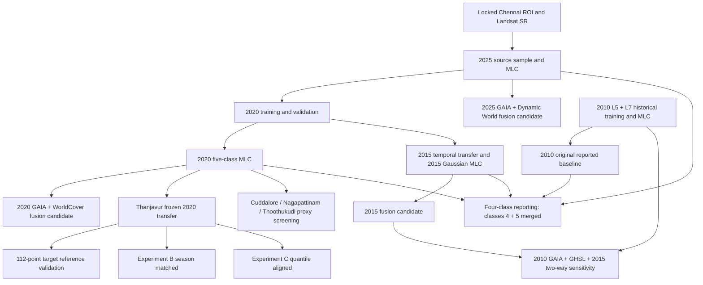

# Chennai Landsat LULC — Source-Reviewed Research Code Manual

**Repository:** https://github.com/bakayaro05/chennai-lulc-gis  
**Audit basis:** GitHub `main`, original Google Earth Engine (GEE) script archive, upstream GEE revision `1c1335e76291d7014336912f2292ba56049bf345` as recorded in `docs/SOURCE_REVISION.md`.  
**Scope of this release:** Source review of key research scripts, including the entire `stage8` and `tnjregion` directories and selected foundation/2010/2015 scripts. A companion static scanner is supplied to describe *every* archived file from its own contents.  
**Evidence boundary:** A script's presence, its comments, or a call to `Export.*` does **not** demonstrate that it was run or that its export task completed. Results below are taken from the project's reproduced console results where specified; they are not freshly rerun against Earth Engine in this audit.

## 1. What is in the repository?

| Source folder | Files | Research role |
|---|---:|---|
| `archive/gee-original/` (root-level scripts) | 67 | ROI, Landsat preprocessing, 2015/2010 training and validation, early classification scripts and utilities |
| `archive/gee-original/stage7/` | 39 | 2010 manual revisions, Landsat 5+7 reconstruction, cross-year audits, four-class aggregation, RF alternatives |
| `archive/gee-original/stage8/` | 29 | Built-up omission diagnostics, spatial-context tests, fusion experiments, final raster exports and 2010 sensitivity reconstruction |
| `archive/gee-original/tnjregion/` | 21 | Thanjavur frozen transfer, reference design, spectral and seasonal analysis, Experiments B/C, three-city automatic screening, map exports |
| **Total** | **156** | Preserve all as originally committed |

The GitHub archive includes **156 code files**, not 156 independently adopted experiments. Files may have no `.js` extension. Do not rename or reorganise anything within `archive/gee-original/`.

## 2. The essential conceptual distinction

The historical programme uses **five underlying Gaussian MLC classes**: (1) Built-up, (2) Vegetation, (3) Water, (4) Agricultural/Open, and (5) Barren/Fallow. A later four-class product combines classes 4 and 5 for the application's LULC summaries. These are related, but not interchangeable, deliverables.

Post-classification fusion changes selected classified pixels on *existing* maps; it is **not** retraining the Gaussian MLC. Separately, the 2020 Chennai-to-Thanjavur geographical benchmark uses the original frozen **five-class** Gaussian MLC; those reported accuracies must not be confused with the Chennai four-class fusion/reporting analyses.

## 3. Recommended chronology — primary research entry points

| Stage | Original file path | Purpose and status supported by source |
|---|---|---|
| ROI / Landsat / 2025 | `01_stage1_to_stage4_2025_master` | Stage 2B Landsat preprocessing, indices, locked Chennai ROI and 2025 classification/export workflow. The file includes multiple export task definitions; check the original code blocks and tasks before re-executing. |
| Temporal transfer | `02_stage5_temporal_transfer` | Transfer 2025 source polygons to the 2020 time slice, generating 2020 training, validation and MLC tasks. |
| 2015 final MLC | `04J_2015_gaussian_mlc` | Explicit five-class Gaussian mean/covariance likelihood classification; exports 2015 raster, validation predictions and accuracy. |
| 2010 earlier MLC | `05F1_2010_gaussian_MLC_validation` | Corrected 2010 Gaussian covariance implementation and classification; an earlier branch, not automatically the later L5/L7 version. |
| 2010 V2C | `06E1_2010_V2C_Gaussian_MLC_validation_export` | 2010 corrected V2C training/validation Gaussian MLC branch. Do not assume this is the final L5/L7 baseline used in Stage 08G-15. |
| 2010 historical baseline | `stage7/07O_2010_L5L7_MLC_export_exp_v1` | Materialises the Landsat 5+7 experimental manual MLC and historical training asset. Its output is used in the later corrected 2010 fusion comparison. |
| Four-class reporting | `stage7/07AC5_FINAL_FOUR_CLASS_EXPORT_ALL_YEARS` | Exports four-class reporting rasters for 2010, 2015, 2020, 2025 by aggregating underlying five-class open/barren labels. |
| Fusion export | `stage8/08G10_Export_Three_Fusion_Candidates` | Exports three separate retained fusion *candidate* rasters for 2015, 2020 and 2025; does not replace original MLC assets. |
| Corrected 2010 audit | `stage8/08G13_Analysis_A_Corrected_2010_Final_QA` | Read-only correction to earlier 2010 asset selection for mapped-area and reference comparison. |
| 2010 fusion sensitivity | `stage8/08G15_2010_GAIA_GHSL_Temporal_Fusion_Comparison` | Original read-only original/add-only/two-way comparison using GAIA, GHSL 2010 and the retained 2015 map. Does not export the 2010 candidate. |
| 2010 archival export | `stage8/11_CHENNAI_STAGE08G15_RECOVER_2010_FUSION_AND_EXPORT_FIVE_LULC_MAPS` | Reconstructs unchanged 08G15 rules and prepares five coloured/categorical map exports plus an asset for the two-way 2010 sensitivity map. Task completion must be checked in GEE. |
| Frozen target transfer | `tnjregion/01_TNJ_2020_Frozen_MLC` | Applies 2020 Chennai Gaussian parameters to the Thanjavur pilot polygon with no target training. |
| Target reference | `tnjregion/03D_TNJ_Reduced_Validation_Design` and `03E_TNJ_2020_Review_Remaining_91` | Reduces the original blind point set to 112 mapped-class-stratified locations and completes independent 2020 reference interpretation. |
| Target accuracy | `tnjregion/04_TNJ_2020_Final_Accuracy_Benchmark` | Area-adjusted accuracy for 112 manually interpreted references using original map strata. |
| Failure diagnosis | `tnjregion/05A_TNJ_Spectral_Transfer_Diagnostics` | Read-only source/target signature comparison; creates three statistical export tasks. |
| Seasonal diagnosis | `tnjregion/05A2_V3_Monthly_Spectral_Extraction` | Corrected monthly Landsat spectral extraction; avoids synthetic image merge causing earlier V2 type errors. |
| Experiment B | `tnjregion/06B_TNJ_2020_Source_Month_Matching` | No-retraining seasonal-composite adaptation, source-month matching. |
| Experiment C | `tnjregion/06C_TNJ_2020_Quantile_Harmonisation_V2` | No-retraining label-free quantile-based six-band gain/offset alignment and index recalculation. |
| Final A/C audit | `tnjregion/07_TNJ_Final_Transfer_Audit` | Read-only class-area comparison and exploratory paired uncertainty estimate. |
| Three-city screening | `tnjregion/08_TN_Closest_Spectral_City_Frozen_MLC_Auto_Proxy_2020` and `tnjregion/STAGE_09 _AUTOMATED_FROZEN_MLC_TRANSFER_BENCHMARK` | Spectral selection of coastal city, then Nagapattinam/Thoothukudi direct frozen transfer and automated WorldCover+Dynamic World agreement. |
| Six map export | `tnjregion/10_EXPORT_ALL_SIX_FROZEN_MLC_LULC_MAPS_TO_DRIVE` | Exports actual categorical and visual rasters for Thanjavur A/B/C and three coastal cities; export tasks are not evidence of their completion. |

## 4. Source-reviewed Stage 08 code inventory (29 files)

The following descriptions are based on actual leading code comments, asset references and/or export definitions read through the GitHub connector, not inferred only from titles. "Read-only" and "exploratory" reproduce script-stated scope; they do not by themselves establish acceptance/rejection decisions.

| Script | What its code is for |
|---|---|
| `08A_BU_UNDERCLASSIFICATION_SPATIAL_AUDIT` | Read-only Built-up versus open-land disagreement investigation, designed for year-specific spatial diagnosis. |
| `08D_2015_HISTORICAL_SITE_GAUSSIAN_DIAGNOSTIC` | Tests historical known sites in the original five-class 2015 Gaussian model, not the later V2A experimental model. |
| `08E_2015_EXACT_PIXEL_FOOTPRINT_AUDIT` | Inspects actual 30 m cell footprints and fixes a pixel/metre coordinate interpretation problem; optional KML. |
| `08F2_2015_Original_Points_Context_MLC_Exploratory` | Experiments with spatial context while reusing original 2015 training and validation point sets. |
| `08F3_2015_5x5_Context_MLC_Exploratory` | Controlled 5×5-window/context Gaussian MLC comparison. |
| `08F4_2015_SNIC_segment_context_exploratory` | Investigates object/segment context using SNIC; source states exploratory, no overwriting originals. |
| `08F4A_2015_SNIC_paired_spatial_audit` | Paired SNIC 2015 audit on original 300, 267 non-shared and 33 shared locations; read-only. |
| `08F4A_1_EXPORT_SNAPSHOT` | Exports a memory-safe 2015 SNIC point snapshot asset for subsequent audits. |
| `08F4A_2_AUDIT_SNAPSHOT` | Audits the frozen point snapshot without recomputing the SNIC segmentation or a full raster. |
| `08F4B_2015_SNIC_snapshot_audit_FIXED` | Corrects the snapshot QA calculation for numeric Boolean `ee.Number.eq()` results. |
| `08F4C_2015_FREEZE_SNIC_PREDICTORS` | Exports the spatially fixed multi-band SNIC predictor raster; explicitly retains 30 m grid alignment. |
| `08F4D_2015_Frozen_SNIC_Reproducibility_Audit` | Audits exact point-level reproducibility against materialised SNIC and original point IDs. |
| `08G1_Builtup_Omission_Atlas_QA` | Visual diagnostic of Built-up omission for 2015, 2020 and recovered 2025 MLC rasters. |
| `08G3_2015_Automated_Builtup_RF` | Experimental GAIA-assisted 2015 Random Forest, using original training/validation safeguards. |
| `08G3B_2015_RF_GAIA_Support_Audit` | Compares original and experimental 2015 RF outputs with GAIA, explicitly noting that GAIA was used in pseudo-training and so is not independent validation. |
| `Chennai_2015_08G3_GAIA_RF_experimental_v1` | Read-only built-up-area audit once the experimental 2015 RF raster is materialised. |
| `8G4_2020_GAIA_Assisted_RF` | Experimental GAIA-assisted 2020 Random Forest; unchanged original 2020 MLC. |
| `08G4A_2020_GAIA2018_RF_Comparison` | GAIA cutoff sensitivity test (2015 vs 2018 evidence timing), no export. |
| `08G4B_2020_Conservative_Builtup_Fusion` | Requires GAIA and ESA WorldCover evidence to conservatively reassign original open/barren 2020 pixels to Built-up. |
| `08G4C_GAIA _2015_versus_2018_fusion` | Compares GAIA historical cutoffs while holding the original MLC and WorldCover rule constant. |
| `08G5_2015_GAIA_WSF_Fusion` | Compares 2015 original MLC, GAIA-assisted RF and WSF-supported fusion, diagnostic only. |
| `08G6G7_Final_Automated_Builtup_Comparison` | Read-only coordinated comparison of final 2015 and 2025 automated Built-up support rules. |
| `08G8_2025_GAIA_DW_PairedValidation` | Reconstructs a separate balanced 300-pixel assessment from 2025 validation polygons and compares GAIA + Dynamic World candidates; not the exact earlier archived 300-point sample. |
| `08G9_2015_Temporal_Consistency_Fusion` | Constructs the 2015 temporal-consistency fusion candidate from historical built-up support, original 2015 MLC and later-map evidence. |
| `08G10_Export_Three_Fusion_Candidates` | Exports 2015 temporal, 2020 GAIA+WorldCover and 2025 GAIA+Dynamic World fusion candidate rasters to new EE assets. |
| `08G11_Analysis_A_B_GHSL_Comparison` | Read-only area comparison between exported 30 m fusion maps and native 100 m GHSL built-surface evidence. |
| `08G13_Analysis_A_Corrected_2010_Final_QA` | Corrects the 2010 L5/L7 source selection and audits classes and area on a common footprint. |
| `08G15_2010_GAIA_GHSL_Temporal_Fusion_Comparison` | Original comparison of 2010 original, add-only and two-way fusion; 2010 map not exported in this script. |
| `11_CHENNAI_STAGE08G15_RECOVER_2010_FUSION_AND_EXPORT_FIVE_LULC_MAPS` | Recreates 08G15's two-way alternative and defines five categorical/RGB map exports, manifest and new EE sensitivity asset. |

## 5. Source-reviewed Thanjavur/generalisation inventory (21 files)

| Script | What its code is for |
|---|---|
| `00_TNJ_City_ROI` | Creates the screenshot-traced ~27.1 km² Thanjavur pilot polygon; it is **not** an official city administrative boundary. |
| `01_TNJ_2020_Frozen_MLC` | Applies five-class Gaussian parameters from the 2020 Chennai 600 training locations to 2020 Thanjavur without target training. |
| `02_TNJ_2020_Reference_Points` | Samples candidate independent reference points by the predicted five-class map, separating subsequent human interpretation from model predictions. |
| `02A_TNJ_Class_Distribution_QA` | Diagnoses output area/coverage and WorldCover overlay; the overlay is not independent reference accuracy. |
| `03A_TNJ_Freeze_Reference_Points` | Materialises the blind target point locations for reference review. |
| `03B_TNJ_2020_Reference_Reviewer` | Original 252-point historical Sentinel-2 blind review UI and progress checkpoint approach. |
| `03C_TNJ_Automated_Reference_Assistance` | Creates provisional WorldCover/Dynamic World reference suggestions while preserving manually labelled checkpoint labels; not a replacement for manual truth. |
| `03D_TNJ_Reduced_Validation_Design` | Deterministic 112-point subset, 25 per four predicted classes and all 12 of the predicted Vegetation class; preserves strata audit. |
| `03E_TNJ_2020_Review_Remaining_91` | Fixed Earth Engine JavaScript-compatible blind manual review and final 112-point reference export. |
| `03_TNJ_2020_Accuracy` | Early target accuracy audit using an independently labelled target asset path; older than final 112-point analysis. |
| `04_TNJ_2020_Final_Accuracy_Benchmark` | Final 112-point area-adjusted direct-transfer benchmark. |
| `05A_TNJ_Spectral_Transfer_Diagnostics` | Recreates frozen model parity and source/target by-class spectral signatures plus unlabeled pooled statistics. |
| `05A2_TNJ_Chennai_2020_Seasonal_Diagnostics` | Initial monthly observation/NDVI/NDWI/NDBI diagnostic; later rewritten for computation constraints. |
| `05A2_V2_Monthly_Spectral_Extraction` | Memory-lighter monthly point extraction, but the fallback collection band-type strategy caused a GEE homogeneity error in the recorded run. |
| `05A2_V3_Monthly_Spectral_Extraction` | Corrected monthly 48-band point extraction without merging masked placeholder imagery into Landsat collections. |
| `06B_TNJ_2020_Source_Month_Matching` | Experiment B: January–May, July–August, December target Landsat composite, frozen Gaussian MLC. |
| `06C_TNJ_2020_Quantile_Harmonisation_V2` | Experiment C: unlabeled six-band quantile-based bounded gain/offset adjustment, recomputed three indices, frozen MLC. |
| `07_TNJ_Final_Transfer_Audit` | Validates A/C area results and approximate paired confidence interval under original mapped-class strata. |
| `08_TN_Closest_Spectral_City_Frozen_MLC_Auto_Proxy_2020` | Compares Cuddalore/Nagapattinam/Thoothukudi unlabeled six-band proximity to Chennai, classifies Cuddalore and uses WC/DW proxy agreement. |
| `STAGE_09 _AUTOMATED_FROZEN_MLC_TRANSFER_BENCHMARK` | City-selector repeat of frozen MLC and automated consensus screening for Nagapattinam and Thoothukudi. |
| `10_EXPORT_ALL_SIX_FROZEN_MLC_LULC_MAPS_TO_DRIVE` | Creates categorical and coloured raster export tasks for three Thanjavur variants and three coastal city maps. |

## 6. Verified quantitative results (from archived console outputs)

### 2010 two-way sensitivity — original script reproduced later

| Variant | Validation accuracy | Built-up area (km²) |
|---|---:|---:|
| Original L5/L7 MLC | 69.3333% | 279.8219 |
| Add-only | 69.6667% | 308.4687 |
| Two-way alternative | 71.3333% | 304.7161 |

The two-way test promoted 28.6469 km² and demoted 3.7526 km², correcting 7 reference points and worsening 1 (net +6/300 correct). **The published-series 2010 baseline remains unchanged.** The Stage 11 script creates an export task for the two-way map; task existence does not verify final asset availability.

### Thanjavur direct-transfer and no-retraining adaptations

| Method | Area-adjusted OA on original 112-point design | Interpretation |
|---|---:|---|
| A, unchanged Chennai 2020 Gaussian MLC | 23.1854% | Weak direct transfer; independently interpreted target reference points |
| B, source-season-matched target composite | 20.6625% | −2.5229 percentage points vs A; season restriction alone did not improve performance |
| C, unlabeled quantile spectral alignment | 35.9444% | +12.7590 percentage points vs A; exploratory improvement without retraining |

A versus C paired SE approximately 4.5023 pp and approximate 95% CI +3.9345 to +21.5835 pp, without spatial dependence or reference-label error correction. Experiment C's class-2 Vegetation area is nonzero (~0.2537 km²), but none of the eight manually labelled Vegetation reference points was predicted as Vegetation.

### Additional coastal city screening — **automatic reference agreement**, not ground-truth accuracy

| City | Weighted product agreement | Non-water agreement | Proxy-supported area |
|---|---:|---:|---:|
| Cuddalore | 57.9251% | ~40.01% | 56.83% |
| Nagapattinam | 82.9085% | 57.7010% | 56.14% |
| Thoothukudi | 46.0861% | 43.6122% | 28.91% |

Agreement was calculated on ESA WorldCover 2020 + Dynamic World consensus pixels, with class-definition mismatch and spatial-resolution limitations. **Do not label these values as independently measured accuracies or compare them unqualified with the Thanjavur accuracy estimates.**

## 7. Asset lineage — do not conflate these outputs



This diagram summarises principal methodology relationships, not an exact runnable DAG of every asset or script. Confirm each live Earth Engine asset and task separately before attempting reproduction.

## 8. Reproducibility, caution and remaining audit work

1. **Never execute all archived scripts in order blindly.** Some carry optional `Export.*` calls, duplicate names or experimental versions, and older scripts may reference obsolete assets.
2. **Check asset existence and permissions** in `projects/assignment-482806/assets/` before running an archived script. GitHub holds JavaScript, not Landsat composites, reference-point feature assets or GeoTIFF exports.
3. **Do not treat source comments as execution logs.** Confirm completed exports and reported numerical results from the original GEE console and stored CSVs.
4. **Four-class historical maps and five-class generalisation maps are different outputs.** Preserve the palette and label mapping appropriate to each product.
5. **2005 is in project scope** but this source audit does not verify a completed, final accepted 2005 LULC classification.
6. The companion `build_script_catalog.py` extracts **all 156 file records** directly from the local archive and creates a searchable Markdown/CSV directory, with asset-name cross-reference and fingerprints. It intentionally leaves scientific adoption status *unverified* rather than inventing acceptance decisions.
7. Remaining source-level work: inspect the 67 root and 39 Stage 7 files individually, confirm assets/research choices against GEE task history, then label canonical entry points in a new `scripts/gee/` directory. The original archive should stay byte-for-byte unchanged.

## 9. Updating GitHub

Copy this document to `docs/CODE_MANUAL_REVIEWED_V1.md` and the companion scanner to `tools/build_script_catalog.py`. From the repository root run:

```bash
python tools/build_script_catalog.py
git status --short
git add docs/CODE_MANUAL_REVIEWED_V1.md docs/CODE_SCAN_CATALOG.md docs/CODE_SCAN_CATALOG.csv docs/ASSET_REFERENCE_INDEX.md tools/build_script_catalog.py
git commit -m "Document historical LULC and generalisation research code"
git push origin main
```

The document and scanner do not modify archived source files. Code scan uses Python's standard library; it never logs into Earth Engine or GitHub.
