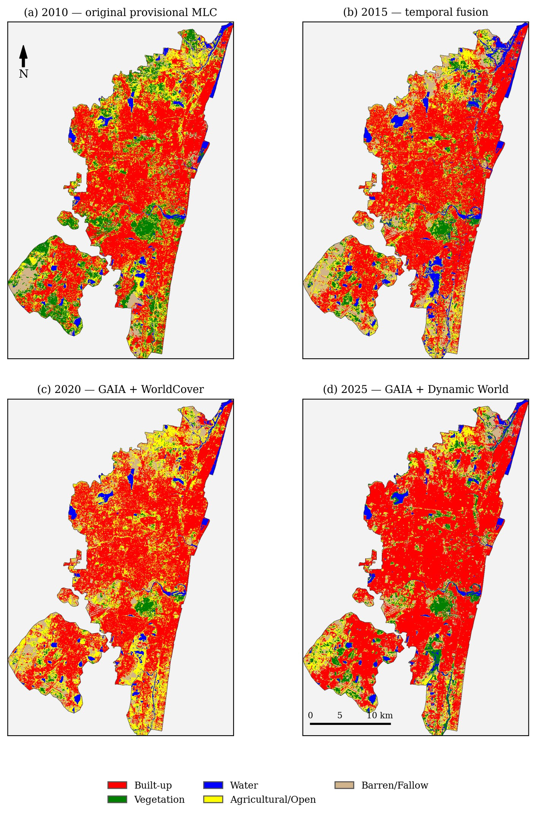
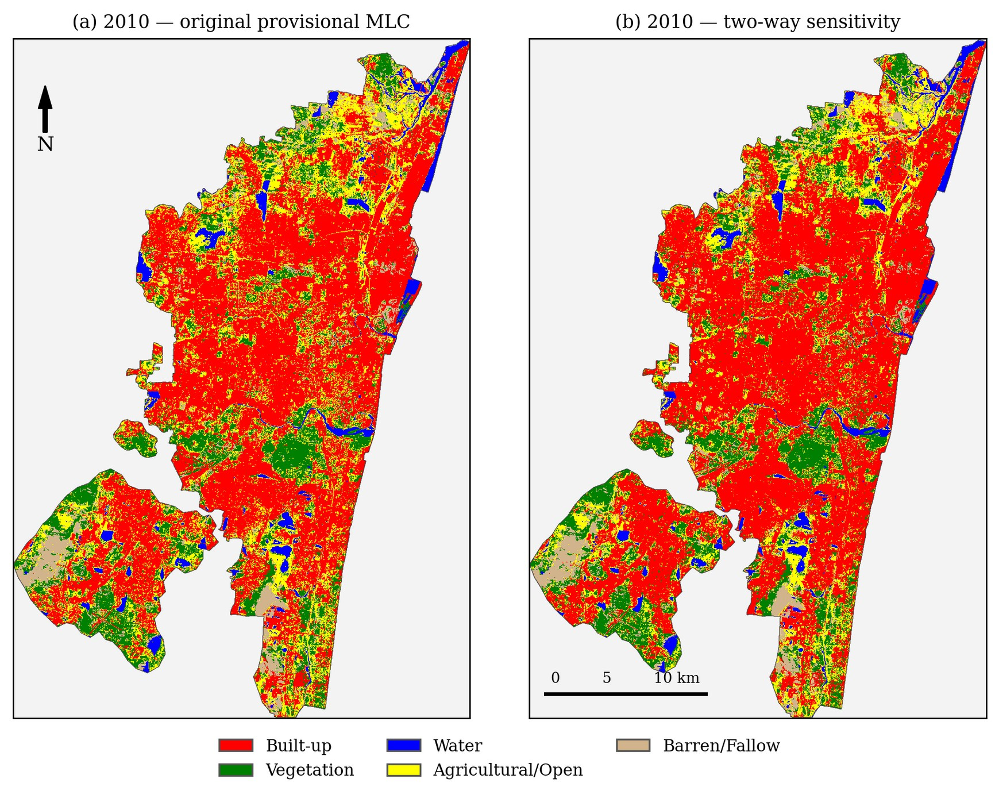
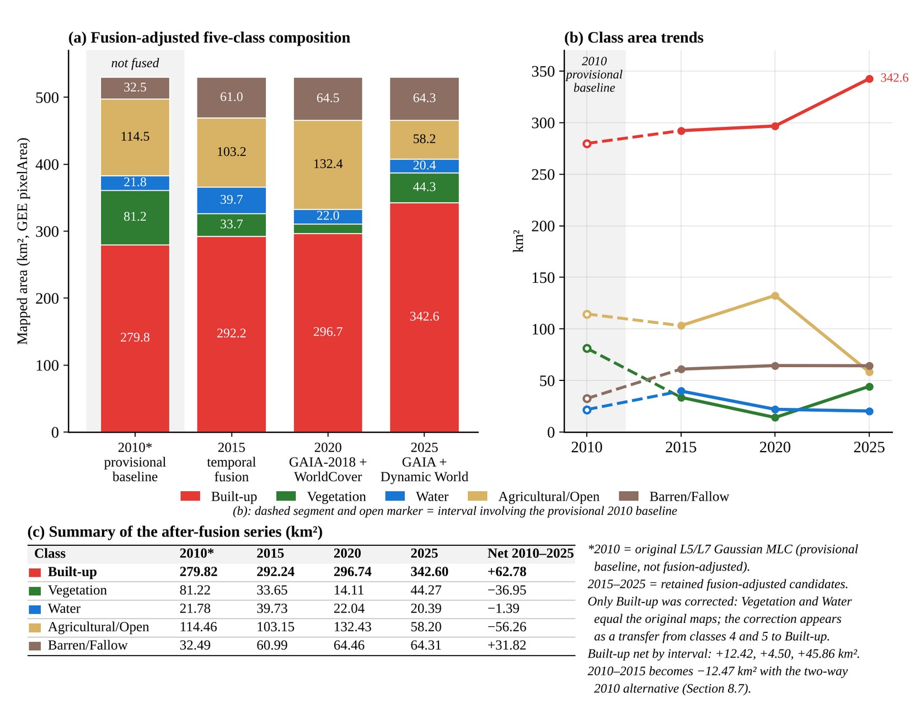
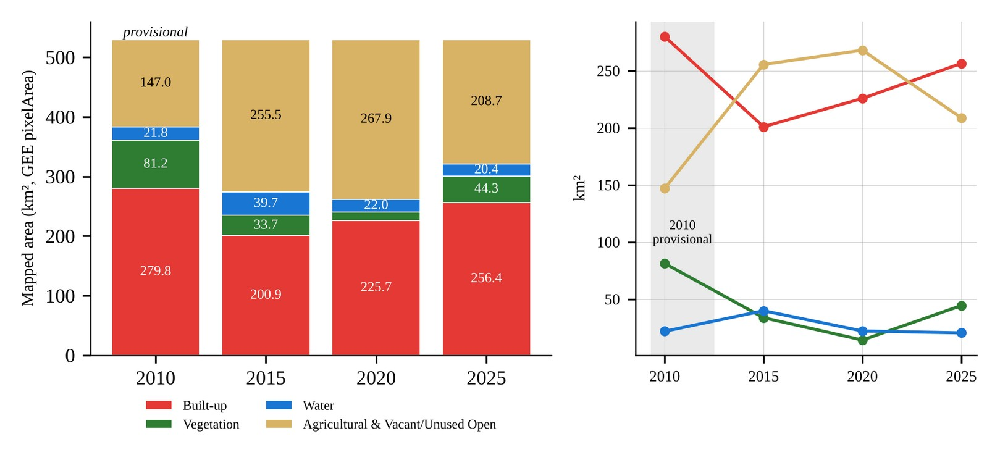

# Authentic figures extracted from the final research report

<!-- experiments-v1.0.0:begin -->
## Report edition and figure provenance

The existing four JPEGs and `figure_provenance.csv` were extracted from the **earlier 103-page PDF edition** with SHA-256 `75f71b75d1af5a41ef4d84911c8b4678efb1d80530719fe736687b03b22bdca6`. Their page numbers are retained as historical source provenance and **must not be assumed to match** the revised public report PDF exported from `Github_REPORT.docx`. See the newly generated supplementary experiment diagrams under [report/supplementary-experiments](../report/supplementary-experiments/README.md).
<!-- experiments-v1.0.0:end -->

The four JPEGs in [`report_exports/`](report_exports/) were extracted **byte-for-byte from embedded images** in `Chennai_LULC_Report_With_Fusion_Maps.pdf` (103 pages) with PyMuPDF; **no recolouring, class editing, cropping or reconstruction** was performed. Source figure numbers and PDF page indices are in [`figure_provenance.csv`](figure_provenance.csv).

*Report Fig. 8.9, PDF p67. The 2010 panel is original provisional MLC; only 2015, 2020 and 2025 are retained post-classification fusion candidates. Five-class figure.*

*Report Fig. 8.10, PDF p68. The second panel is a separate research sensitivity analysis and must not replace the reported 2010 baseline. Five-class figure.*

*Report Fig. 8.8, PDF p64. Reported-series fusion-adjusted area composition from GEE pixel-area results, not error-adjusted real-world change.*

*Report Fig. 6.1, PDF p39. Original MLC-derived four-class area series, distinct from Fig. 8.8.*

**Important:** These are **publication figures** embedded in the report, not georeferenced GeoTIFF rasters. They cannot be used to recompute confusion matrices, area or pixel transitions. Do not use screenshots of Drive folder thumbnails as scientific map products; use the actual exported GeoTIFFs and verified metadata for dataset release.
