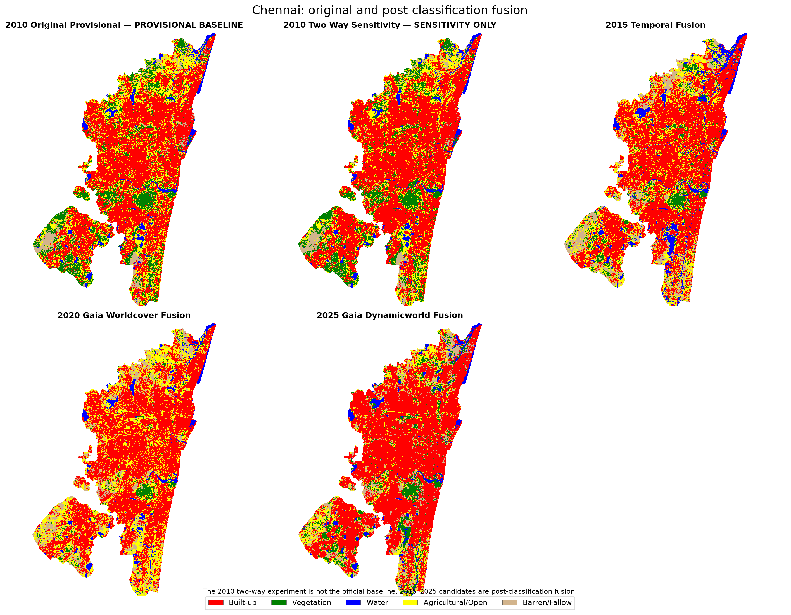
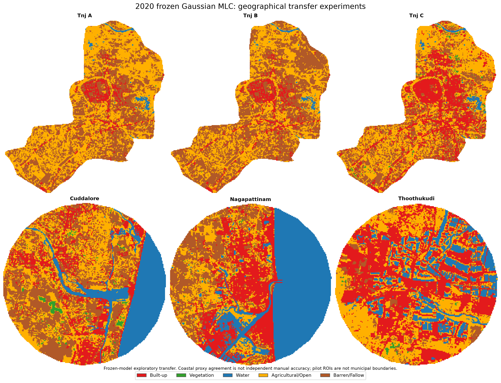

# Supplementary figures — Chennai fusion and geographical transfer

The two PNG plates here were **derived from original categorical five-class GeoTIFF exports** for visual comparison. They are **not** newly trained classifications, new accuracy measurements, or replacements for the report's authentic embedded figures.

## Chennai original/fusion classification comparisons

Five panels: **2010 original provisional reported baseline**; **2010 two-way sensitivity only** (NOT an official substitute); 2015 temporal-consistency fusion; 2020 GAIA + ESA WorldCover fusion; 2025 GAIA + Dynamic World fusion. These post-classification fusion experiments do not retrain the Gaussian classifier. Numeric evidence: [fusion validation](../../results/reported/fusion_validation_table8_6.csv), [five-class areas](../../results/reported/five_class_fusion_areas_table8_9.csv), and [2010 sensitivity](../../results/fusion_2010_sensitivity.csv).

## Frozen Chennai Gaussian MLC transfer — 2020

Six panels: Thanjavur A direct frozen transfer; B source-month matching; C unsupervised quantile alignment; and exploratory Cuddalore, Nagapattinam, Thoothukudi. Coastal comparisons use **automatic ESA WorldCover/Dynamic World consensus on eligible subsets**, NOT independent manually verified overall accuracy. The 3 km coastal pilot buffers are **not** administrative boundaries. See [proxy agreement](../../results/reported/coastal_proxy_agreement_table10_7.csv), [mapped class areas](../../results/reported/transfer_six_experiment_areas_table10_8.csv), and [Thanjavur manual A/B/C evaluation](../../results/reported/thanjavur_manual_abc_table10_4.csv).

## Source datasets, integrity and reproduction limits

- **[Published original experiment exports](https://github.com/bakayaro05/chennai-lulc-gis/releases/tag/experiments-v1.0.0)** — 26 original files and 1 SHA-256 manifest attached separately.
- **[Pinned file hashes](https://github.com/bakayaro05/chennai-lulc-gis/releases/download/experiments-v1.0.0/extended_experiment_manifest.csv)** — verify downloaded bytes before interpretation.
- **Source scripts:** [fusion workflows](../../scripts/gee/05_fusion/), [frozen transfer and coastal workflows](../../scripts/gee/06_generalisability/), [original archived GEE scripts](../../archive/gee-original/).
- The current revised public PDF is [one folder above](../Chennai_LULC_Report_With_Fusion_Maps.pdf); archived page numbers in research tables and figure-provenance files refer to the earlier 103-page source edition.

The original exports are geospatial data products, not a complete public mirror of all Landsat inputs, external products, historical GEE FeatureCollections, manually drawn geometries or model-training decisions. No accepted final 2005 map is supplied. Keep the reported 2010 original provisional, five-class fusion, derived four-class reporting, and transfer-proxy comparisons distinct.
